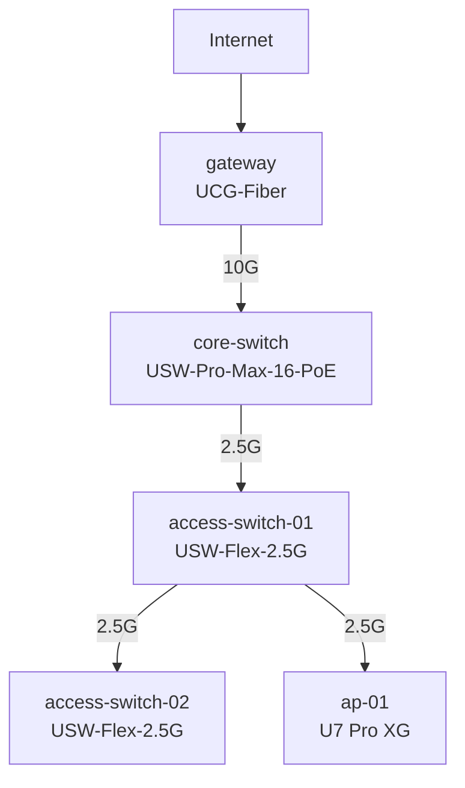

# Network Lab

This is how my home network is built. It started as a flat setup behind a consumer router and grew into a segmented network with twelve VLANs, a zone-based firewall, intrusion prevention, WireGuard remote access, and a switching layer that feeds a three-node hypervisor. I run it on UniFi, and I treat it the way I would treat a small production network: nothing trusts anything else by default, the management plane is the hardest thing to reach, and every tier only talks to the tiers it has a reason to.

This repository is my own documentation of that design. It covers the segmentation model, the firewall policy set, the threat-management configuration, the remote-access path, the switching design, and the networking fundamentals underneath all of it.

> **A note on the values in here.** Addresses, MAC addresses, device names, wireless network names, keys, and other identifying details have been replaced with placeholders to keep my network and personal information private. The architecture, the policies, the zones, and the design decisions are real; only the identifiers are stand-ins.

## The network at a glance

| Layer | What I run | Notes |
|---|---|---|
| Gateway | UCG-Fiber | WAN, routing, IDS/IPS, VPN servers |
| Core switch | USW-Pro-Max-16-PoE | 10G uplink to the gateway, PoE for downstream gear |
| Access switches | 2x USW-Flex-2.5G | daisy-chained off the core at 2.5G |
| Access point | U7 Pro XG | three SSIDs mapped to separate VLANs |
| Segmentation | 12 routed VLANs, 9 firewall zones | three-tier model for the lab compute |
| Edge security | base CyberSecure IPS/IDS, region blocking, DNS filtering | "notify and block" |
| Remote access | WireGuard | no inbound admin ports exposed to the LAN or WAN |

## Physical topology

## What's in here

| Chapter | Topic |
|---|---|
| [01 - Segmentation](docs/01-segmentation.md) | The VLAN layout, the nine firewall zones, and the three-tier model |
| [02 - Firewall policies](docs/02-firewall-policies.md) | The zone-based policy set and the inter-zone allow matrix |
| [03 - Threat management](docs/03-threat-management.md) | IDS/IPS, region blocking, honeypots, DNS content filtering |
| [04 - Remote access](docs/04-remote-access.md) | WireGuard servers and the management path |
| [05 - Switching](docs/05-switching.md) | Port profiles, the selective hypervisor trunk, PoE supervision |
| [06 - Wireless](docs/06-wireless.md) | SSID-to-VLAN mapping and isolation |
| [07 - Host firewall](docs/07-host-firewall.md) | The hypervisor host firewall rules |
| [08 - Fundamentals](docs/08-fundamentals.md) | Subnetting and the switch/router builds the rest is built on |

Diagrams live in [diagrams/](diagrams/), and a sanitized as-built reference of the live configuration is in [configs/](configs/).
