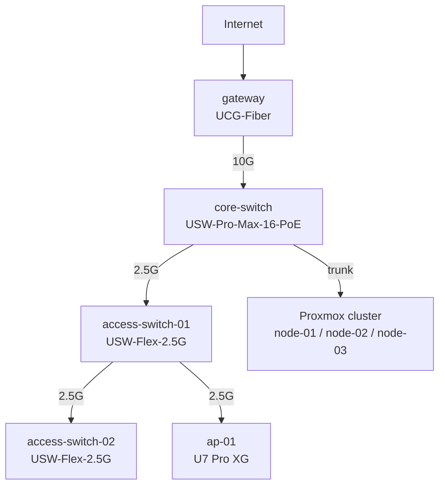

# Network Lab

My home network started as a flat setup behind a consumer router: one subnet, everything trusting everything, the gateway's web UI one guessed password away from the whole house. This repository is the record of turning that into a segmented network I run the way I would run a small production environment: twelve routed VLANs, a nine-zone firewall, intrusion prevention at the edge, WireGuard for remote administration, and a switching layer that feeds a three-node hypervisor cluster. Nothing trusts anything else by default, the management plane is the hardest thing on the network to reach, and each tier only talks to the tiers it has a reason to.

It runs on UniFi (a UCG-Fiber gateway, a PoE core switch, two access switches, and a Wi-Fi 7 access point), with a Proxmox cluster behind it carrying the lab compute. The work here is the design and the policy, not the hardware.

## The network at a glance

| Layer | Hardware | Role |
|---|---|---|
| Gateway | UCG-Fiber | WAN, inter-VLAN routing, IDS/IPS, WireGuard servers |
| Core switch | USW-Pro-Max-16-PoE | 10G uplink to the gateway, PoE for downstream gear |
| Access switches | 2x USW-Flex-2.5G | daisy-chained off the core at 2.5G |
| Access point | U7 Pro XG | SSIDs mapped to separate VLANs, client isolation on |
| Compute | 3-node Proxmox cluster | lab servers and management VMs, reached over a selective trunk |

## Physical topology

## Projects

Each folder is a self-contained piece of the build, written as a walkthrough of what I did and why.

| Project | What it covers |
|---|---|
| [01 - Segmentation and zoning](projects/01-segmentation-and-zoning/README.md) | The twelve VLANs, the nine firewall zones, the three-tier compute model, and the switching and wireless that carry the segments |
| [02 - Zone-based firewall](projects/02-zone-based-firewall/README.md) | The seventeen-policy rule set, the inter-zone allow matrix, and the design intent behind each allow and block |
| [03 - Threat management](projects/03-threat-management/README.md) | IDS/IPS tuning, country blocking, honeypots, and DNS content filtering |
| [04 - WireGuard remote access](projects/04-wireguard-remote-access/README.md) | Four VPN servers, the management-only access path, and why no admin port is exposed |
| [05 - Hypervisor host firewall](projects/05-hypervisor-host-firewall/README.md) | A default-deny Proxmox host firewall as the second layer behind the network firewall |
| [06 - Switch and router build](projects/06-switch-and-router-build/README.md) | A from-scratch Cisco switch-and-router build: addressing, SSH hardening, MAC-table verification, and troubleshooting |
| [07 - IPv4 addressing design](projects/07-ipv4-addressing-design/README.md) | Variable-length subnetting for three network designs, worked end to end from source worksheets |
| [08 - Proxmox cluster build](projects/08-proxmox-cluster-build/README.md) | Expanding a single-node Proxmox install into a three-node Galaxy cluster, including SSH-based joins, host-firewall remediation, quorum checks, and stale-node cleanup |
| [09 - SSH hardening and key distribution](projects/09-ssh-hardening-and-key-distribution/README.md) | Converging the fleet on key-only SSH, no direct root login, and Ansible-managed admin keys |

Configuration artifacts (a switch baseline, a WireGuard server config, the host firewall group) live in [configs/](configs/). Reusable audit tooling lives in [tools/](tools/).
