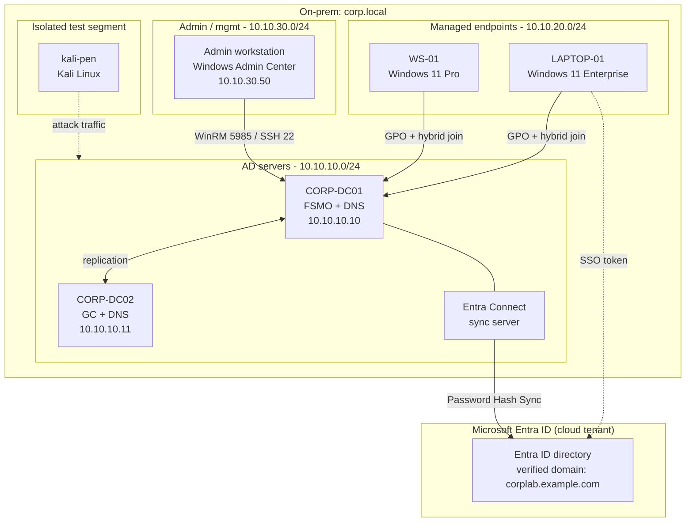

# Hybrid Azure AD Lab

A Windows Server 2025 Active Directory forest, hardened the way a real managed environment is hardened, then extended into Microsoft Entra ID, backed up to Azure, and attacked from Kali to find out where it bends.

I build infrastructure by taking it apart. This repo is the write-up of one of those builds: a two-DC on-prem domain (`corp.local`) running on my Proxmox cluster, locked down with Group Policy and AppLocker, synced to a cloud tenant, protected with Azure Backup and Site Recovery, and then put through a red-team pass so I could prove the hardening actually holds. Every chapter ships the PowerShell that did the work and the evidence that it ran.

> All identifiers in this repo are sanitized. The domain, hostnames, usernames, IP ranges, and Wi-Fi names are placeholders (`corp.local`, `CORP-DC01`, `jack-user`, `10.10.x.x`). The configurations, scripts, and policies are the real ones.

## Lab at a glance

| Component | Detail |
|---|---|
| Domain | `corp.local` (NetBIOS `CORP`), Windows Server 2025 forest/domain functional level |
| Domain controllers | `CORP-DC01` (`10.10.10.10`, all five FSMO roles, AD-integrated DNS), `CORP-DC02` (`10.10.10.11`, Global Catalog, DNS) |
| Managed endpoints | `WS-01` (Windows 11 Pro), `LAPTOP-01` (Windows 11 Enterprise), placed in a managed Workstations OU |
| Identity | On-prem AD synced to Microsoft Entra ID. Password Hash Sync plus Seamless SSO, hybrid Azure AD join |
| Remote administration | Key-based OpenSSH and WinRM / Windows Admin Center |
| Backup & DR | Azure Recovery Services vault, MARS agent for DC system state, Azure Site Recovery for VM failover |
| Offensive testing | Kali Linux VM on an isolated network segment |
| Hypervisor | Proxmox VE homelab cluster |

## Architecture



## What this lab proves

| Chapter | Area | Skills demonstrated |
|---|---|---|
| [01 - On-prem AD build](docs/01-onprem-ad-build.md) | Active Directory Domain Services | Forest and domain design, FSMO placement, multi-DC replication, AD-integrated DNS, OU and delegation model |
| [02 - GPO security hardening](docs/02-gpo-security-hardening.md) | Endpoint and identity hardening | Group Policy engineering, AppLocker, LSA protection against credential theft, USB/browser/Wi-Fi control, logon-hours enforcement |
| [03 - Hybrid identity (Entra)](docs/03-hybrid-identity-entra.md) | Cloud identity | Entra Connect, Password Hash Sync, Seamless SSO, UPN planning, hybrid Azure AD join |
| [04 - Backup & disaster recovery](docs/04-backup-and-disaster-recovery.md) | Resilience | Recovery Services vault, DC system-state backup, Azure Site Recovery, documented restore test |
| [05 - Attack & defend](docs/05-attack-and-defend.md) | Offensive validation | Recon, poisoning, password spray, Kerberoasting, BloodHound, and mapping each result to the control that stops it |
| [06 - Toolchain & walkthroughs](docs/06-toolchain.md) | Tooling | Step-by-step use of GPMC, PowerShell, Windows Admin Center/WinRM, OpenSSH, Entra Connect, Azure Backup, and the Kali toolset |

## Repository layout

```
docs/        five case-study chapters (start at 01)
scripts/     the PowerShell that built and hardened the lab, by topic
evidence/    sanitized GPO exports
diagrams/    Mermaid source for the diagrams used across the chapters
```

## How to read this

Start with [chapter 01](docs/01-onprem-ad-build.md) for the foundation, or jump to the [GPO hardening](docs/02-gpo-security-hardening.md) and [attack/defend](docs/05-attack-and-defend.md) chapters if you came for the security work. Each chapter follows the same five beats: the objective, the architecture, the implementation (with scripts), how I verified it, and what it demonstrates.

The scripts in [`scripts/`](scripts/) are runnable. They prompt for credentials rather than storing them, and they use the same sanitized values as the docs, so read before you run.
