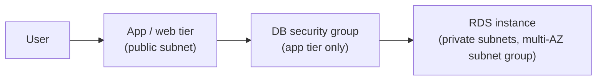

# AWS EC2, EBS, and RDS

With a VPC in place ([project 01](../01-aws-custom-vpc-and-web-server/README.md)), this project is the compute, storage, and database layers that run inside it. Three labs, worked end to end: managing an EC2 instance through its lifecycle, attaching and snapshotting block storage with EBS, and standing up a managed database with RDS and talking to it from an application. Together they are the difference between "I can launch a server" and "I understand what the server runs on and how its data survives."

## EC2: the compute lifecycle

The first lab took an instance through everything you do to one after launch:

1. **Launch** an EC2 instance into the VPC.
2. **Monitor** it through the built-in metrics (CPU, network, status checks), so I could see its health rather than assume it.
3. **Update its security group** to open the path to the web server and confirm the page loaded, the same route-table-then-security-group reasoning as [project 01](../01-aws-custom-vpc-and-web-server/README.md).
4. **Resize it**, in two senses: changing the instance type to give it more compute, and growing its EBS root volume for more disk. The instance has to be stopped to change its type, which is itself a lesson in what "elastic" does and does not mean.
5. **Explore service limits**, the per-account quotas that cap how many instances and resources you can run, so a runaway script or a bill cannot grow without bound.
6. **Test stop protection**, the setting that prevents an instance from being stopped by accident.

The two things that stuck: the **volume types** (general-purpose SSD versus the alternatives, and matching the volume to the workload's IO needs) and **stop protection** as a guardrail against the most common mistake, which is fat-fingering the wrong instance in a list.

## EBS: block storage and surviving data loss

The storage lab was about treating a disk as something separate from the instance that mounts it:

1. **Create an EBS volume** in the same availability zone as the instance (a volume and the instance it attaches to have to share an AZ).
2. **Attach** the volume to the instance.
3. **Connect** to the instance over SSH.
4. **Create and configure a file system** on the new volume from the command line, then mount it, so the raw block device became usable storage.
5. **Snapshot** the volume, capturing a point-in-time copy.
6. **Restore** from that snapshot into a new volume, proving the backup was real.

Configuring the file system by hand was the part that made EBS concrete: a volume arrives as raw blocks, and it is the file system you put on it that turns it into a drive. The snapshot-and-restore cycle is the reason EBS matters for resilience: storage that can be captured and rebuilt on demand means a lost or corrupted volume is an inconvenience, not a disaster.

## RDS: a managed database behind an app

The database lab moved up a layer to a managed service, where AWS runs the database engine and I configure the surroundings:

1. **Create a security group** for the database, scoped so only the application tier can reach it, not the whole world. A database should never sit on a public path.
2. **Create a DB subnet group** spanning subnets in more than one availability zone, which is what lets RDS place a standby in a second AZ for failover.
3. **Create the RDS DB instance** itself, choosing the engine and instance class.
4. **Interact with the database** through a web application that read and wrote to it, with a page that showed live instance metadata (instance ID, availability zone, current CPU load).

The shape mirrors the three-tier idea from my [network design](https://github.com/Duresa7/Network-Lab): the database lives where the internet cannot reach it, and only the application tier is allowed in. The managed part is what changes; patching, backups, and failover are AWS's job, and mine is to place it correctly and lock down who can talk to it.

## What the three labs add up to

Compute, storage, and data are the three things any real workload needs, and each lab was about the same underlying discipline: put the resource in the right place, give it only the access it needs, and make sure its data can survive the resource being destroyed. The web server from [project 01](../01-aws-custom-vpc-and-web-server/README.md) is the front; this is the machinery behind it.

## Files in this project

- [`commands.md`](commands.md) - the AWS CLI for the EC2, EBS, and RDS steps.
- [`sources.md`](sources.md) - EC2, EBS, and RDS references.
