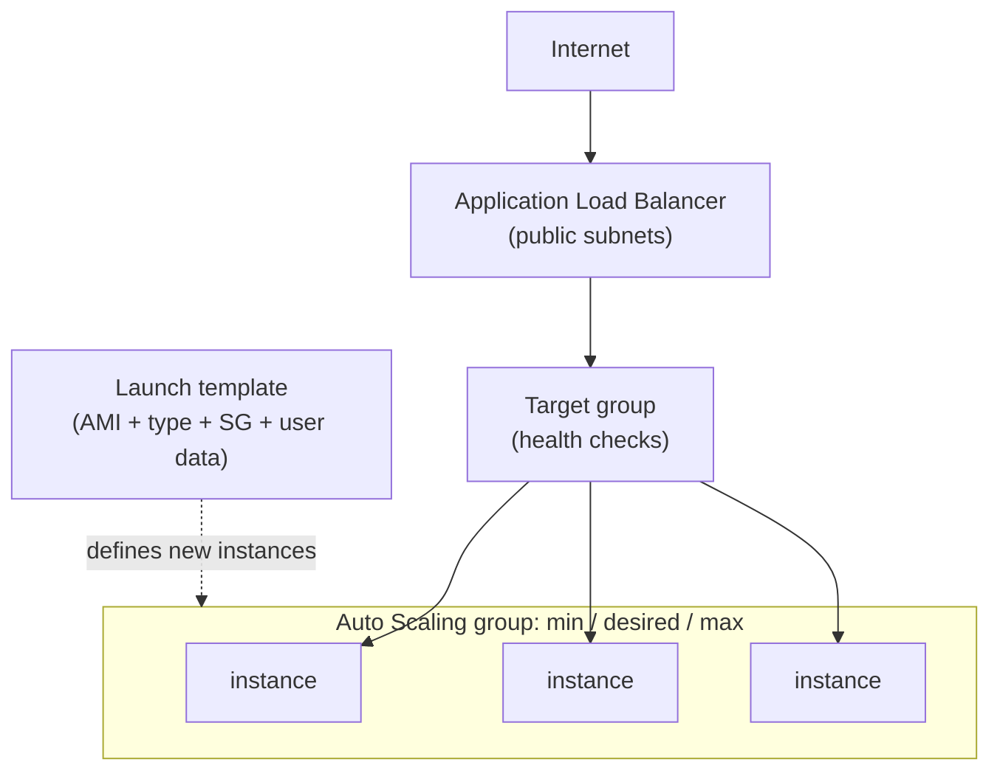

# AWS scaling and load balancing

A single web server is a single point of failure and a fixed amount of capacity. This project replaced that with a pool of interchangeable instances behind a load balancer, set to grow and shrink on its own. It is the shift from thinking about "a server" to thinking about "however many servers the traffic needs," which is the property that makes a cloud deployment resilient instead of just hosted.

## The architecture

Every instance is identical, the load balancer is the only thing facing the internet, and the Auto Scaling group decides how many instances exist at any moment.

## How I built it

1. **Create an AMI** from the configured web server. This is the golden image: a snapshot of a fully set-up instance that every new instance in the pool is cloned from, so the pool is uniform.
2. **Create a load balancer.** An Application Load Balancer in the public subnets takes inbound traffic and spreads it across the instances. It is the single front door; the instances behind it do not need public addresses of their own.
3. **Create a launch template and an Auto Scaling group.** The launch template captures how a new instance comes up (which AMI, instance type, security group, and user data). The Auto Scaling group ties it to a minimum, a desired, and a maximum count, plus a scaling policy that adds instances when a metric crosses a threshold and removes them when demand falls.
4. **Verify load balancing** by confirming requests were being distributed across more than one instance rather than all landing on one.
5. **Test auto scaling** by driving load up until the alarm tripped, then watching the Auto Scaling group launch new instances in response.
6. **Terminate an instance** on purpose, to watch the group notice the count was below desired and replace it.

## The two properties that fall out

A single server cannot do either of these; the pool does both with no manual step.

**It self-heals.** When I terminated an instance, the Auto Scaling group saw the running count drop below the desired count and launched a replacement from the launch template. The load balancer's health check kept traffic off the dead instance in the meantime, so users never hit it. The most satisfying part of the lab was watching this happen on its own: kill an instance, and the system quietly rebuilds itself back to the count it is supposed to have.

**It scales with load instead of with guesses.** Rather than sizing one big box for peak demand and paying for it while it sits idle, the pool grows under load and shrinks after. Capacity tracks the actual traffic, which is both cheaper and more reliable than provisioning for a peak that may never come. Seeing instances spawn in response to an alarm I triggered, then go away when the load dropped, is the whole value of the cloud in one demonstration.

## Why the load balancer matters beyond balancing

The load balancer is also the natural place to terminate TLS and the single front to harden, which keeps the instances behind it simpler. It is the cloud version of the edge layer in my [network design](https://github.com/Duresa7/Network-Lab): one controlled entry point, everything real behind it, and the things behind it never exposed directly. The health check doing double duty as both a traffic router and a failure detector is what makes the whole pool behave like one dependable service instead of a handful of fragile ones.

## Files in this project

- [`commands.md`](commands.md) - the AWS CLI for the AMI, ALB, launch template, and Auto Scaling group, plus the self-healing test.
- [`sources.md`](sources.md) - ELB and EC2 Auto Scaling references.
