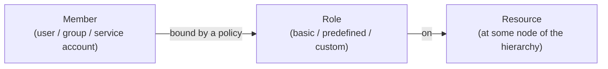

# GCP IAM and compute

Google Cloud approaches the same problems as AWS and Azure but organizes access around a strict resource hierarchy, and the labs I worked through made that the centerpiece. The most useful was an IAM exercise run across two accounts, where I granted and revoked one account's access and watched the effect land in real time. Around it sat compute and networking work done from the `gcloud` command line.

## The resource hierarchy

Permissions in GCP are not set in isolation; they inherit down a tree, and understanding the tree is what makes the access model predictable:

```
Organization
  └─ Folders
       └─ Projects
            └─ Resources
```

A policy set at any level flows down to everything beneath it. Grant a role at the organization and it applies everywhere; grant it on a single project and it stops there. The **project** is the unit everything really hangs off: every resource belongs to a project, billing is per project, and each lab gets its own project with its own ID. The least-privilege rule is the same as everywhere else: bind a role at the lowest node that still does the job.

## IAM across two accounts

The IAM Qwik Start lab is the one that made roles concrete, because I could see access appear and disappear:

1. **Prepare a resource** that the second account would try to use.
2. **Grant** the second account a role, then confirm from that account that it could now do the thing.
3. **Remove** the second account's access.
4. **Verify** the access was gone, by switching to that account and watching the same action be refused (for example, a piece of content it could read a moment ago no longer loading).

Running it with two real accounts side by side is what made the model click. IAM grants access by binding a **member** (a user, group, or service account) to a **role** on a resource:

- **Basic roles** (Owner, Editor, Viewer) are broad and mostly a holdover; they grant far more than a specific task needs. I used Editor and Viewer in the lab and could feel how much Editor hands over.
- **Predefined roles** are scoped to one service and an action set ("Storage Object Viewer", say) and are what least privilege usually means in practice.
- **Custom roles** exist for when even the predefined ones grant too much, letting you assemble an exact permission list.

**Service accounts** are the identities non-human workloads use, the GCP equivalent of an AWS role for a workload: a VM or an application acts as a service account rather than carrying a person's credentials.



## Compute and networking from gcloud

The rest of the GCP work was hands-on with the CLI and the console:

- **Cloud Shell and gcloud.** I configured the environment, including setting the default compute zone (`gcloud config set compute/zone`), which tripped me up until I read up on why a zone has to be set before zonal commands work. From there I connected to a VM instance, updated its firewall rules, and viewed the system logs.
- **Creating a VM** both ways: through the console and with a single `gcloud` command, then installing a web server (Nginx) on it. Doing it from the CLI is what turns "I clicked through a wizard" into "I can script this."
- **VPC networking.** I explored the default network, created my own VPC network with VM instances in it, and tested connectivity by reaching the VMs and adjusting firewall rules. GCP firewall rules attach to the network and gate traffic by direction, source, and port, the same job a security group does in AWS.

## What carries across the three providers

Working GCP after AWS and Azure made the pattern obvious: each provider has a hierarchy of scopes, roles that bundle permissions, and a least-privilege discipline that says bind the narrowest role at the lowest scope. AWS calls them policies and ARNs, Azure calls them role assignments and scopes ([project 04](../04-azure-resource-governance/README.md)), GCP calls them bindings and a resource hierarchy. The vocabulary changes; the instinct, granting the least access at the most specific place, transfers unchanged.

## Files in this project

- [`commands.md`](commands.md) - the gcloud commands for the VPC, a VM, and the IAM grant/revoke pair.
- [`sources.md`](sources.md) - GCP IAM, resource-hierarchy, and VPC references.