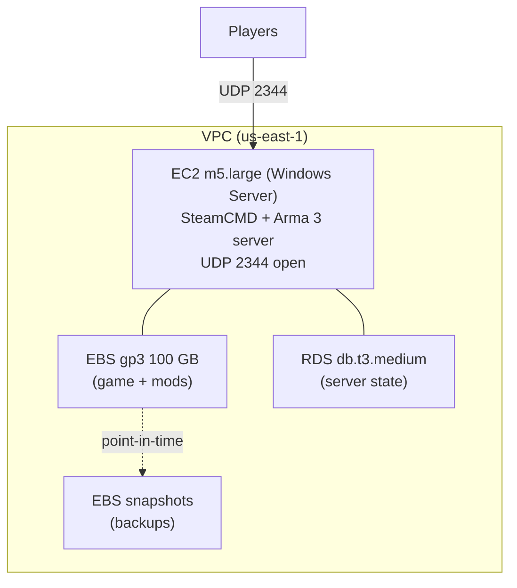

# Cloud gaming architecture proposal

The other projects here are things I built. This one is a thing I designed: a proposal to host a multiplayer game server on AWS, costed out before a single resource was created. I included it because deciding *what* to build, sizing it, and putting a monthly number on it is as much the job as clicking it together, and it is where the infrastructure pieces from the other projects turn into a decision.

## The problem

Host a dedicated server for **Arma 3**, a military-simulation game that is demanding on CPU and memory and sensitive to latency, so that a group can play on a stable, always-available server instead of someone's home machine. The design had to answer four questions: what to run it on, where, how to store its data, and what it costs.

## The design

| Decision | Choice | Why |
|---|---|---|
| Compute | EC2 **m5.large** | Arma 3 is CPU- and RAM-intensive; a general-purpose instance with real memory headroom fits better than a burstable micro instance |
| Region | **us-east-1** | I am on the east coast, so the closest region keeps round-trip latency low for the players who matter most |
| Operating system | **Windows Server** | the dedicated-server tooling is better supported on Windows for this title; community reports flagged reliability issues with the Linux build |
| Networking | a VPC with the game port (**UDP 2344**) opened to players, everything else closed | the same security-group discipline as [project 01](../01-aws-custom-vpc-and-web-server/README.md): open exactly the one port the game needs and nothing more |
| Game server | **SteamCMD** | the standard tool for installing and updating a Steam dedicated server |
| Storage | **100 GB gp3 SSD (EBS)** | enough for the game, mods, and mission files, on SSD-backed block storage for load times |
| Database | **db.t3.medium (RDS)** | for player and server state, sized small because the workload is light |
| Backups | **EBS snapshots** | point-in-time snapshots so a corrupted server or a bad mod update is a restore, not a rebuild, exactly the pattern from [project 02](../02-aws-ec2-ebs-and-rds/README.md) |

## The architecture

## The cost

The point of costing it out is that "host it in the cloud" is not free, and the number changes the decision. My estimate, per month:

| Line item | Estimate |
|---|---|
| EC2 instance (m5.large) | $138.24 |
| EBS storage (100 GB gp3) | $10.00 |
| Data transfer | $45.00 |
| EBS snapshots | $2.50 |
| **Total** | **~$195.74 / month** |

The compute dominates, which is the lesson: the instance choice is the cost decision. An always-on m5.large is most of the bill, so the next cost control is to stop the instance when nobody is playing, which on-demand pricing rewards directly. Data transfer is the second-largest and least predictable line, scaling with how much players pull down.

## Reconciliation against the approved proposal

I checked this chapter against the approved proposal source and kept the architecture and cost decisions aligned: Arma 3, EC2 `m5.large`, `us-east-1`, Windows Server, SteamCMD, UDP `2344`, 100 GB gp3 EBS storage, `db.t3.medium`, EBS snapshots, and a total estimate of about `$195.74 / month`. I left out personal planning tables and kept the public writeup focused on the infrastructure decision.

## What I would reconsider

Putting a real number on it surfaced the trade-offs an idle design hides:

- **Always-on versus on-demand.** A server that runs 24/7 costs the full $138 in compute even at 3 a.m. with nobody connected. Scheduling it to stop overnight, or starting it on demand, cuts the largest line item directly.
- **Reserved capacity.** If the server is going to run for a year, a reserved instance or savings plan trades commitment for a lower rate, which a hobby server may or may not justify.
- **The database may be overkill.** A light player-state workload might live in a flat file or a small managed store for far less than a dedicated RDS instance; I would validate the database is earning its line on the bill before keeping it.

The proposal is small, but it is the whole shape of a real cloud decision: gather the requirements, pick instance types and storage to match, draw the network so only the needed port is open, and then put a monthly figure on it so the design can be argued about in dollars rather than vibes.

## Files in this project

- [`setup-commands.md`](setup-commands.md) - the AWS CLI and SteamCMD commands to provision the proposed server.
- [`sources.md`](sources.md) - pricing, instance-type, SteamCMD, and Arma 3 server references.
