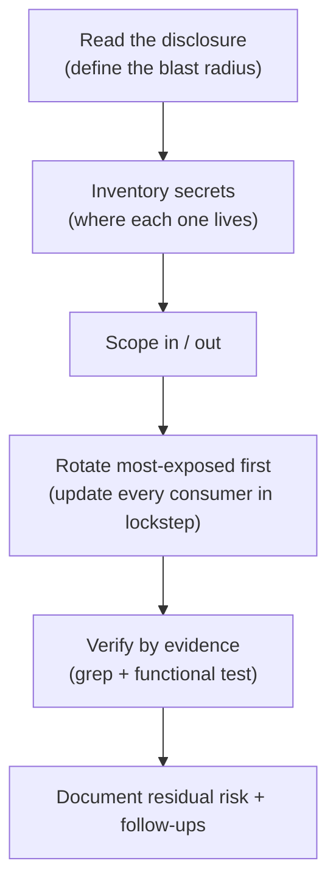

# Vendor breach incident response

When a vendor your application depends on discloses a breach, the question is not "were we named" but "what of ours did that vendor hold, and is any of it still valid?" In April 2026, Vercel (where I deploy a web application) published a bulletin about unauthorized access to internal systems. This project is how I responded: the order I worked in, what I researched first, what I touched first, and how I proved it was done.

The formal deliverable is in [incident-report.md](incident-report.md). This page is the story of producing it. The sources I leaned on are in [sources.md](sources.md).

## How I worked through it

### 1. Read the disclosure before touching anything

The first thing I did was read Vercel's bulletin in full rather than start changing keys. It mattered because the bulletin defined the blast radius: the access had come through a compromised third-party integration, and the attacker had been able to **enumerate and decrypt environment variables that were not marked "sensitive"** for a subset of customers. That single detail set my whole priority order. My Supabase keys lived in Vercel environment variables, so they were exactly the class of secret the bulletin said was at risk. The vendor's own remediation guidance (enable MFA, rotate non-sensitive environment variables, use the "sensitive" flag, review account activity and deployments) became the backbone of my action list.

I was not individually notified and saw no evidence my project was touched, so I treated this as precautionary invalidation: assume a secret a breached third party could read is already gone, and make it worthless.

### 2. Inventory where every secret actually lived

Before rotating, I mapped every credential the application used and, more importantly, *where it physically lived*: which were stored as Vercel environment variables, which sat in Supabase, which were only in my local `.env`, and which belonged to integrations (the GitHub auto-deploy). This is the step that took the longest, and the one I most wished I had done in advance. The map is what let me sort secrets by exposure instead of rotating blindly.

### 3. Scope in, then out

From that inventory I drew a hard line between in-scope (anything stored in or reachable from Vercel: the Supabase keys, the database password reachable through them, the GitHub integration, the `delete-account` Edge Function secrets) and out-of-scope (the Google OAuth secret and Resend key, which live only in Supabase, plus end-user sessions). Defining scope first is what kept the response bounded and complete instead of an open-ended panic.

### 4. Rotate in priority order, most-exposed first

I did not rotate alphabetically; I rotated by exposure. The Supabase **publishable key** went first because it sat directly in a Vercel environment variable, the exact thing the bulletin said was enumerable. Then the secret/service key and the database password as precautions (one hop away), then I disabled the legacy anon JWT key outright. For each new key I updated *every* consumer in lockstep, the Edge Function secrets, the Vercel environment variable, and my local `.env`, so the system was never half-rotated. Last, I rebuilt the GitHub integration by uninstalling the Vercel app and reinstalling it scoped to a single repository instead of the whole account, tightening least privilege while I was in there.

### 5. Verify by evidence, not assumption

A rotation you have not verified is a guess. I confirmed the legacy key read `disabled`, that the new keys were referenced everywhere, and then I grep'd the entire working tree for any surviving secret: the old publishable key, the legacy JWT signature, the `sb_secret_` prefix, and the HS256 JWT header pattern. All four returned nothing. Finally I exercised the live application in a browser (login, data load, account delete) and confirmed the Edge Function still invoked. That functional test is what caught a separate, unrelated bug in the delete-account function, which I would have wrongly blamed on the rotation if I had only checked configuration.

### 6. Write it down, including what is still open

I wrote the [record](incident-report.md) as I went, and I deliberately ended it with residual risk and five follow-up items (rotate the local personal access token, mark Vercel variables "sensitive," set a rotation schedule, evaluate the OAuth and Resend keys) rather than declaring it perfectly closed. The follow-ups and the residual-risk section are what make it a real record instead of a checklist.

## Why this order matters

Reading first set the priorities; inventorying first made rotation safe; scoping kept it finite; rotating by exposure put effort where the risk was; verifying by evidence is what turned "I changed the keys" into "I proved the old ones are dead and the app still works." The full document with every action and verification check is in [incident-report.md](incident-report.md).
