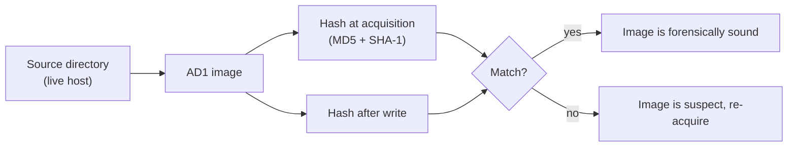

# DFIR investigation

This project is the hands-on forensic loop on a suspected-compromised Windows host: capture the volatile evidence before it disappears, image the disk in a way that holds up later, read the network and event logs, and turn what I found into reusable indicators. I ran it against lab VMs seeded with simulated suspicious activity, registry persistence, and credential-dumping behavior, so there were real artifacts to find rather than hypotheticals.

I kept this work in `02-dfir-investigation` instead of creating a new project. The existing project already covered the live response, imaging, registry review, and indicator work; the new source material deepens it with packet-capture and Windows-event-log findings instead of creating a second project with the same incident-response loop.

## Live response, in order of volatility

The first rule of touching a live machine is that the most fragile evidence has to come first. Memory contents, network connections, and running processes vanish the moment the machine is powered off or even left alone too long; the disk is comparatively permanent. So I collected from most volatile to least, documenting each command, and I treated the collection itself as something that alters the machine (every command I run is a footprint, so I run as few as needed and record them all).

| Order | What I captured | Command | Why it is volatile |
|---|---|---|---|
| 1 | Identity / context | `whoami` | the session context at the moment of response |
| 2 | Network configuration | `ipconfig /all` | addresses and DHCP leases change |
| 3 | Active connections | `netstat -ano` | sockets open and close constantly |
| 4 | Running processes | `tasklist` | a malicious process can exit at any time |
| 5 | Full process detail | `Get-Process \| Format-List *` | as above, with parent/path detail |

A real detail worth keeping: the classic step here is `wmic process list full`, but `wmic` is deprecated and failed on the host, so I substituted the PowerShell equivalent (`Get-Process | Format-List *`) and wrote it to my evidence folder. Knowing the substitute on the spot is the difference between a gap in the timeline and a complete one.

### Reading the results

- `whoami` and `ipconfig /all` established the host identity (`DESKTOP-HM66LJC`, user `w11-test`), its single NIC, its IPv4 address (`10.0.2.15/24`, a VirtualBox NAT lab VM), and its gateway and DNS, so I knew what machine I was looking at and how it was addressed.
- `netstat -ano` surfaced an established outbound connection to an external address on port 443. That is exactly the shape of a command-and-control callback, so I ran it down: the owning PID mapped to `svchost`, and the destination resolved to a Microsoft Azure endpoint. **Benign.** Writing that conclusion down matters as much as finding a real threat; an unexplained connection left in the report is a loose end someone else has to chase.
- `tasklist` captured a live `cmd.exe` process with PID `10564`, which matched the simulated `weirdsvc.bat` activity I had started for the exercise. The full process export corroborated the path as `C:\WINDOWS\system32\cmd.exe` and gave me a start time to anchor the timeline.
- Outside that controlled process, the full process list showed expected binaries: forensic tools, the browser, and the hypervisor guest additions. That let me keep the report precise: I had evidence of the simulated suspicious activity, but not of a second live malware process.

## Forensic imaging with verification

To investigate the disk without working on the live evidence, I imaged the target directory with FTK Imager into an AD1 image, with a documented chain of custody (examiner, case number, evidence number). The part that makes an image admissible is the hashing:

- FTK computed an **MD5 and a SHA-1** of the image at acquisition.
- After the image was written, I verified that the stored hashes matched the image, proving it had not changed during or after acquisition.



Two hashes rather than one is deliberate: relying on MD5 alone invites a collision argument, so pairing it with SHA-1 (or stronger) makes the integrity claim much harder to dispute. The hash is the whole reason a court, or a skeptical colleague, can trust that the image is the evidence and not a modified copy.

## Finding the persistence mechanism

The host had been seeded with a registry Run-key persistence entry, which is one of the most common ways malware survives a reboot. To analyze it without trusting the live machine, I exported the user's `NTUSER.DAT` registry hive and examined it offline with a registry forensics tool. The indicator was a value under:

```
HKEY_CURRENT_USER\Software\Microsoft\Windows\CurrentVersion\Run
  FakeUpdater = C:\Temp\update.exe
```

Anything listed under a `...\CurrentVersion\Run` key executes at logon, so a value pointing at an executable in `C:\Temp` is a textbook persistence artifact. I hashed the referenced file with `Get-FileHash -Algorithm SHA256`; the hash resolved to the well-known value for a zero-byte file, which told me the dropped payload was an empty placeholder in this exercise. In a real case that same hash would go straight into threat-intel lookups to identify the malware.

## What the packet capture proved

I used Wireshark in two different ways: first to scope a short simulated incident window, then to see what could and could not be recovered from ordinary web traffic.

For the scoping capture, I generated traffic that gave me both suspicious and baseline activity: a request to `testmyids.com`, normal browsing to `example.com`, and an ICMP ping. Filtering on `http || icmp` showed the expected ICMP traffic and the DNS lookup for the test alert domain. The domain resolved to `217.160.0.187`, which I treated as the network indicator for that exercise. The useful part was not the domain itself; it was the workflow, capture a narrow time window, separate normal DNS and ICMP from the alert-triggering traffic, then carry the indicator into the written report.

The second capture showed the limit of packet analysis on modern web traffic. I browsed several major sites and then tried a plain HTTP display filter. It returned nothing useful because the sessions were encrypted with TLS 1.2, TLS 1.3, or QUIC. That is a finding, not a failure: without keys or endpoint telemetry, a packet capture may prove timing, destination, SNI-adjacent metadata, and protocol use, while the HTTP content stays opaque.

## What the event logs missed

The event-log lab used a DetectionLab Windows host and a credential-dumping simulation. The Security log showed the preconditions:

- Event ID `4624` recorded an interactive logon for the lab user.
- Event ID `4672` recorded special privileges on that logon, including `SeDebugPrivilege`, the permission a tool needs to read another process's memory.

The gap was the important part. The default logging did not show the direct attack:

- No Event ID `4688` tied process creation to `mimikatz.exe`.
- No Event ID `4656` or `4663` showed that process opening or reading `lsass.exe`.

I confirmed the tool had run through live observation, but the default Security log only showed conditions that made the attack possible. That changed the recommendation from "search harder in the same log" to "collect better telemetry": enable process-creation auditing with command-line capture, deploy Sysmon for process and network detail, audit LSASS object access where practical, and use controls such as Credential Guard and the Defender ASR rule that blocks credential stealing from LSASS.

## Turning findings into indicators

The last step is making the investigation reusable. Using an IOC editor (FireEye/Mandiant schema), I built indicators that another analyst, or a detection tool, could match against other hosts. The three shapes I built cover the three ways you recognize the same threat again:

- **A file-hash indicator:** a known-bad SHA-1 tied to a specific system file path, the simplest "have I seen this exact file" check.
- **A compound indicator:** match if the file size equals a known value, **OR** the name matches, **OR** (the created timestamp matches **AND** the hash matches). Combining attributes with AND/OR catches a threat that changed one attribute to evade a single-fact rule.
- **A registry-persistence indicator:** match a value under the `Run` key with a specific name and a referenced file, which catches the persistence mechanism itself rather than a particular payload.

The progression is the point of DFIR: volatile evidence captured in the right order, a disk imaged and proven intact, an artifact found and analyzed offline, and the whole thing distilled into indicators that turn one investigation into detection coverage for the next host. The detections those indicators become are the subject of [the detection-engineering project](../03-detection-engineering/README.md).

## Files in this project

- [live-response-commands.md](live-response-commands.md) - the live-response command order and what each command established.
- [worked-report.md](worked-report.md) - the combined report across live triage, imaging, packet capture, registry persistence, and event logs.
- [indicators.md](indicators.md) - the OpenIOC-style indicators I built from the investigation.
- [sources.md](sources.md) - references for evidence handling, imaging, indicators, Windows auditing, and defensive controls.
