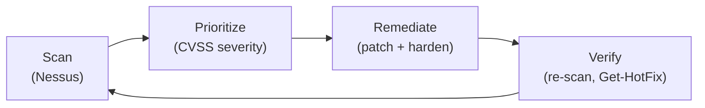

# Vulnerability management and hardening

Detection and response deal with attacks that are already happening. This project is the work that comes before that: finding the weaknesses on a system, deciding which ones matter, fixing them, and proving the fix landed. It runs as a loop, scan, prioritize, remediate, verify, and I worked each stage with the tools a small shop actually uses.

## The loop



The arrows close on purpose: verification feeds the next scan, because a system is never "done," only current as of the last pass.

## Scanning for vulnerabilities

I used Nessus (Essentials) to scan hosts for known vulnerabilities. The output is a list of findings, each tied to a CVE and scored by severity (CVSS), and the scanner's value is as much in the ranking as the discovery. A flat list of two hundred findings is noise; the same list sorted critical-first is a work queue. For findings I wanted to understand further, I pulled the CVE detail and used VirusTotal to check file and indicator reputation, so a "high" finding became a decision (patch now, mitigate, or accept) rather than just a red row.

## Hardening to a baseline with STIGs

Patching closes known holes; hardening removes configuration weaknesses that are not bugs at all, just insecure defaults. I worked with DISA STIGs (Security Technical Implementation Guides) using the STIG Viewer, checking a system's configuration against the baseline and noting where it diverged. A STIG is a long checklist of settings (disable an unused service, require a setting, restrict a permission), and walking one is how "is this host hardened" becomes a list of specific, checkable items instead of a feeling. It is the same instinct as the switch baseline in my [network lab](https://github.com/Duresa7/Network-Lab): bring the system up to a known-secure state by default, then justify any deviation.

## Scripted patching with PowerShell

The remediation stage I automated, because patching by hand does not scale and is easy to do incompletely. I still kept the workflow manual enough to verify each step: list the offered updates, decide whether to install all or target one KB, write the output to evidence files, then confirm the installed KB before rebooting. That is the difference between "Windows says it patched" and a remediation record I can point to.

Using the `PSWindowsUpdate` module:

```powershell
Install-Module PSWindowsUpdate -Force
Set-ExecutionPolicy RemoteSigned -Scope Process
Import-Module PSWindowsUpdate

# See what is available, then narrow to security updates
Get-WindowsUpdate
Get-WindowsUpdate | Where-Object { $_.Title -like "*Security*" }

# Install everything, deferring the reboot so I control when it happens
Install-WindowsUpdate -AcceptAll -IgnoreReboot

# Or target one specific patch by KB number
Get-WindowsUpdate -KBArticleID "KB5054979" -Install -AcceptAll -IgnoreReboot
```

I logged every run to a file (`Out-File`, `Export-Csv`, and `Tee-Object` so the output went to both the screen and a record), which is what turns an ad-hoc patch into something auditable. The text log is fast to read during a maintenance window; the CSV is easier to sort later by KB, title, result, and date. On a Linux host the same idea is `apt update` then `apt list --upgradable | grep security` to see the security-relevant updates before applying them.

## Verifying the fix

A patch is not done until it is confirmed installed:

```powershell
Get-HotFix          # confirm the KB is present
Get-HotFix -Id KB5054979
```

`Get-HotFix` lists installed updates with KB numbers and installation dates, so I could confirm the specific KB I targeted actually applied, then reboot (`Restart-Computer`) on my schedule. Re-running the Nessus scan afterward is the real proof: the finding that drove the patch should be gone, which both validates the work and closes the loop back to the start.

## Host triage with Sysinternals

Alongside the scan-and-patch cycle, I used the Sysinternals suite for hands-on inspection of a host's actual behavior:

- **Autoruns** to enumerate everything configured to start automatically, the same persistence surface I hunt in [the DFIR work](../02-dfir-investigation/README.md).
- **Process Explorer** to see the live process tree, parent-child relationships, and what each process has open.
- **Process Monitor** to watch file, registry, and network activity in real time.
- **Sigcheck** to verify whether binaries are signed and by whom.

Where Nessus tells you what is known to be vulnerable, these tell you what the machine is actually doing right now, which is how you catch the thing that is not in any vulnerability database yet.

## Why the order matters

The discipline is doing the stages in order and not skipping verification. Scanning without prioritizing buries the critical finding; patching without verifying leaves you believing a hole is closed when it is not; hardening without a baseline is guesswork. Run as a loop, it is the unglamorous work that means an incident response never has to happen for a vulnerability that was known and fixable.
