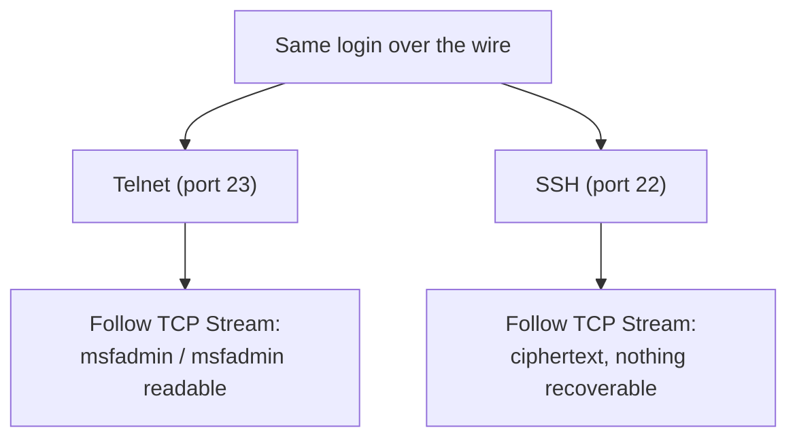
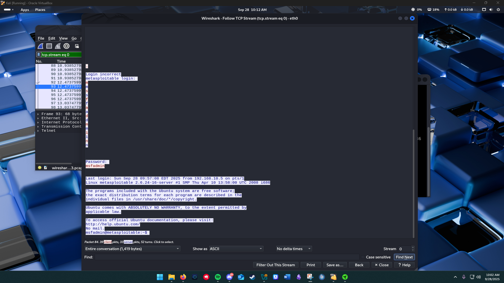
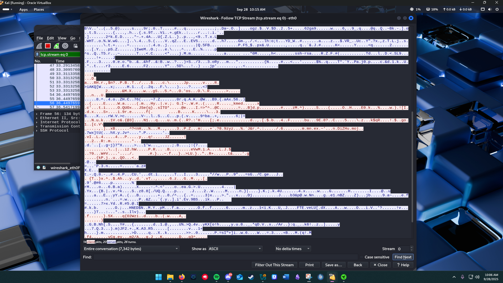

# Protocol analysis

This project answers a question with a packet capture instead of an opinion: what can someone watching the network actually read? I captured the same login over Telnet and SSH, then put the two streams side by side. Telnet exposed the username, password, and shell text. SSH exposed the handshake and encrypted payload bytes. That contrast is the reason plaintext management protocols do not belong on a network.

## The setup

A Kali box captured traffic in Wireshark on `eth0`, and a target Linux server (Metasploitable) was reachable over both Telnet (port 23) and SSH (port 22). I used PuTTY from Kali for both attempts so the capture changed only by protocol, then used Wireshark's **Follow TCP Stream** to reassemble each session into the conversation as the wire saw it. The credentials shown are the target's well-known defaults.

## Telnet: the login in clear text

Following the Telnet stream reassembled the entire session as readable ASCII. The credentials were right there in the capture:

```
metasploitable login: msfadmin
Password: msfadmin
Last login: ... from 10.10.0.5 on pts/1
msfadmin@metasploitable:~$
```

Anyone positioned on the path, on the same segment, on a compromised switch, on the wire anywhere between client and server, could pull the username, the password, the source address, and every command typed afterward, with no decryption and no special tooling. Telnet sends it all as plaintext, so capturing it is the whole attack.

## SSH: the same login, unreadable

I repeated the login over SSH and followed that stream. After the initial handshake (which negotiates the encryption and is supposed to be visible), the session was opaque, a block of ciphertext with no recoverable username, password, or commands:

```
(unreadable encrypted payload)
```

Same login, same credentials, same capture tool. The only variable that changed was the protocol, and that one change took the session from fully exposed to useless to an eavesdropper.



## What it changes about how I build things

This is not a theoretical exercise; it is the reason for a specific configuration choice I make everywhere. On the Cisco devices in my [network lab](https://github.com/Duresa7/Network-Lab), management is `transport input ssh` with Telnet refused outright, and this capture is why: a single sniffer on the management segment turns Telnet administration into a handed-over credential. The defensive rules that follow directly from the capture:

- **Disable plaintext protocols** (Telnet, FTP, unencrypted HTTP for anything sensitive) and replace them with their encrypted equivalents (SSH, SFTP, HTTPS).
- **Monitor for plaintext protocols in use**, because a Telnet session on the network is both a vulnerability and a signal that something is misconfigured.
- **Assume the network is hostile.** Encryption matters precisely because you cannot guarantee no one is listening; the capture proves what listening yields when the traffic is clear.

A related finding from analyzing a separate, modern traffic capture reinforced the same point from the other direction: filtering for plaintext HTTP returned nothing, because the traffic was entirely TLS and QUIC. That is the world working as it should, the encrypted-by-default baseline that makes the Telnet capture above look like the artifact of a different era, which is exactly what it should be.

## Evidence

Both captures were taken in Wireshark using Follow TCP Stream against a lab target. Sources are in [sources.md](sources.md).



*The Telnet session reassembled: the login prompt and session are fully readable.*



*The SSH session reassembled: after the handshake there is nothing recoverable.*
