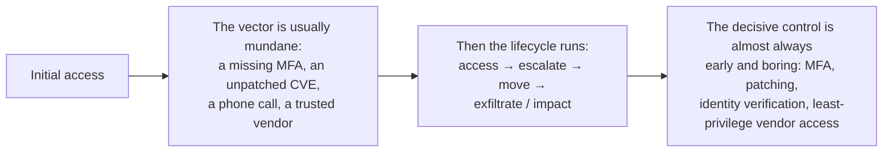

# Incident case studies

Responding to my own [vendor breach](../01-vendor-breach-incident-response/README.md) taught me the mechanics of a response. Studying other people's breaches taught me the patterns: how attackers get in, how far they go before anyone notices, and which single control would have changed the outcome. These are structured analyses of real, public incidents, each mapped to the response lifecycle and to MITRE ATT&CK, using only publicly reported indicators. The value of the exercise is reading a breach the way a responder has to: not as a story, but as a sequence of decisions that could have gone differently.

## Colonial Pipeline (DarkSide, 2021)

A DarkSide affiliate used a stolen password for a legacy VPN account that did not enforce MFA. The compromise started in the IT network, but Colonial Pipeline shut down pipeline operations on May 7, 2021 because it could not safely rule out operational risk while the investigation was still active.

| Date | Event | Response meaning |
|---|---|---|
| April 29, 2021 | Public reporting places the first access at a legacy VPN account tied to a password that had appeared in a credential dump. | The first failure was identity control, not malware. |
| May 6, 2021 | The attackers exfiltrated about 100 GB of corporate data before encrypting systems. | The incident had moved from ransomware to double extortion. |
| May 7, 2021 | Colonial found the ransom note, activated response, notified the FBI, and shut down pipeline operations. | Containment protected the OT side, but the business impact was immediate. |
| May 10, 2021 | The FBI publicly attributed the compromise to DarkSide ransomware. | Attribution made the case useful for threat-informed defense planning. |
| May 12 to May 13, 2021 | Colonial began restart and announced product delivery to all markets. | Recovery depended on phased restoration and confidence in the IT and OT boundary. |
| June 7, 2021 | DOJ announced the seizure of 63.7 BTC from the ransom payment. | Fast law-enforcement notification helped recover a large part of the payment. |

**Initial access and TTPs:** The access pattern maps to Valid Accounts and External Remote Services: one credential, one remote-access path, and no second factor. After access, the public reports describe reconnaissance, data theft, ransomware deployment, and recovery inhibition behavior associated with DarkSide. I treated the case as a lifecycle exercise rather than a malware-only story: identify the entry point, scope data access, decide whether the IT incident could threaten OT operations, then restore from known-good systems.

**Impact:** Colonial operates a 5,500-mile pipeline system that supplies a large share of fuel used on the U.S. East Coast. The shutdown created fuel disruption, emergency federal coordination, and a ransom payment of about 75 BTC, valued around $4.4 million at the time. DOJ later reported the seizure of 63.7 BTC, worth about $2.3 million at seizure.

**Defensive lessons:** MFA on VPN access was the missing control, but the broader lesson is account lifecycle discipline. A disabled or retired account cannot be reused, a monitored remote-access path produces an alert before encryption, and an exercised IT/OT incident plan gives leadership a better decision than shutting down because the boundary is uncertain.

Publicly reported indicators I tabulated: a representative payload hash, the C2 IP `198.54.117.197`, the staging domain `baroquetees.com`, and the use of Cobalt Strike over TOR. I mapped the TTPs in the **MITRE ATT&CK Navigator** (valid-account access, command-and-control, exfiltration, impact), wrote a simple **YARA** rule keyed on a known DarkSide string to practice signature authoring, and used **Process Explorer** to understand how the loader would present on a live host.

## MOVEit Transfer / Clop (2023)

A mass-exploitation campaign against a managed file-transfer product.

- **Initial access:** **CVE-2023-34362**, a SQL-injection vulnerability in MOVEit Transfer, exploited before a patch was widely applied.
- **Mechanism:** a web shell named **LEMURLOOT**, planted as `human2.aspx` in the MOVEit web root and driven through a custom HTTP header (`X-siLock-Comment`) so ordinary requests would not trigger it.
- **Impact:** over 2,700 organizations and more than 93 million individuals affected, through a single vulnerable product used across many victims.
- **The control that would have mattered:** rapid patching of internet-facing software, plus file-integrity monitoring on the web root that would have flagged a new `.aspx` appearing where none belonged.

Publicly reported indicators: a sample web-shell hash, the IP `92.118.36.112`, and the on-disk path `C:\MOVEitTransfer\wwwroot\human2.aspx`. This is the case that connects directly to [my detection work](../03-detection-engineering/README.md): "a new executable file appears in a web-serving directory" is exactly the kind of behavior an indicator or a file-integrity rule is built to catch.

## MGM and Caesars (Scattered Spider, 2023)

Two casino operators hit by the same social-engineering crew within weeks of each other, with opposite outcomes.

- **MGM:** attackers used **vishing** (a phone call to the help desk impersonating an employee) to get an Okta identity reset, then pivoted to encrypting more than 100 VMware ESXi servers. Reported impact exceeded $100M; no ransom was paid.
- **Caesars:** the same crew reached in through a **third-party IT vendor** (a supply-chain path), and Caesars reportedly paid about $15M.
- **The control that would have mattered:** identity-verification procedures at the help desk that a phone call cannot defeat, and tighter scrutiny of third-party vendor access. The technical defenses were not the weak point; the human and vendor trust boundaries were.

These two are the reminder that the initial vector is often not an exploit at all. No CVE, no malware on the way in, just a convincing phone call and a help desk that reset the wrong account.

## What reading breaches this way teaches

Laid side by side and mapped to the lifecycle, the four incidents (these three plus my own vendor response) rhyme:

The expensive part of every one of these was downstream, but the decisive control was upstream and unglamorous. That is the thread back to the rest of this repository and to my [network](https://github.com/Duresa7/Network-Lab) and [cloud](https://github.com/Duresa7/Cloud-Lab) work: segment so lateral movement is hard, require strong authentication so a leaked password is not enough, patch so a known CVE is not sitting exposed, and scope vendor and account access so a single compromise is contained. Studying how the big breaches happened is how I keep choosing where to spend defensive effort, at the cheap controls that would have stopped them, not the expensive cleanup that followed.
