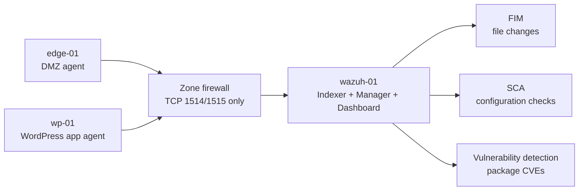

# Wazuh SIEM deployment

The public homelab writeup only says that Wazuh watches logs. This is the build behind that sentence: a single-node Wazuh deployment in the management tier, with agents on the edge and WordPress application hosts, and the basic host-detection capabilities turned on.

## Goal

I wanted one place where host evidence could land before I had a full SOC stack: file changes, configuration drift, package vulnerabilities, and service logs from the systems most exposed to users. Wazuh fit that role because the same manager could enroll Linux agents, collect logs, run File Integrity Monitoring (FIM), run Security Configuration Assessment (SCA), and show vulnerability findings without splitting the lab across several tools.

## Single-node build

I deployed Wazuh as an all-in-one node named `wazuh-01` on Ubuntu 22.04 LTS with 4 vCPUs, 16 GiB of RAM, and a 100 GB disk. It lives in the management tier at `192.168.70.20`.

The assisted installer put the three core services on the same VM:

| Component | Role |
|---|---|
| Wazuh Indexer | Stores and searches alerts and events |
| Wazuh Manager | Processes events, manages agents, and applies detection content |
| Wazuh Dashboard | Provides the web interface for alerts, agents, FIM, SCA, and vulnerabilities |

```bash
curl -sO https://packages.wazuh.com/4.10/wazuh-install.sh
sudo bash wazuh-install.sh -a
```

The installed version was Wazuh 4.10.3. I kept the installer-generated dashboard credentials out of the repo. The manager monitors its own host, so I did not install a separate Wazuh agent on `wazuh-01`.

## Data flow



## Agent enrollment

The first two enrolled agents were the edge host and the WordPress application host. The WordPress host is the same service family described in [my homelab services writeup](https://github.com/Duresa7/Homelab-Project/blob/main/docs/06-self-hosted-services.md), but this project focuses on the monitoring layer rather than the application build.

| Agent | Role | OS | Address | Zone | Status |
|---|---|---|---|---|---|
| `wp-01` | WordPress application host | Debian 13 | `192.168.80.10` | Lab-Servers | Active |
| `edge-01` | Edge / reverse-proxy host | Debian 13 | `192.168.90.10` | DMZ | Active |

On each Debian agent I added the Wazuh package repository, pointed the installer at the manager, and started the service:

```bash
sudo apt-get install gnupg apt-transport-https -y
sudo curl -s https://packages.wazuh.com/key/GPG-KEY-WAZUH | sudo gpg --no-default-keyring --keyring gnupg-ring:/usr/share/keyrings/wazuh.gpg --import
sudo chmod 644 /usr/share/keyrings/wazuh.gpg
echo "deb [signed-by=/usr/share/keyrings/wazuh.gpg] https://packages.wazuh.com/4.x/apt/ stable main" | sudo tee /etc/apt/sources.list.d/wazuh.list
sudo apt update
sudo WAZUH_MANAGER='192.168.70.20' apt-get install wazuh-agent -y
sudo systemctl daemon-reload
sudo systemctl enable wazuh-agent
sudo systemctl start wazuh-agent
```

## Firewall policy

The agents do not need broad access to the management tier. They need TCP 1514 for agent communication and TCP 1515 for enrollment. I opened only those ports to `wazuh-01`, matching the zone-based firewall pattern in [Network-Lab project 02](https://github.com/Duresa7/Network-Lab/blob/main/projects/02-zone-based-firewall/README.md).

| Source zone | Source scope | Destination | Ports | Why |
|---|---|---|---|---|
| Lab-Servers | App hosts | `wazuh-01` (`192.168.70.20`) | TCP 1514, 1515 | Let server agents enroll and send events |
| DMZ | `edge-01` only | `wazuh-01` (`192.168.70.20`) | TCP 1514, 1515 | Let the edge host report in without opening the rest of the DMZ |

That rule shape matters. Logs flow inward to the SIEM, but the app and edge tiers still cannot administer the management tier. If an exposed host is compromised, Wazuh still receives telemetry, while the firewall keeps that host from becoming a management-plane pivot.

## Capabilities turned on

| Capability | What I used it for | Status |
|---|---|---|
| File Integrity Monitoring | Watch for file additions, changes, and deletions on monitored hosts | Active on all agents |
| Security Configuration Assessment | Surface hardening gaps and configuration drift from policy checks | Active |
| Vulnerability Detection | Correlate agent package inventory with known CVEs | Active |
| Log Collection | Centralize host logs for search and alerting | Active |
| Active Response | Automated response actions | Available, not configured |

I left Active Response available but not configured because automatic blocking needs tuning and a rollback plan. The first useful milestone was visibility: agents enrolled, host data flowing, FIM/SCA/vulnerability views populated, and firewall rules narrow enough that monitoring did not weaken segmentation.

## Files in this project

- [`sources.md`](sources.md) - Wazuh and related portfolio references.
