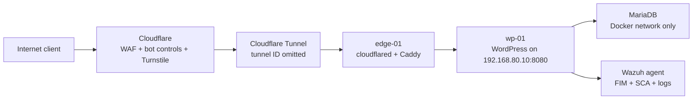

# Secure WordPress hosting

I wanted a public WordPress site without turning the rest of the lab into the blast radius for a web app. This project is the defensive shape of that build: isolate the host, hide the origin behind Cloudflare Tunnel, proxy through Caddy, harden WordPress itself, and keep backups ready for the day prevention is not enough.

## Threat picture

A public WordPress host gets noisy fast. The patterns I planned for were not exotic: automated login attempts, probes for `/wp-login.php` and `/wp-admin`, plugin and theme vulnerability scans, XML-RPC authentication abuse, comment spam, direct-origin discovery, and recovery failure after a bad update or compromise. The answer was not one control. It was layers that fail in different ways.

## Isolation and ingress

The WordPress workload runs on `wp-01`, a Debian VM in the application tier at `192.168.80.10`. The edge host sits in the DMZ and is the only system allowed to proxy web traffic to the WordPress container on port 8080. There is no direct inbound WAN port-forward to the WordPress VM.

The public path is Cloudflare first, then a Cloudflare Tunnel, then Caddy on the edge host, then the WordPress container. That ingress pattern lines up with the public [homelab ingress flow](https://github.com/Duresa7/Homelab-Project/blob/main/diagrams/ingress-flow.md), while the east-west restrictions come from the [Network-Lab zone firewall](https://github.com/Duresa7/Network-Lab/blob/main/projects/02-zone-based-firewall/README.md).

## Edge controls

Cloudflare handles the first pass because it can block junk before the tunnel touches my network:

| Layer | Control | What it reduces |
|---|---|---|
| Tunnel | Cloudflare Tunnel to the edge host | Direct origin exposure and WAN port-forwarding |
| WAF | Custom rule for admin paths, locked to a single admin source IP | Drive-by access to WordPress admin routes |
| Bot controls | Bot Fight Mode | Commodity bot traffic before it reaches WordPress |
| Turnstile | Login and password reset challenge | Automated login and reset abuse |
| Rate limiting | Login path throttled to a small request count in a short window | Brute force bursts and noisy scanners |

The hidden login path is deliberately not published. The technique is what matters: move the login route away from the default path, rate-limit that route, and make the default login URL return a dead end. A hidden path is not authentication, so it sits behind WAF rules, Turnstile, Wordfence, and 2FA rather than replacing them.

## WordPress hardening

Inside WordPress, I kept the controls focused on the paths attackers actually touch:

| Control | Setting used |
|---|---|
| Wordfence firewall | Extended Protection mode |
| Brute force protection | Enabled |
| 2FA | Required for administrator role |
| XML-RPC authentication | Disabled |
| File editor | Disabled with `DISALLOW_FILE_EDIT` |
| Comments and pingbacks | Disabled |
| User registration | Disabled |
| Admin username | Non-default, not `admin` |
| Table prefix | Changed away from `wp_` |

The table-prefix change is a small hardening step, not the control I rely on. It removes one default assumption and forced me to document the database migration, but the important controls are still patching, WAF rules, least-privilege ingress, 2FA, backups, and monitoring.

## Application and data layout

The Docker Compose stack keeps WordPress and MariaDB together while keeping the database off the routed network. The public WordPress URL is `https://example.com`. Database and admin secrets live in an `.env` file that stays out of git.

The compose and proxy notes are in [`compose-snippet.md`](compose-snippet.md). The stack used:

- the official `wordpress:latest` image;
- `mariadb:latest` for the database;
- a host bind only for WordPress on `8080:80`;
- Docker volumes for WordPress files and MariaDB data;
- `.env` permissions set to `600`;
- `WORDPRESS_TABLE_PREFIX` set to a non-default prefix;
- `DISALLOW_FILE_EDIT` in the WordPress config extras;
- Caddy forwarding `X-Forwarded-Proto: https` so WordPress understood the outer HTTPS layer.

## Backups and restore

Daily database backups run at 02:00 with a seven-day retention window. The backup job dumps MariaDB from the database container, writes a timestamped SQL file under `/home/analyst/backups/wordpress/`, logs to `/home/analyst/backups/backup.log`, and deletes SQL backups older than seven days.

The backup and restore commands are in [`backup-snippet.md`](backup-snippet.md). I treated the restore command as part of the backup, because an untested backup is only a file.

## Monitoring

The WordPress host reports to the [Wazuh SIEM project](../07-wazuh-siem-deployment/README.md). That gives me FIM for file changes, SCA for configuration drift, vulnerability detection for package exposure, and host logs in the same place as the edge host. The point is not only to block traffic at the edge. It is to notice when the host changes anyway.

## Files in this project

- [`compose-snippet.md`](compose-snippet.md) - Docker Compose, Caddy, WAF, and rate-limit examples.
- [`backup-snippet.md`](backup-snippet.md) - MariaDB backup, retention, and restore notes.
- [`sources.md`](sources.md) - public references used for the controls.
