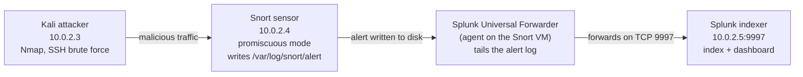

# Snort and Splunk detection pipeline

This was my team's capstone: take an intrusion detection sensor that produces a flood of raw alerts and wire it into a SIEM, so the alerts stop being a log file nobody reads and become something a person can search, correlate, and triage. The deliverable was the design and a working pipeline on a lab network. I am writing it up as a design and concept project, the same way I treat the [cloud gaming proposal](https://github.com/Duresa7/Cloud-Lab) in another repo: the architecture and the reasoning are the substance, not a screenshot tour. Where this fits next to my other detection work: the [detection-engineering project](../03-detection-engineering/README.md) writes and tests the Snort rules; the [Wazuh deployment](../07-wazuh-siem-deployment/README.md) is the same SIEM idea built on a different platform. This one is the Splunk side, and the piece that connects a sensor to a SIEM.

> **Lab values.** The pipeline ran on an isolated VirtualBox NAT network (`10.0.2.0/24`); those addresses are throwaway lab values. Teammate names are omitted.

## The two halves and why you need both

Snort on its own answers "did something match a rule?" and writes a line to a log. That is necessary and not sufficient: a busy sensor produces thousands of those lines, most of them noise, and a flat alert log gives you no way to ask "which host is being scanned the most this week" or "did this brute-force source also trigger anything else." The SIEM is what turns the stream into answers.

| Tool | Role | What it does in the pipeline |
|---|---|---|
| **Snort** | The sensor | Open-source IDS. Inspects packets in real time against a signature ruleset, and writes an alert to `/var/log/snort/alert` when traffic matches. |
| **Splunk** | The analysis layer | Ingests the alert stream, normalizes it, indexes it, and makes it searchable and visualizable, so raw detections become correlation, dashboards, and triage. |

The shorthand the team used: Snort is the security camera, Splunk is the brain that watches every camera at once and tells you where to look.

## What it was built to catch

We aimed the design at the two noisiest early-stage behaviors an external attacker produces, both generated from a Kali box on the lab network:

- **Reconnaissance:** network and port scanning with Nmap, and ICMP sweeps. This is the scanning that precedes almost every intrusion, and it is exactly what a signature IDS is good at flagging.
- **Brute force:** repeated authentication attempts against SSH. A single failed login is nothing; the pattern of many in a short window is the signal, and it is the kind of thing that is obvious in a SIEM and invisible in a raw log.

## The pipeline

The point of the architecture is the path a single alert takes from the wire to a dashboard:

The mechanism that connects the two tools is the **Splunk Universal Forwarder**, a lightweight agent installed on the Snort sensor. It tails `/var/log/snort/alert` and ships each new line to the Splunk indexer on TCP `9997`, Splunk's default receiving port. That forwarder is the whole integration: Snort does not need to know what Splunk is, and Splunk does not need to touch the wire. The sensor detects and writes; the agent forwards; the indexer makes it useful.

Snort runs in promiscuous mode so it sees all traffic on the segment, not just packets addressed to it, which is what lets one sensor watch the whole lab subnet.

## What the SIEM layer adds

Once the alerts are in Splunk, the value is the questions you can now ask of them. A SOC-style overview built on the indexed data is where the raw stream becomes triage:

- **Volume and priority:** total alerts grouped by severity, so the critical handful is not buried under thousands of low-priority hits.
- **Disposition:** marking detections as true positive, false positive, or benign-but-expected, which is how you measure whether the ruleset is actually useful or just loud.
- **Correlation and ownership:** tying alerts to a source or host and to an owner, so the same scanning source that also triggered a brute-force rule shows up as one story instead of two unrelated lines.
- **ATT&CK mapping:** grouping detections by MITRE ATT&CK technique, so the activity reads as "reconnaissance, then credential access" rather than as disconnected signatures.

None of those are things Snort can do by itself. They are the reason the pipeline exists.

## Why this matters

An IDS without a SIEM is a smoke detector with no one home. Snort gives real-time visibility into packets but produces raw alerts faster than anyone can read them; Splunk centralizes and analyzes that output, cuts the noise into patterns, and turns detection into decisions. The combination is the standard shape of a detection pipeline in a real SOC, and building it end to end, attacker to sensor to forwarder to indexer to dashboard, is what the capstone was for.

## Files in this project

- [sources.md](sources.md) - Snort, Splunk, the Universal Forwarder, and MITRE ATT&CK references.
