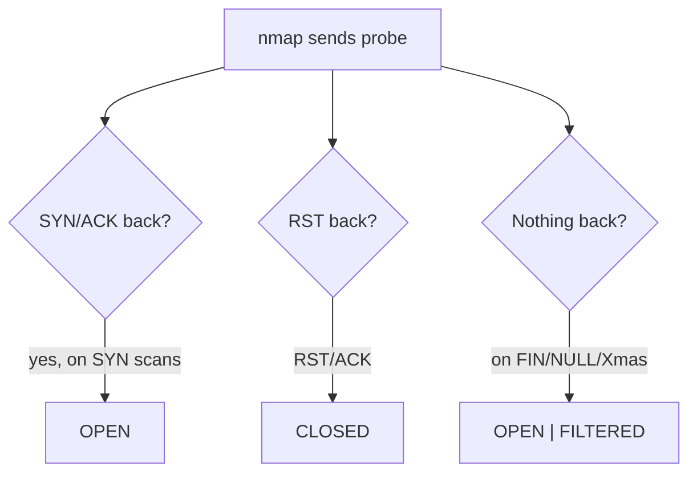
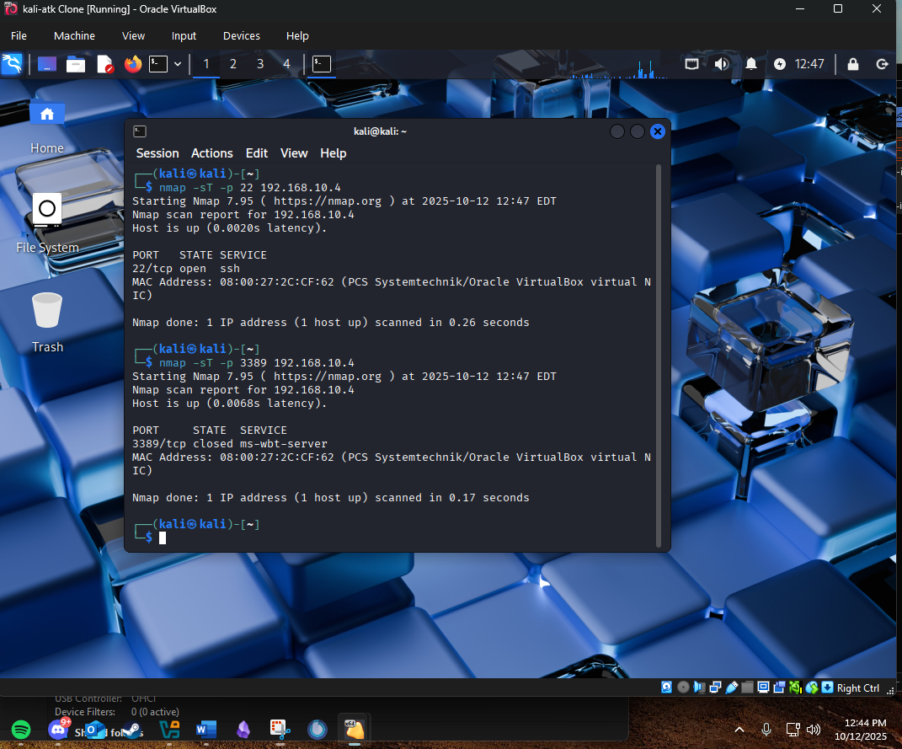
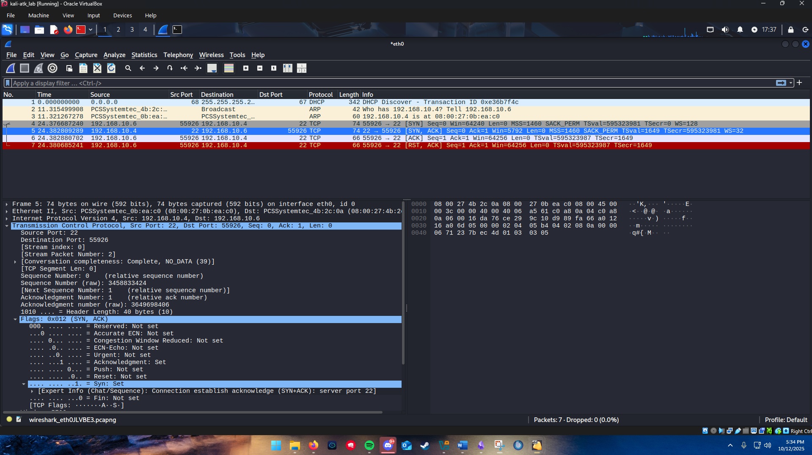
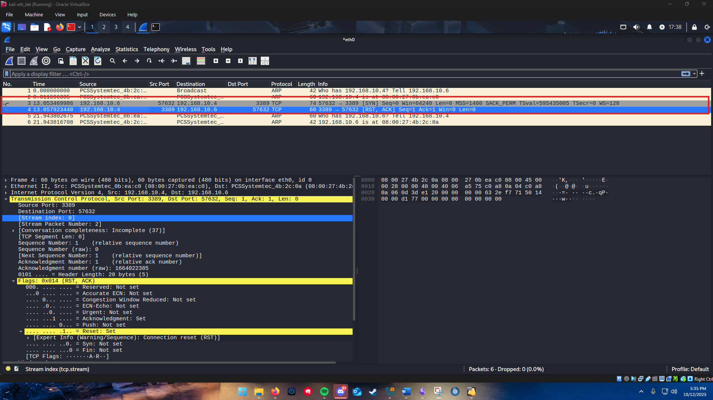
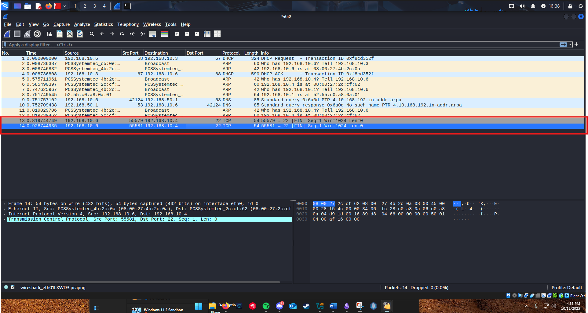
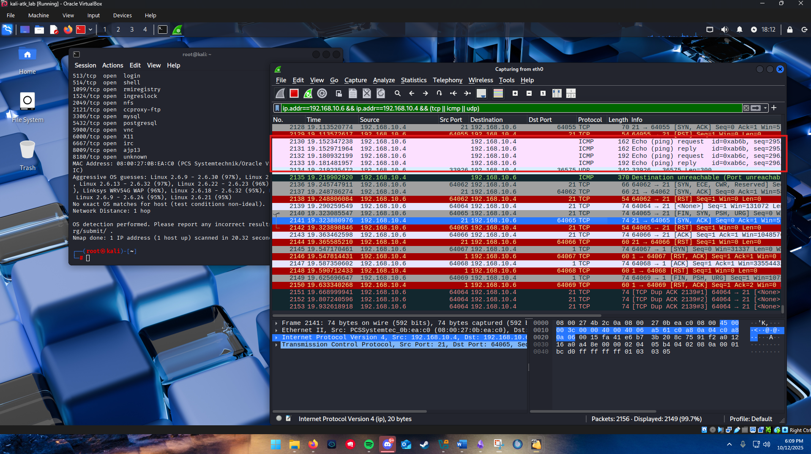

# Network recon and port scanning

Scanning is the first move against any target, and the part most people run without understanding. I wanted to do the opposite: run common nmap scan types against one target while capturing the wire in Wireshark, so I could connect each result to the TCP flags behind it. By the end I could explain any line of nmap output from the packets on screen.

## The lab

Two virtual machines on an isolated host-only network:

- **Attacker:** Kali Linux at `192.168.10.6`, running nmap 7.95 and Wireshark.
- **Target:** a deliberately vulnerable Linux VM (Metasploitable) at `192.168.10.4`.

For each scan I ran two cases, an open port (`22`, SSH) and a closed port (`3389`), and filtered Wireshark to the two hosts (`ip.addr==192.168.10.6 && ip.addr==192.168.10.4`) so the exchange was the only thing on screen.

## TCP connect scan (`-sT`)

```
nmap -sT -p 22 192.168.10.4
```

This is the scan that completes a full TCP handshake. Against the open port, Wireshark showed the textbook three-way handshake followed by an immediate teardown:

```
attacker -> target: SYN
target -> attacker: SYN, ACK
attacker -> target: ACK
attacker -> target: RST, ACK
```

nmap reported `22/tcp open ssh`. The handshake completing is the proof the port is open; nmap then sends a RST to tear the connection down rather than leaving it half-built. Against the closed port:

```
attacker -> target: SYN
target -> attacker: RST, ACK
```

`3389/tcp closed`. A closed port answers a SYN with a RST, so there is no ambiguity. The cost of `-sT` is that completing the handshake means the connection is something the target's services can log.

## SYN / stealth scan (`-sS`)

```
nmap -sS -p 22 192.168.10.4
```

The default and the one to understand. It never completes the handshake. Against the open port:

```
attacker -> target: SYN
target -> attacker: SYN, ACK
attacker -> target: RST   (nmap tears down before ACK)
```

nmap learns the port is open the instant the SYN/ACK arrives, then sends a RST instead of the final ACK, so a full connection never forms. Against the closed port the target answers the lone SYN with `RST, ACK`. The reason it is called stealth is exactly this half-open behavior: historically, services that only logged completed connections never saw it.

## FIN, NULL, and Xmas scans

These three exploit how the TCP specification says a port should react to a packet that arrives with no active connection. They send unusual flag combinations and read the result the same way:

```
nmap -sF -p 22 192.168.10.4   # FIN only
nmap -sN -p 22 192.168.10.4   # no flags set
nmap -sX -p 22 192.168.10.4   # FIN, PSH, URG together (a "Christmas tree" packet)
```

In Wireshark, the FIN scan sent bare `[FIN]` packets, the NULL scan sent packets with no flags at all, and the Xmas scan sent `[FIN, PSH, URG]`. The logic for all three:

- **Open port:** the packet is out of state, so a compliant stack stays silent. No reply means open (or filtered).
- **Closed port:** the stack answers with `RST, ACK`.

Against the open port (22), all three got no response. Against the closed port (3389), all three drew a `RST, ACK`. The value of these scans is that they carry no SYN, so a filter watching only for connection attempts can miss them. The catch, which the lab made concrete: this behavior is the standard-compliant behavior, and Windows hosts do not follow it, so these scans give useless results against Windows and are a Unix-target technique.

## OS fingerprinting

```
nmap -O 192.168.10.4
```

The fingerprint scan inferred the operating system from subtle differences in how the stack responds, and dumped the full open-port inventory at once. The target showed a long list of legacy services open (among them `513/login`, `514/shell`, `1099/rmiregistry`, `1524/ingreslock`, `2049/nfs`, `3306/mysql`, `5432/postgresql`, `5900/vnc`, `6000/X11`, `6667/irc`, `8180/http`), the classic profile of an intentionally vulnerable host. nmap's best guesses clustered around **Linux 2.6.x** at 95 to 97 percent confidence, with "no exact OS matches" and "network distance: 1 hop." That open-port list is a target map: every one of those services is a thing to investigate next.

## How a scan decides open versus closed



The whole game is reading the reply: a SYN/ACK means open, a RST means closed, and silence on a flag scan means the port did not feel obligated to answer, which usually means open or firewalled.

## The control that stops it

You cannot stop someone from sending you packets, but you can change what they learn and whether you notice. The defenses, in order of effect:

- **Default-deny at the firewall.** When a firewall drops probes to ports that should not be reachable, the target never sends a RST, so closed ports read as `filtered` instead of `closed`. The scanner gets ambiguity instead of a map. This is the same posture as the zone firewall in my [Network Lab](https://github.com/Duresa7/Network-Lab): nothing answers that does not have a reason to.
- **Scan detection.** A burst of connection attempts across many ports from one source is a signature an IDS catches; the recon shows up as an alert before the attacker reaches the services they found.
- **Reducing the attack surface.** Half of the target's danger was the sheer number of services listening. Every closed-off port is one fewer line in the attacker's next step.

## Files in this project

- [`scan-commands.md`](scan-commands.md) - the exact nmap commands per scan type.
- [`sources.md`](sources.md) - nmap, RFC 793, and Wireshark references.
- `evidence/` - the captures below (isolated lab VMs, `192.168.10.x`).

## Evidence



*`nmap -sT` reporting `22/tcp open` and `3389/tcp closed`.*



*The open port: SYN -> SYN,ACK -> ACK, then nmap tears the connection down.*



*The closed port: the lone SYN draws an immediate RST,ACK.*



*A FIN scan: bare FIN packets, with silence from the open port.*



*`nmap -O`: the full open-service profile and the Linux 2.6.x OS guess.*

These screenshots are from isolated training VMs.
