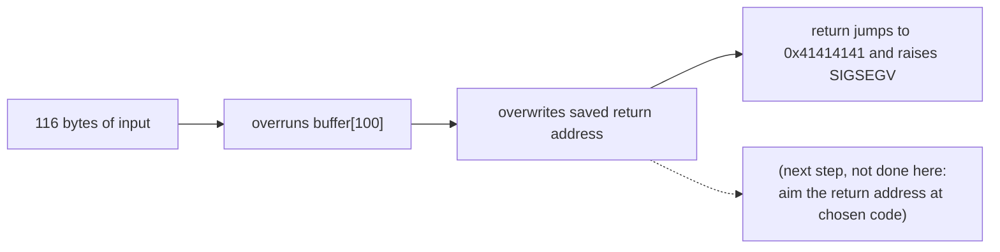
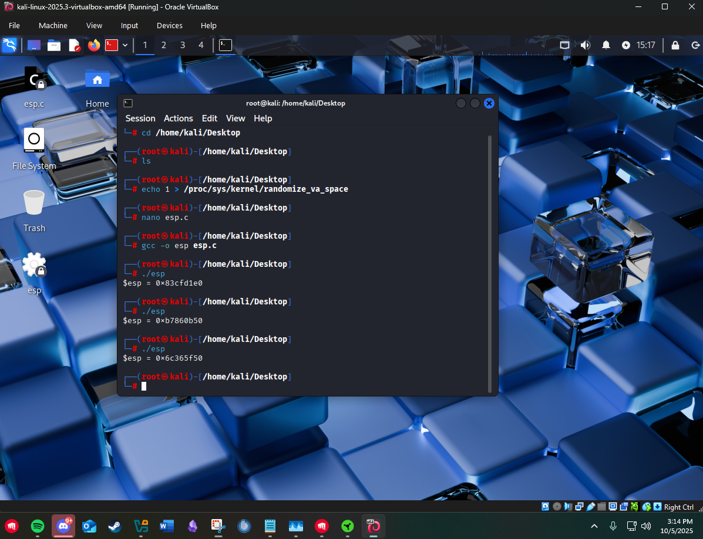
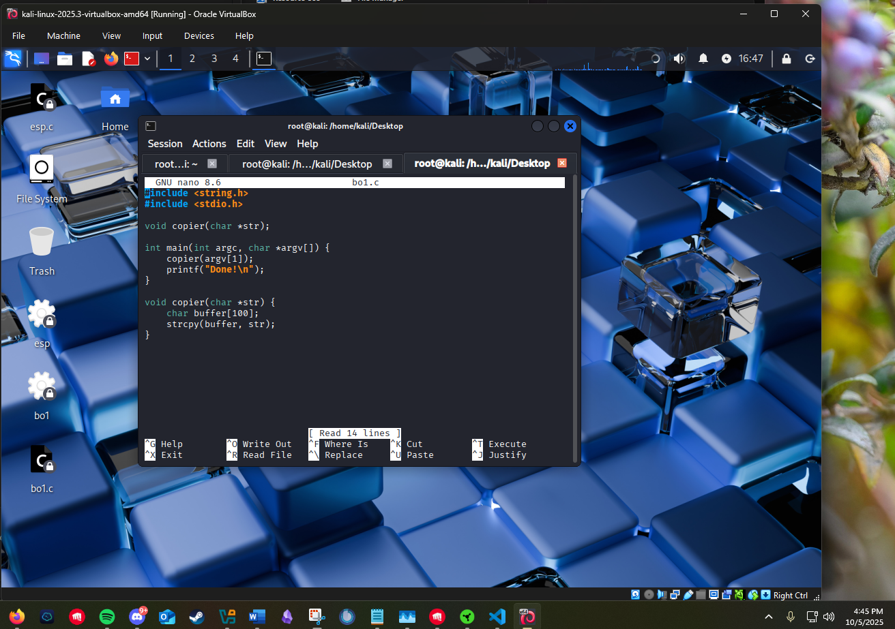
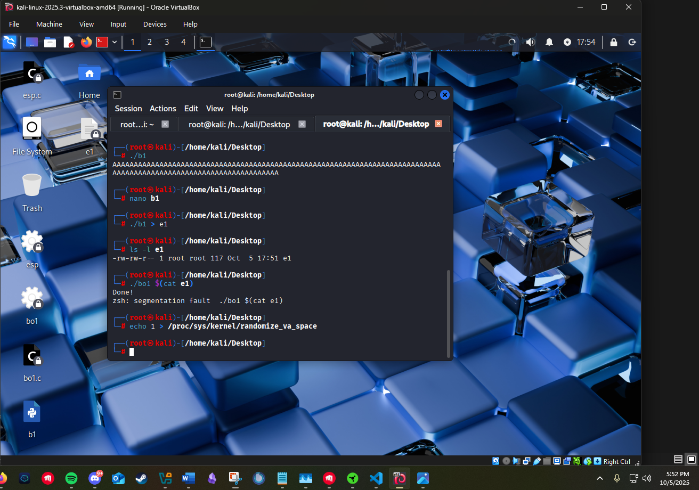

# Stack buffer overflow

This is the project that taught me what "memory corruption" means at the byte level. I demonstrated address-space layout randomization (ASLR) and what turning it off does, wrote a C program with a textbook unsafe copy, and fed it an input large enough to overrun its buffer and corrupt the saved return address, crashing it on purpose. I stopped at the controlled crash rather than building a working code-execution exploit, but getting to the crash is the part that makes every mitigation that follows make sense.

> This was run on an isolated lab VM with protections I deliberately disabled. The point is to understand the vulnerability class and why modern defaults defeat it, not to produce reusable exploit code. There is no shellcode here.

## Step 1: watch ASLR move the stack

Before overflowing anything, I wanted to see the thing that makes overflows hard in the real world. ASLR randomizes where the stack lands each time a program runs, so an attacker cannot predict an address to jump to. A tiny C program prints its own stack pointer:

```c
#include <stdio.h>
void main() {
    register int i asm("esp");
    printf("$esp = %#010x\n", i);
}
```

With ASLR on (`echo 1 > /proc/sys/kernel/randomize_va_space`), three runs gave three different stack pointers:

```
$esp = 0x83cfd1e0
$esp = 0xb7860b50
$esp = 0x6c365f50
```

With ASLR off (`echo 0 > /proc/sys/kernel/randomize_va_space`), the address was identical every run:

```
$esp = 0xffffe200
$esp = 0xffffe200
```

That contrast is the whole reason ASLR exists. A real attack needs a stable address to aim at, and with randomization on, the target moves between runs. The rest of this lab runs with ASLR off, because the goal is to study the overflow itself, not to defeat ASLR.

## Step 2: a program that trusts its input

The vulnerable program copies an argument into a fixed 100-byte buffer with `strcpy`, which has no idea how big the buffer is:

```c
#include <string.h>
#include <stdio.h>
void main(int argc, char *argv[]) {
    copier(argv[1]);
    printf("Done!\n");
}
void copier(char *str) {
    char buffer[100];
    strcpy(buffer, str);   // no bounds check
}
```

I compiled it with protections turned off so the underlying behavior is visible:

```
gcc -g -z execstack -no-pie -o bo1 bo1.c
```

`-z execstack` marks the stack executable, `-no-pie` produces a fixed (non-position-independent) layout. Run with a short argument, it behaves:

```
./bo1 A
Done!
```

`copier` copies `"A"` into the 100-byte buffer, returns, and `main` prints `Done!`.

## Step 3: overflow the buffer

`buffer` holds 100 bytes, but the bytes after it on the stack hold the saved frame and the return address that tells `copier` where to go when it finishes. An input longer than the buffer plus that saved data overwrites the return address. I generated 116 bytes with a one-line Python script:

```python
x = "A" * 116
print(x)
```

(An honest detail from the lab: the first version failed with `SyntaxError: invalid character '"' (U+201C)` because the quotes had been pasted as smart quotes. Retyping them as plain ASCII fixed it, a small reminder that the payload is bytes and the wrong byte breaks it.)

I wrote those 116 bytes to a file and passed them as the argument:

```
./b1 > e1
./bo1 $(cat e1)
Done!
zsh: segmentation fault  ./bo1 $(cat e1)
```

`copier` still ran (it printed nothing of its own), but when it tried to return, the saved return address was no longer a valid code address; it was `0x41414141`, the hex for `AAAA`. The CPU jumped there, found nothing executable, and the kernel killed the process with a segmentation fault.

## What the crash proves

The segfault is not a bug in my program; it is proof that I controlled the saved return address with attacker-supplied input. Those four `0x41` bytes sitting in the instruction pointer are the dividing line between a crash and a code-execution exploit:



A full exploit would replace those `AAAA` bytes with a real address pointing at injected instructions. This lab stops at demonstrating that the address is controllable, which is a denial-of-service in its own right and the foundation everything else is built on.

## The controls that defeat it

The reason this only worked because I disabled protections is the lesson. Each modern default closes part of the path:

- **Stack canaries** (`-fstack-protector`, on by default) place a known value between the buffer and the saved return address and check it before returning. My 116 bytes would have smashed the canary, the check would have failed, and the program would abort cleanly before the corrupted return address was ever used.
- **Non-executable stack / NX** (the opposite of the `-z execstack` I had to add) marks the stack non-executable, so even a jump into injected stack data executes nothing.
- **ASLR** (which I had to switch off) randomizes the address an attacker would need to aim at, as the first step showed.
- **Position-independent executables / PIE** (the opposite of `-no-pie`) randomize the program's own code layout too.

I had to explicitly defeat four defaults to make a 100-byte buffer fall to a 116-byte input. On a normally compiled program, the same input aborts safely at the canary check. The takeaway for the defensive side is concrete: compile with the protections on, never use unbounded copies like `strcpy`, and treat every length as untrusted.

## Files in this project

- [`src/esp.c`](src/esp.c) - prints the stack pointer to observe ASLR.
- [`src/bo1.c`](src/bo1.c) - the deliberately vulnerable program.
- [`src/overflow.py`](src/overflow.py) - generates the 116-byte crash input (no shellcode).
- [`sources.md`](sources.md) - ASLR, GCC protections, and the vulnerability class.
- `evidence/` - the captures below (isolated Kali lab VM).

## Evidence



*The stack pointer with ASLR on (changes each run) versus off (constant).*



*`bo1.c`: the unbounded `strcpy` into a 100-byte buffer.*



*Feeding 116 bytes overruns the buffer and corrupts the saved return address: segmentation fault.*

These screenshots are from an isolated lab VM with protections changed for the exercise. They show the controlled crash path only, not a working code-execution exploit.
