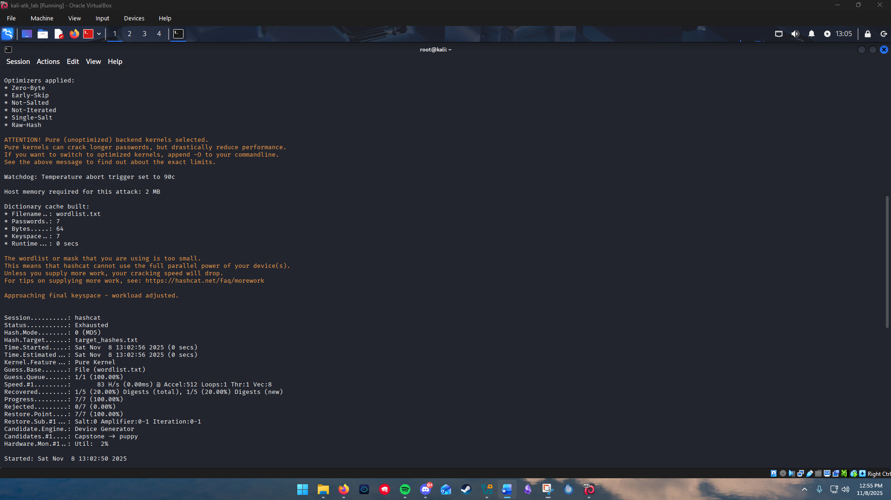

# Password cracking

A stolen password database is only as dangerous as the speed at which the hashes in it can be reversed. I built a mixed set of hashes, ran a dictionary attack with hashcat, and watched which ones fell and which ones did not. The interesting result was not that hashes crack; it was *why only some of them did*, which is the whole argument for how passwords should be stored.

## The setup

I created two files on Kali:

- `target_hashes.txt`, ten hashes produced with different algorithms (MD2, MD5, SHA-1, and SHA-256) from a mix of words.
- `wordlist.txt`, a small dictionary of candidate passwords.

Then I ran a straight dictionary attack:

```
hashcat -m 0 -a 0 -o cracked.txt target_hashes.txt wordlist.txt
```

The two flags are the lesson hiding in plain sight:

- `-m 0` tells hashcat the hashes are **MD5**.
- `-a 0` selects **attack mode 0**, a straight dictionary: hash each word in the list, compare to the targets.

## What happened

hashcat hashed every word in the list as MD5 and compared. The MD5 entries in my file matched their dictionary words and were recovered. The MD2, SHA-1, and SHA-256 entries did not match anything, because hashcat was computing MD5 and an MD5 of a word never equals that word's SHA-256. The run finished `Status: Exhausted` with only the MD5 subset recovered.

This is the intended trap, and it is the most useful thing the lab taught: **you crack the hash you tell the tool you have.** To attack the SHA-1 entries I would rerun with `-m 100`, and for SHA-256 with `-m 1400`. A real attacker identifies the algorithm first (by length, format, and context) and only then chooses the mode. Get that wrong and a crackable password looks uncrackable.

## Attack modes worth knowing

Mode 0 was a dictionary attack, but it is one of several shapes:

| Mode | Name | What it does |
|---|---|---|
| `-a 0` | Straight | hash each word in a wordlist |
| `-a 1` | Combination | concatenate words from two lists |
| `-a 3` | Brute force / mask | try every string matching a pattern, e.g. `?u?l?l?l?l?d?d` |
| `-a 6` / `-a 7` | Hybrid | a wordlist with brute-forced characters appended or prepended |

A dictionary attack is cheap and catches real passwords because people pick real words. A mask attack is exhaustive within a pattern and catches the "password + two digits" habit. The choice is a trade between coverage and time.

## Fast hashes versus slow hashes

The deeper point is speed. MD5 and SHA-family hashes are *fast*: they were designed to digest large files quickly, which is the opposite of what you want for a password. On a GPU, MD5 candidates are tried in the billions per second, so a fast hash of a weak password is effectively already cracked. (My run was a CPU pure-kernel run measured in dozens of hashes per second, slow by design for the lab, but the production reality is many orders of magnitude faster.)

Password hashes are supposed to be *slow* and *salted*:

- A **salt** is a unique random value mixed into each hash, so identical passwords produce different hashes and an attacker cannot precompute a single rainbow table against the whole database.
- A **slow key-derivation function** like bcrypt, scrypt, or Argon2 has a deliberate work factor that makes each guess take milliseconds instead of nanoseconds. The same dictionary attack that finishes in seconds against MD5 takes years against bcrypt at a sane cost factor.

## The control that stops it

Cracking is an offline attack: once an attacker has the hash file, they are limited only by hardware and the storage choices made before the breach. So the defense is made entirely in advance:

- Store passwords with a **salted, slow KDF** (bcrypt, scrypt, or Argon2), never raw MD5 or SHA.
- Require **length and unpredictability**, because a slow hash still falls to a guessable password; the KDF buys time, the password has to be worth the time.
- Assume the hash file will eventually leak and design so that a leak is not the same event as an account compromise.

The lab cracked the MD5s in seconds and could not touch the others without switching algorithms. A production system that hashed those same passwords with Argon2 and a salt would have handed the attacker a file that costs more to crack than the accounts are worth, which is the entire goal.

## Files in this project

- [`commands.md`](commands.md) - the hashcat invocation, mode mapping, and attack modes.
- [`sources.md`](sources.md) - hashcat, OWASP password storage, and NIST authentication references.
- `evidence/` - the capture below (isolated Kali lab VM).

## Evidence



*The hashcat run in `-m 0` (MD5) mode: only the MD5 entries in the mixed set are recovered.*

This screenshot is from an isolated Kali lab VM. The recovered candidate shown is a training value from the local wordlist.
