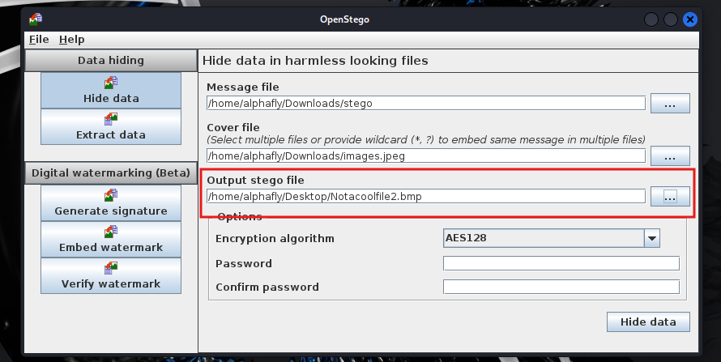
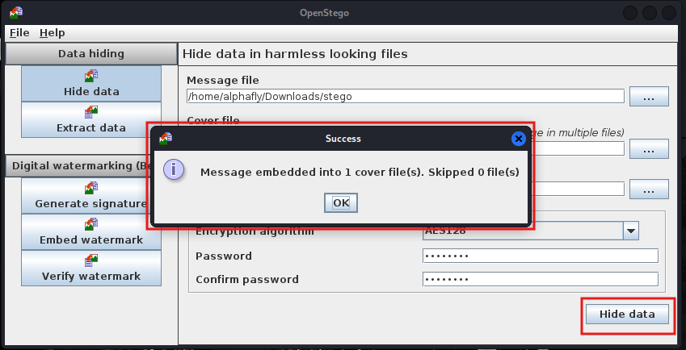
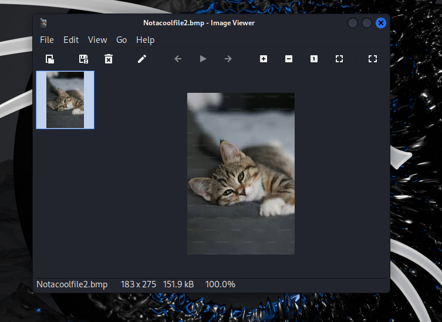
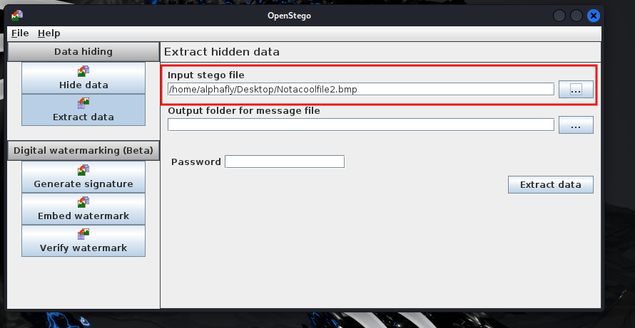

# Steganography: hiding data in plain sight

Steganography is the quiet cousin of encryption. Encryption makes data unreadable; steganography makes it invisible, hiding one file inside another so the carrier looks completely ordinary. An attacker reaches for it to move data past controls that are watching for the obvious: an image leaving the network draws no attention, even with a document sealed inside it. I worked through the full hide-and-recover cycle with OpenStego on Kali to see how little the carrier gives away, and then what actually catches it. The commands are in [commands.md](commands.md).

## Hiding the data

[OpenStego](https://github.com/syvaidya/openstego) is a straightforward stego tool. I installed the `.deb` on Kali (`sudo dpkg -i openstego_0.8.6-1_all.deb`) and launched the GUI.

The hide step takes three inputs: the secret data file, a cover image to carry it, and an output path for the result. OpenStego embeds the data into the cover, and it can encrypt the payload first; I set AES-128 with a password. That layering is the point: even if someone suspects the image and pulls the hidden payload out, it is still encrypted. I ran the hide and got the success confirmation.

What comes next is the whole reason the technique works: I opened the output image and it looked and behaved like any other picture. Nothing about how it displays hints that a file is inside it. That is the value of the technique to an attacker and the problem it creates for a defender.

## Recovering it

Extraction is the reverse: point OpenStego at the stego image, give it an output location and the password, and it pulls the original file back out intact. Without the password the AES layer holds, so a clean recovery is also the proof that both the embedding and the encryption worked.

## What catches it

Steganography defeats a control that only inspects the obvious, so the controls that catch it look for the anomaly instead of the content:

- **Size and entropy.** A carrier with an embedded, encrypted payload is larger and more random than a clean one. Comparing a file against a known-good baseline, or flagging unusually high entropy for the file type, is the classic detection.
- **Steganalysis tooling.** Tools built to spot the statistical fingerprint of LSB embedding can flag a suspect image where the eye cannot.
- **Control the channel, not just the content.** Egress data-loss-prevention, inspecting or blocking uploads to unknown destinations, and alerting on large or unusual outbound transfers catch the exfiltration even when the payload itself is invisible. The lesson from doing it: you cannot reliably read the hidden data, so you watch the behavior around it.

## Files in this project

- [commands.md](commands.md) - the install and usage steps.
- [sources.md](sources.md) - OpenStego and steganalysis references.

## Evidence

Screenshots from my own Kali VM. My handle `alphafly` and the lab paths are shown on purpose; the cover image is a generic test picture and the hidden "secret" is throwaway text.

*The hide step: the secret file as the message, an ordinary image as the cover, an output path, and AES-128 with a password.*

*OpenStego confirms the message was embedded into the cover image.*

*The output file opens and displays as a normal image. Nothing about it reveals the encrypted file inside, which is the whole point of the technique.*

*Recovery: point OpenStego at the stego image and supply the password to pull the original file back out.*
