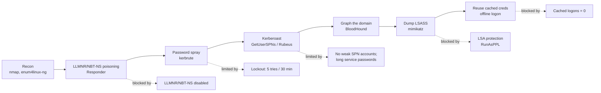

# Attack chain and the control that stops each step

The Kali pass against `corp.local`, read left to right. Each attack is paired with the hardening from [chapter 02](../docs/02-gpo-security-hardening.md) that blocks or limits it.

The point of the exercise is the dotted lines. An attack chain that reads cleanly on an unhardened domain keeps hitting walls here, and each wall traces back to a specific Group Policy setting I can point to.
