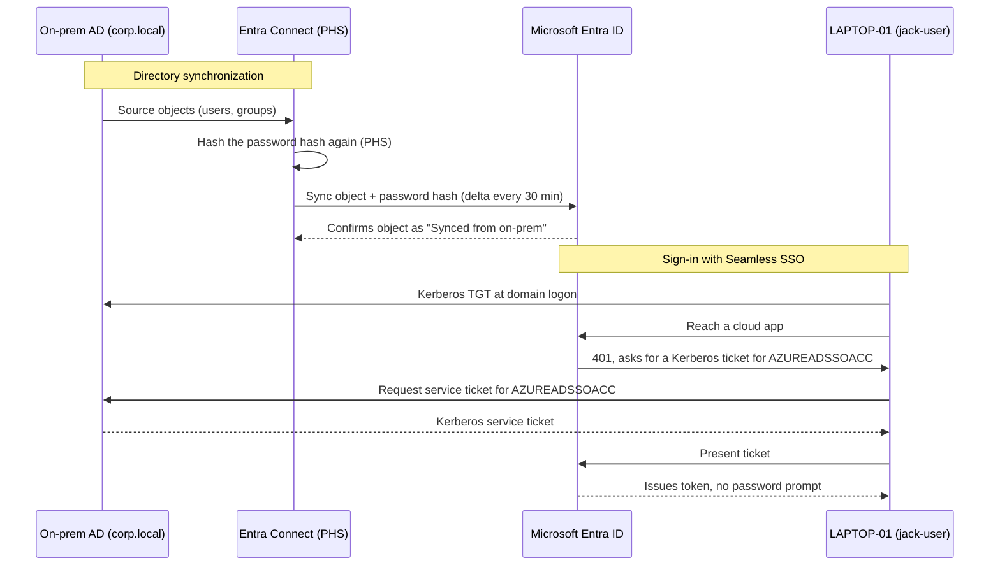

# Hybrid identity flow

How an on-prem `corp.local` account becomes a usable cloud identity, and how a domain-joined laptop signs in to cloud apps without a second password prompt.

Two things make this work without paid licensing:

- **Password Hash Sync** copies a re-hashed version of the on-prem password hash into Entra, so the same password works in both places. No federation servers to run.
- **Seamless SSO** installs a computer account (`AZUREADSSOACC`) in AD. Domain-joined, on-network machines get a silent token using their existing Kerberos ticket.

Hybrid Azure AD join is published through the Service Connection Point (SCP) that Entra Connect writes into the on-prem configuration partition, so domain-joined devices register themselves into Entra automatically.
