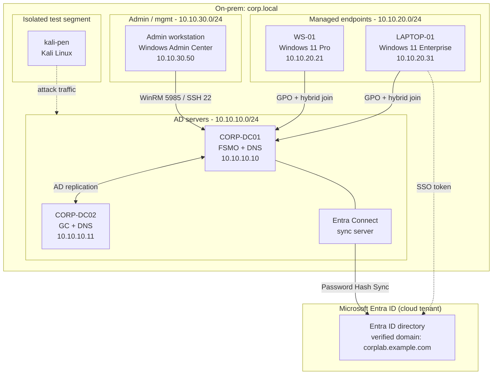

# Lab topology

Network and identity layout for the lab. On-prem segments are routed VLANs on the Proxmox cluster; the cloud side is a Microsoft Entra tenant reached over the internet from the sync server.

| Segment | Range | Hosts |
|---|---|---|
| AD servers | `10.10.10.0/24` | `CORP-DC01` (.10), `CORP-DC02` (.11), Entra Connect sync server |
| Managed endpoints | `10.10.20.0/24` | `WS-01` (.21), `LAPTOP-01` (.31) |
| Admin / management | `10.10.30.0/24` | Admin workstation running Windows Admin Center (.50) |
| Isolated test | separate segment | `kali-pen` |
