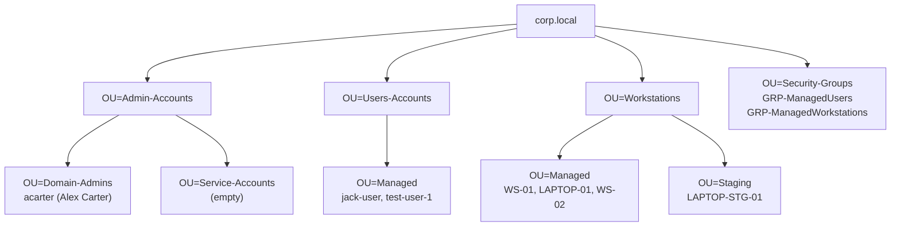

# OU and account structure

The `corp.local` organizational-unit tree. Accidental-deletion protection is enabled on every custom OU. Managed users and managed workstations sit in their own OUs so the restriction GPOs apply by location, not by hand-editing membership.

| Object | Type | Notes |
|---|---|---|
| `acarter` | User | Domain Admin. UPN `acarter.adm@corp.local`. Only member of Domain Admins |
| `jack-user` | User | Managed user. Member of `GRP-ManagedUsers`. Logon-hours enforced |
| `test-user-1` | User | Managed user. Member of `GRP-ManagedUsers` |
| `GRP-ManagedUsers` | Group | Apply target for `GPO-ManagedUsers-Restrictions` |
| `GRP-ManagedWorkstations` | Group | Tracks managed machines |
| `OU=Staging` | OU | Holding spot for a machine while an admin installs approved software, before it returns to Managed |
