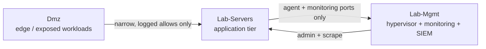

# 01 - Segmentation

I run an IPv4-only network split into twelve routed VLANs. Each one is a `/24` with a 24-hour DHCP lease, and each sits in a firewall zone that decides what it can reach. The point of splitting it this way is containment: a compromised IoT camera, a guest on the DMZ, or a misbehaving lab VM should not be one hop away from my domain controllers or my hypervisor management interfaces.

## The VLANs

| VLAN | Name | Subnet | Zone | What lives here |
|---|---|---|---|---|
| untagged | Management | 10.1.0.0/24 | Internal | gateway, switches, AP, NAS |
| 10 | Trusted | 10.10.0.0/24 | Internal | personal laptops, phones, tablets |
| 20 | IoT | 10.20.0.0/24 | Untrusted | smart-home gear, TVs, cameras (isolated) |
| 30 | DMZ | 10.30.0.0/24 | Dmz | a public game server |
| 40 | Personal-A | 10.40.0.0/24 | Internal | lab VMs (Docker hosts, Ansible, an AI box) |
| 50 | Secure | 10.50.0.0/24 | Internal | a hardened workstation |
| 60 | Secure Client | 10.60.0.0/24 | Internal | domain-joined client tier |
| 65 | AD-SERVERS | 10.65.0.0/24 | Internal | domain controllers |
| 66 | AD-ENDUSER | 10.66.0.0/24 | Internal | domain-joined endpoints |
| 70 | MGMT-A | 10.70.0.0/24 | Lab-Mgmt | hypervisor nodes, monitoring, SIEM |
| 80 | SERVERS-A | 10.80.0.0/24 | Lab-Servers | application servers |
| 90 | DMZ-A | 10.90.0.0/24 | Dmz | exposed edge workloads |

IoT is the only segment with client isolation turned on, so devices on it cannot talk to each other, only out through the gateway. The two AD VLANs (65 and 66) carry a Windows domain that I document in a separate repository; here they matter only as Internal-zone members that the lab tiers must not reach.

## The zones

VLANs decide addressing. Zones decide trust. I use the gateway's zone-based firewall with nine zones: seven that ship with it and two I created to wall off the lab compute.

| Zone | Type | Members |
|---|---|---|
| Internal | system | Management, Trusted, Personal-A, Secure, Secure Client, AD-SERVERS, AD-ENDUSER |
| Untrusted | system | IoT |
| Dmz | system | DMZ, DMZ-A |
| Lab-Mgmt | custom | MGMT-A |
| Lab-Servers | custom | SERVERS-A |
| Vpn | system | the WireGuard remote-user servers |
| External | system | the WAN |
| Gateway | system | the gateway's own services |
| Hotspot | system | unused |

The two custom zones are the reason the rest of the firewall stays readable. Instead of writing rules against individual VLAN numbers, I write them against `Lab-Mgmt` and `Lab-Servers`, and the membership decides which subnet that means.

## The three-tier model

The lab compute follows the same shape I would use for a small hosted service:

Edge workloads live in `Dmz`. The applications they front live in `Lab-Servers`. The plane that runs and watches all of it, the hypervisor nodes, Prometheus, and the Wazuh SIEM, lives in `Lab-Mgmt`. Traffic only crosses a tier boundary through an explicit, narrowly scoped allow rule, and the rule set is built so the edge can never reach back into the Internal zone. The exact policies that enforce this are in [chapter 02](02-firewall-policies.md).
