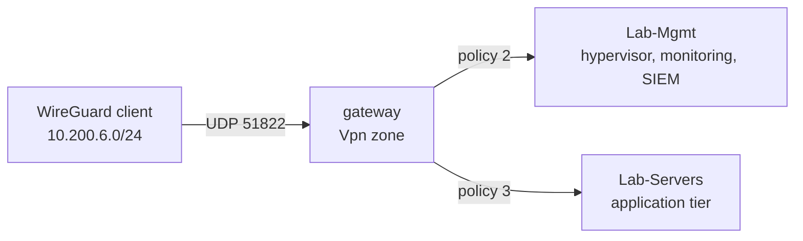

# 04 - Remote access

I do not forward any admin port to the internet, and I do not expose the hypervisor GUI or SSH to the LAN at large. When I need to manage the lab from outside the house, I come in over WireGuard and land in a zone that the firewall already trusts for management. The VPN is the front door; there is no second one.

## The WireGuard servers

All remote access is WireGuard, bound to the WAN interface, and every server sits in the `Vpn` firewall zone so the policies in [chapter 02](02-firewall-policies.md) apply to it uniformly.

| Server | Tunnel subnet | Listen port | State | Purpose |
|---|---|---|---|---|
| Management Access | 10.200.6.0/24 | UDP 51822 | enabled | primary admin path into the lab |
| Game-Access | 10.200.66.0/24 | UDP 51823 | enabled | reach game/voice hosts remotely |
| One-Click VPN | 10.200.12.0/24 | UDP 51820 | enabled | quick full-tunnel client config |
| Standby | 10.200.3.0/24 | UDP 51821 | disabled | spare profile, off unless needed |

There is also one outbound WireGuard client configured for egress through a commercial VPN; it is disabled and sits in the External zone when in use. Public keys are managed in the controller and are not reproduced here.

## The management path

The Management Access server is the one that matters. A client that connects to it gets an address in `10.200.6.0/24` and, through policies 2 and 3, can reach the `Lab-Mgmt` and `Lab-Servers` zones:

That means full remote administration of the management and server tiers, the hypervisor GUI, SSH to the nodes, the monitoring stack, without any of those services being reachable from the Trusted or IoT VLANs, let alone the WAN. The only inbound thing the WAN sees is the WireGuard listener itself and a single identity-sync port on the gateway (policy 1). Everything else an attacker would scan for is simply not there to find.

The host firewall on the hypervisor reinforces this from the other side: it accepts management traffic from the VPN subnet and drops SSH and the GUI from everywhere else. That layer is in [chapter 07](07-host-firewall.md).
