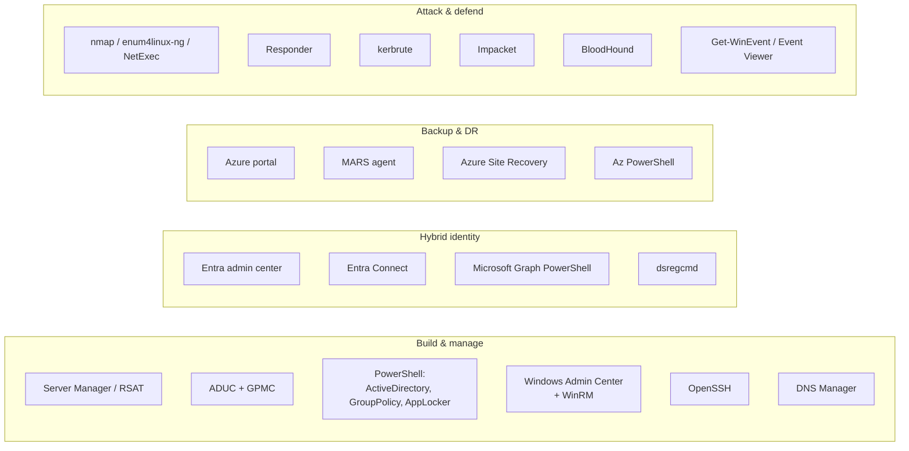

# Chapter 06 - Toolchain and walkthroughs

The earlier chapters say what I built. This one says what I built it *with*, and shows the actual click-path and command sequence for the tools that did the heavy lifting. The walkthroughs use the same sanitized values as the rest of the repo (`corp.local`, `CORP-DC01` at `10.10.10.10`, admin workstation at `10.10.30.50`, users `acarter` and `jack-user`).

## The toolset, by phase



| Tool | Phase | What I used it for |
|---|---|---|
| Server Manager, RSAT | Build | Add the AD DS role, manage remotely |
| AD Users and Computers (ADUC) | Build | OUs, accounts, group membership |
| Group Policy Management Console (GPMC) | Build | Author, link, and security-filter GPOs |
| PowerShell (`ActiveDirectory`, `GroupPolicy`, `AppLocker`) | Build | Scripted everything repeatable; see [scripts/](../scripts/) |
| Windows Admin Center + WinRM | Build | Browser-based DC management across subnets |
| OpenSSH | Build | Headless, key-based admin of DCs and workstations |
| Microsoft Entra Connect | Hybrid | Directory sync, Password Hash Sync, Seamless SSO |
| Microsoft Graph PowerShell | Hybrid | Verify synced objects from the cloud side |
| `dsregcmd` | Hybrid | Confirm hybrid Azure AD join on a device |
| Azure portal + MARS agent | DR | Recovery Services vault, DC system-state backup |
| Azure Site Recovery | DR | Whole-machine replication and test failover |
| nmap, enum4linux-ng, NetExec | Security | Recon and SMB enumeration |
| Responder | Security | LLMNR/NBT-NS poisoning |
| kerbrute | Security | Username enumeration and password spray |
| Impacket | Security | Kerberoasting and AS-REP roasting |
| BloodHound | Security | Graph attack paths |
| Get-WinEvent / Event Viewer | Security | Read the defensive evidence the attacks left |

---

## Walkthrough: GPMC, author and security-filter a restriction GPO

The goal: a GPO that applies only to members of `GRP-ManagedUsers`, not to everyone who logs on.

1. Open **Group Policy Management** (`gpmc.msc`). Expand `Forest: corp.local > Domains > corp.local`.
2. Right-click `OU=Managed,OU=Users-Accounts` and choose **Create a GPO in this domain, and Link it here**. Name it `GPO-ManagedUsers-Restrictions`.
3. Select the new GPO, open the **Scope** tab. Under **Security Filtering**, remove `Authenticated Users`, then **Add** `GRP-ManagedUsers`.
4. Open the **Delegation** tab > **Advanced**. Add `Authenticated Users` back with **Read** only (no Apply). This is required since the MS16-072 change: the computer needs Read to process the GPO, but only the group gets Apply.
5. Right-click the GPO > **Edit**, and set the user policies under `User Configuration`.
6. On a target machine, run `gpupdate /force`, then `gpresult /h C:\Temp\r.html` and confirm the GPO shows under **Applied GPOs**.

Result: the restrictions hit `jack-user` and `test-user-1`, while `acarter` signing in to the same machine is untouched.

## Walkthrough: PowerShell for repeatable hardening

The GUI is fine for one change. For 30 of them across two GPOs, it is a script. This is the pattern from [implement-gpo-hardening.ps1](../scripts/gpo-hardening/implement-gpo-hardening.ps1).

```powershell
Import-Module GroupPolicy, ActiveDirectory, AppLocker

# Registry-backed policy: turn on LSA protection in the workstation GPO
Set-GPRegistryValue -Name "GPO-ManagedWorkstations-Security" `
    -Key "HKLM\SYSTEM\CurrentControlSet\Control\Lsa" `
    -ValueName "RunAsPPL" -Type DWord -Value 1

# Export a before/after report as evidence
Get-GPOReport -Name "GPO-ManagedWorkstations-Security" -ReportType Html `
    -Path "C:\Temp\workstation-after.html"
```

Result: the same setting lands identically every run, and each change leaves an HTML report behind. Those exports are what became [evidence/gpo-reports/](../evidence/gpo-reports/).

## Walkthrough: Windows Admin Center over WinRM, across subnets

The problem I hit: Windows Admin Center on the admin workstation (`10.10.30.50`) could not reach `CORP-DC01` (`10.10.10.10`) because they sit on different subnets and the Public-profile firewall rule limits WinRM to the local subnet.

1. On the admin workstation, trust the DC for WinRM:
   ```powershell
   Set-Item WSMan:\localhost\Client\TrustedHosts -Value "10.10.10.10" -Force
   ```
2. On `CORP-DC01`, enable the predefined inbound rule **Windows Remote Management (HTTP-In)** for the Domain, Private, and Public profiles.
3. Scope the Public-profile rule to the admin workstation only: open its **Scope** tab and set the remote address to `10.10.30.50`.
4. Verify reachability and authentication:
   ```powershell
   Test-NetConnection 10.10.10.10 -Port 5985   # TcpTestSucceeded : True
   Test-WSMan 10.10.10.10                       # returns the WSMan identity
   ```
5. In Windows Admin Center, **+ Add > Servers**, enter `CORP-DC01`, and authenticate as `corp\Administrator`.

Result: full browser-based management of the DC. The connection uses port **5985** (HTTP) with NTLM over Negotiate, since a non-domain-joined workstation cannot use Kerberos against the DC.

## Walkthrough: OpenSSH for headless admin

1. On `CORP-DC01`, install and start the server:
   ```powershell
   Add-WindowsCapability -Online -Name OpenSSH.Server~~~~0.0.1.0
   Set-Service sshd -StartupType Automatic; Start-Service sshd
   ```
2. Allow only key-based auth: set `PubkeyAuthentication yes` and `PasswordAuthentication no` in `sshd_config`, place the public key in `administrators_authorized_keys`, and restart `sshd`.
3. Connect from the admin box:
   ```powershell
   ssh acarter@10.10.10.10
   ```

For workstations, the same install is delivered as a machine startup script through a GPO, so any machine that joins the managed OU gets it automatically. See [install-openssh-workstation.ps1](../scripts/gpo-hardening/install-openssh-workstation.ps1) and [deploy-managed-workstation-ssh-gpo.ps1](../scripts/gpo-hardening/deploy-managed-workstation-ssh-gpo.ps1).

## Walkthrough: Entra Connect for hybrid identity

1. On the domain-joined sync server, run the Entra Connect installer and choose **Customize** (not Express, so the sign-in method and SSO can be set).
2. **User sign-in:** select **Password Hash Synchronization** and tick **Enable single sign-on**.
3. Connect to Entra with a Global Administrator, then connect to the on-prem forest with an Enterprise Admin.
4. **Domain and OU filtering:** sync only `OU=Users-Accounts` and `OU=Security-Groups`, not the whole directory.
5. **Device options:** enable **Hybrid Azure AD join**, which writes the Service Connection Point into the on-prem configuration partition so domain-joined devices register themselves.
6. Finish the wizard, then force the first sync:
   ```powershell
   Import-Module ADSync
   Start-ADSyncSyncCycle -PolicyType Initial
   ```

Result: on-prem users appear in Entra as directory-synced, and domain-joined machines get silent SSO. Full detail in [chapter 03](03-hybrid-identity-entra.md).

## Walkthrough: Microsoft Graph PowerShell to verify sync

```powershell
Connect-MgGraph -Scopes "User.Read.All"
Get-MgUser -Filter "userPrincipalName eq 'jack-user@corplab.example.com'" `
    -Property DisplayName, OnPremisesSyncEnabled, OnPremisesLastSyncDateTime |
    Select-Object DisplayName, OnPremisesSyncEnabled, OnPremisesLastSyncDateTime
```

Result: `OnPremisesSyncEnabled = True` confirms the account is mastered on-prem and flowed up through Entra Connect, rather than being a cloud-only account.

## Walkthrough: Azure Backup (MARS) for the DC

1. In the Azure portal, create a **Recovery Services vault** (`rsv-corplab`).
2. From the vault, download the **MARS agent** installer and the **vault credentials** file.
3. On `CORP-DC01`, install the agent and register it with the credentials file. Set an encryption passphrase and store it offline; without it, restores are impossible.
4. In the MARS console, choose **Schedule Backup**, select the **System State** item, and set the schedule and retention.
5. Choose **Back Up Now**, then confirm completion under the vault's **Backup jobs** in the portal.

Result: daily system-state recovery points for the DC, which is the supported way to protect AD. Restore-test detail is in [chapter 04](04-backup-and-disaster-recovery.md).

## Walkthrough: the offensive tools

> Lab only. Everything below ran against my own domain on an isolated segment. The full sequence is in [scripts/attack-defend/attack-chain.sh](../scripts/attack-defend/attack-chain.sh).

- **Responder** answers poisoned LLMNR/NBT-NS lookups to capture a `NetNTLMv2` hash:
  ```bash
  sudo responder -I eth0 -wv
  ```
  Defense: turn off multicast name resolution by GPO.

- **kerbrute** enumerates valid usernames, then sprays one password across all of them:
  ```bash
  kerbrute passwordspray -d corp.local --dc 10.10.10.10 users.txt 'Spring2026!'
  ```
  Defense: the account-lockout policy turns this into locked accounts and `4740` events.

- **Impacket** requests Kerberos service tickets for SPN accounts to crack offline:
  ```bash
  GetUserSPNs.py corp.local/jack-user -dc-ip 10.10.10.10 -request
  ```
  Defense: no service accounts with weak passwords, so nothing worth roasting.

- **BloodHound** collects the directory and graphs attack paths:
  ```bash
  bloodhound-python -d corp.local -u jack-user -p '<lab-pw>' -c All -ns 10.10.10.10
  ```
  Then import the JSON into the BloodHound GUI and run **Shortest Paths to Domain Admins**. Result: nothing from a managed user, because only `acarter` is privileged.

## Walkthrough: Get-WinEvent for the blue-team side

```powershell
# Lockouts the spray triggered
Get-WinEvent -FilterHashtable @{LogName='Security'; Id=4740}

# Kerberos service-ticket requests (the Kerberoast attempt)
Get-WinEvent -FilterHashtable @{LogName='Security'; Id=4769} -MaxEvents 50
```

Result: the attacks are visible from the defender's chair as concrete event IDs, which is what closes the loop in [chapter 05](05-attack-and-defend.md). The full set of checks is in [blue-team-verification.ps1](../scripts/attack-defend/blue-team-verification.ps1).
