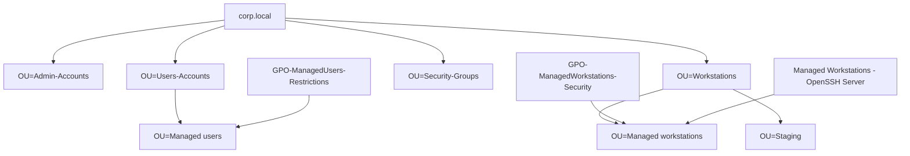

# Chapter 07 - Managed Windows fleet hardening

Chapter 02 is the broad GPO hardening overview. This chapter is the closer
record of the managed-fleet model I built afterward: separate user and computer
policy, a staging OU for admin work, credential controls on the workstation
side, and AppLocker rules that block the places a standard user can write to.

The endpoint I had in mind was not a clean lab VM. It was the kind of shared
laptop that drifts unless policy keeps pulling it back: browser settings change,
downloaded launchers appear, local accounts linger, and the machine leaves the
domain network. I treated that laptop as untrusted and made the domain the
source of truth.

## Design Goal

I split the design into two questions.

The first question was what follows the person. Managed users needed a tight
desktop, a browser that defaults to deny, hidden account and admin settings,
and blocked management tools. That became `GPO-ManagedUsers-Restrictions`,
linked to `OU=Managed,OU=Users-Accounts` and security-filtered to
`GRP-ManagedUsers`.

The second question was what follows the machine. Managed workstations needed
credential hardening, local administrator control, removable-storage controls,
Wi-Fi controls, AppLocker, and remote administration. That became
`GPO-ManagedWorkstations-Security`, linked to `OU=Managed,OU=Workstations`.



The staging OU mattered more than I expected. When I needed to install approved
developer tools as an admin, I could move the laptop into `OU=Staging`, do the
work, then move it back to `OU=Managed,OU=Workstations` and force policy again.
That gave me a clean exception path instead of weakening the managed OU.

## User Policy

The user GPO handles the session surface. I kept coding shells available because
the managed account still needed to write code, but I blocked the Windows tools
that would let that account change the machine or inspect policy internals.

| Control area | Final state |
|---|---|
| Registry Editor | Blocked with `DisableRegistryTools = 2` |
| Task Manager | Blocked with `DisableTaskMgr = 1` |
| Password change UI | Hidden with `DisableChangePassword = 1` |
| MMC snap-ins | Restricted with `RestrictToPermittedSnapins = 1` |
| Admin tools | `mmc.exe`, `msconfig.exe`, `control.exe`, `gpedit.msc`, `secpol.msc`, and `lusrmgr.msc` blocked through `DisallowRun` |
| Coding shells | Command Prompt, PowerShell, Windows Terminal, and Run allowed after testing the coding workflow |

That last row is the trade-off. My first instinct was to block every shell. In
practice, that made the managed account useless for the coding work it was
supposed to support. I moved the control down a layer: keep the shells, then use
AppLocker and browser policy to stop the risky paths those shells could reach.

## Workstation Policy

The workstation GPO carries the controls that should apply before any user
session starts.

| Control | Setting | Reason I added it |
|---|---|---|
| Local Administrators | Restricted to `CORP\Domain Admins` | Remove drift from local group membership. |
| Built-in Administrator | Disabled | Avoid a predictable local break-glass account. |
| Cached logons | `CachedLogonsCount = 0` | Stop offline sign-in from bypassing domain policy. |
| Unlock behavior | `ForceUnlockLogon = 1` | Require the DC when unlocking a workstation session. |
| WDigest | `UseLogonCredential = 0` | Keep plaintext credentials out of LSASS memory. |
| LSA protection | `RunAsPPL = 1`, `RunAsPPLBoot = 1` | Make LSASS harder to read even with an admin token. |
| Domain credential storage | `DisableDomainCreds = 1` | Reduce saved credential exposure. |
| USB storage | `USBSTOR` startup disabled | Remove removable storage as an easy copy-in/copy-out path. |
| AutoRun and AutoPlay | Disabled on all drives | Stop automatic execution from removable media. |
| Windows Installer | Per-user installs and elevated MSI behavior disabled | Remove common privilege-escalation paths. |

I verified these from the endpoint side rather than trusting the GPO editor.
The checks that mattered were the registry values under `HKLM`, the effective
AppLocker policy, the browser policy hives, and the exported GPO reports under
`evidence/gpo-reports/`.

## AppLocker Evolution

AppLocker started as audit work. I wanted to see what would break before I
enforced anything. The final model was targeted deny, not a full application
inventory:

| Rule type | Allowed | Denied |
|---|---|---|
| Executables | Windows, Program Files, and local administrators | Downloads, Desktop, Temp, `AppData\Local\Programs`, OneDrive Downloads/Desktop, and named launcher paths |
| Scripts | Windows, Program Files, and local administrators | User-writable paths |
| MSI installers | Windows, Program Files, and local administrators | User-writable paths |
| DLLs | Windows, Program Files, and local administrators | User-writable paths |
| Packaged apps | Signed packaged apps | Store and game access handled by user and browser policy |

The useful part is the shape of the deny rules. I did not need to list every app
on the machine. I needed to block execution from the places a standard user can
write to and add named denies for launchers that users tend to sideload. The
rule summary is in
[`applocker-targeted-deny-rules.md`](../evidence/gpo-reports/applocker-targeted-deny-rules.md).

## Browser and Settings Controls

Chrome and Edge both landed on the same policy stance: `URLBlocklist = *`, then
an allowlist for account sign-in, productivity, coding practice, developer
documentation, research, approved AI tools, and the support domains those sites
need. Extensions use the same pattern: block all, then allow and force-install
only uBlock Origin Lite and Google Docs Offline.

The browser policy also disables Sync, Guest mode, adding a new browser person,
Incognito, and history deletion. I disabled Edge launch for managed users so I
only had one browser path to validate during testing.

For Windows Settings, I moved from a tiny allowlist to a more practical one:
display and projection, Bluetooth and printers, accessibility, default apps,
sound, notifications, Windows Update visibility, selected privacy pages, and
basic personalization. I left account management, sign-in options, local users,
remote desktop, developer settings, and advanced network configuration hidden.

## Validation

The final checks were intentionally boring. I wanted settings that showed up in
plain commands and exported reports.

```powershell
gpupdate /force
gpresult /h C:\Temp\managed-workstation.html
Get-AppLockerPolicy -Effective -Xml
Get-ItemProperty "HKLM:\SYSTEM\CurrentControlSet\Control\Lsa" -Name RunAsPPL
Get-ItemProperty "HKLM:\SOFTWARE\Microsoft\Windows NT\CurrentVersion\Winlogon" -Name CachedLogonsCount
Get-ItemProperty "HKLM:\Software\Policies\Google\Chrome" -Name URLBlocklist
```

The result was a managed workstation model I could explain and test: the user
GPO limits the session, the computer GPO hardens the machine, AppLocker blocks
user-writable execution, browser policy defaults to deny, and the staging OU
keeps admin maintenance from weakening the managed OU.

## What This Proves

This build shows Group Policy used as an endpoint control system, not a settings
checklist. I started with the real ways the endpoint could drift, separated user
controls from machine controls, tested the impact, and kept the policy evidence
exported so each claim points back to a concrete GPO report or script.
