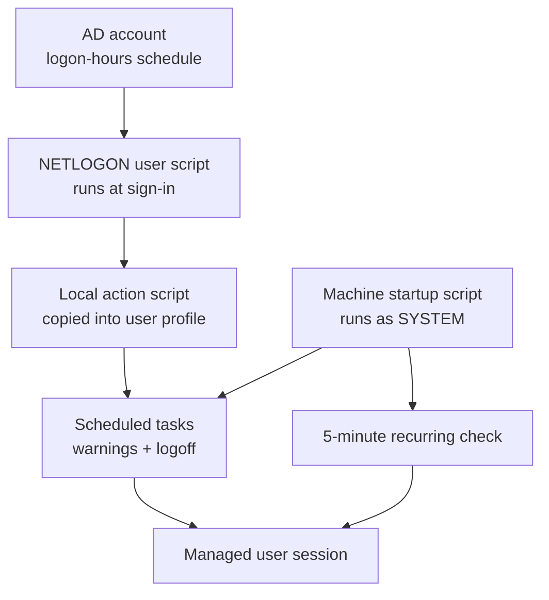

# Chapter 08 - Logon-hours enforcement offline

Active Directory logon hours looked simple until I tested the laptop away from
the domain network. The domain could stop a fresh sign-in outside the allowed
window, but it did not solve the harder case: a managed user already signed in,
the laptop disconnected, and the cached session kept running past cutoff.

This chapter is the fix I built after that test failed.

## The Failure Mode

The managed account had a domain logon-hours schedule:

| Days | Allowed window | Warning times | Forced logoff |
|---|---|---|---|
| Sunday | 06:00 to 22:00 | 21:30, 21:50, 21:55 | 22:00 |
| Monday through Thursday | 15:00 to 21:00 | 20:30, 20:50, 20:55 | 21:00 |
| Friday | 15:00 to 22:00 | 21:30, 21:50, 21:55 | 22:00 |
| Saturday | 06:00 to 22:00 | 21:30, 21:50, 21:55 | 22:00 |

The policy was correct on the domain account, but the behavior was incomplete.
AD logon hours decide whether authentication is allowed. They do not, by
themselves, keep checking an already-running local session every minute. A
laptop that still had cached credentials could also authenticate while it was
offline unless the workstation policy removed that cache.

The first real fix was setting `CachedLogonsCount = 0`, enabling
`ForceUnlockLogon = 1`, and forcing the workstation to wait for the network at
startup and logon. That closed the offline sign-in path. I still needed a
session enforcer for the case where the user was already logged on.

## Layered Enforcement

I ended up using two layers because each one covers a different failure mode.



The user-context layer is created at sign-in. A NETLOGON wrapper starts a
PowerShell registration script. That script creates scheduled tasks for the
warning messages and final logoff, then copies the action script into the
user's local profile. The copy matters because the laptop may be disconnected
when the cutoff arrives.

The machine-context layer is the stronger one. A startup script from
`GPO-ManagedWorkstations-Security` registers tasks as `SYSTEM` under the
`\CORP\` task folder. One task runs every five minutes and checks whether the
managed account has an interactive session outside the allowed window. If it
does, the script sends a short warning and logs off the session by ID.

## Why SYSTEM Was Needed

The user-context tasks were useful for warnings, but they still depended on the
managed user's session being healthy. A standard user can also create strange
edge cases by sleeping the laptop, disconnecting, or staying signed in across a
policy refresh.

Running the recurring check as `SYSTEM` moved enforcement to the machine. The
script does not need the user's token. It asks Windows who is signed in with
`quser.exe`, finds the managed account, and calls `logoff.exe` against that
session ID.

The sanitized implementation lives in:

- [`logon-hours-machine-register.ps1`](../scripts/gpo-hardening/logon-hours-machine-register.ps1)
- [`logon-hours-machine-action.ps1`](../scripts/gpo-hardening/logon-hours-machine-action.ps1)
- [`logon-hours-machine-register.cmd`](../scripts/gpo-hardening/logon-hours-machine-register.cmd)

The registration script creates the recurring task and the timed warning tasks:

```powershell
Register-CorpTask 'Jack Logon Hours Enforce Every 5 Minutes' 'MINUTE' '' '' 'enforce'
Register-CorpTask 'Jack Logon Hours Warning 30 Mon-Thu' 'WEEKLY' 'MON,TUE,WED,THU' '20:30' 'warn30_2100'
Register-CorpTask 'Jack Logon Hours Logoff Mon-Thu' 'WEEKLY' 'MON,TUE,WED,THU' '21:00' 'logoff_2100'
Register-CorpTask 'Jack Logon Hours Warning 30 Fri-Sun' 'WEEKLY' 'FRI,SAT,SUN' '21:30' 'warn30_2200'
Register-CorpTask 'Jack Logon Hours Logoff Fri-Sun' 'WEEKLY' 'FRI,SAT,SUN' '22:00' 'logoff_2200'
```

The action script keeps the enforcement decision small:

```powershell
default {
  if (-not (Is-JackAllowedNow)) {
    Logoff-Jack 'CORP logon hours are not active right now. This session is being logged off.'
  }
  exit 0
}
```

## Timezone Bug

The part that cost me the most time was not the scheduled-task code. It was the
domain controller clock. The DC was evaluating the account schedule against the
wrong time zone, so a schedule that looked right in the UI did not line up with
the intended local cutoff.

I corrected the DC to `Eastern Standard Time`, then re-saved the managed user's
logon-hours schedule. That made the displayed schedule and the enforcement
clock agree. Without that step, the scripts could be correct and the policy
would still feel wrong to the person using the laptop.

## Verification

I verified the control in layers:

```powershell
net user jack-user /domain
gpupdate /force
shutdown /r /f /t 5
schtasks /Query /TN "\CORP\Jack Logon Hours Enforce Every 5 Minutes"
Get-ItemProperty "HKLM:\SOFTWARE\Microsoft\Windows NT\CurrentVersion\Winlogon" -Name CachedLogonsCount
```

After reboot, the managed laptop returned on SSH, the workstation GPO applied,
the local-only account path was removed, and the scheduled tasks existed under
`\CORP\`. The important result was not the task list by itself. The important
result was that the machine-side task had enough privilege to log off the
managed session even when domain connectivity was not available.

## What This Proves

This was a small control with a real engineering lesson: the setting with the
right name was not the whole solution. I had to test the offline case, remove
cached logons, fix the DC time source, and add a machine-side enforcer that
could act without the user's cooperation. That is the difference between a
checkbox and a control that holds on a laptop.
