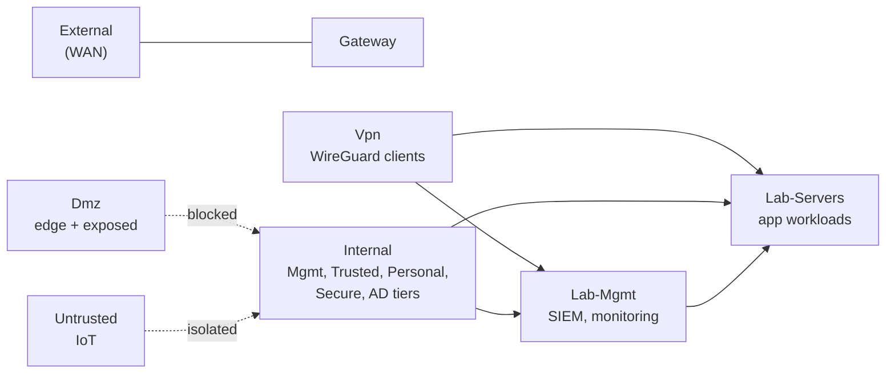
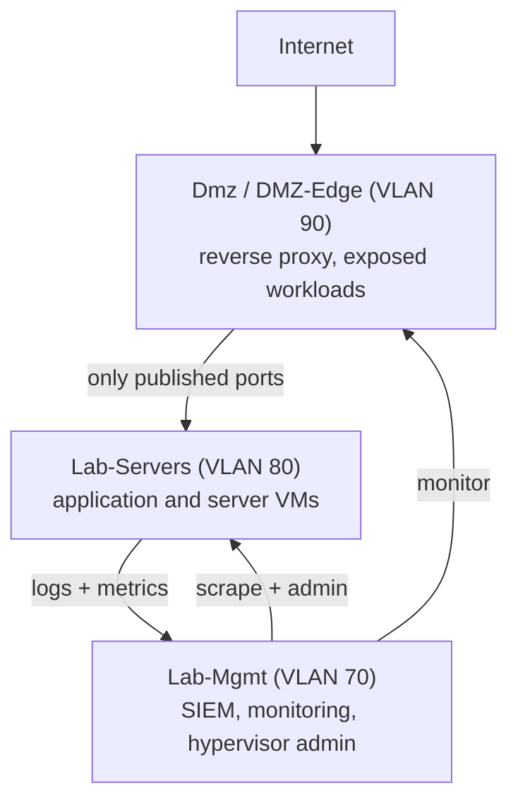
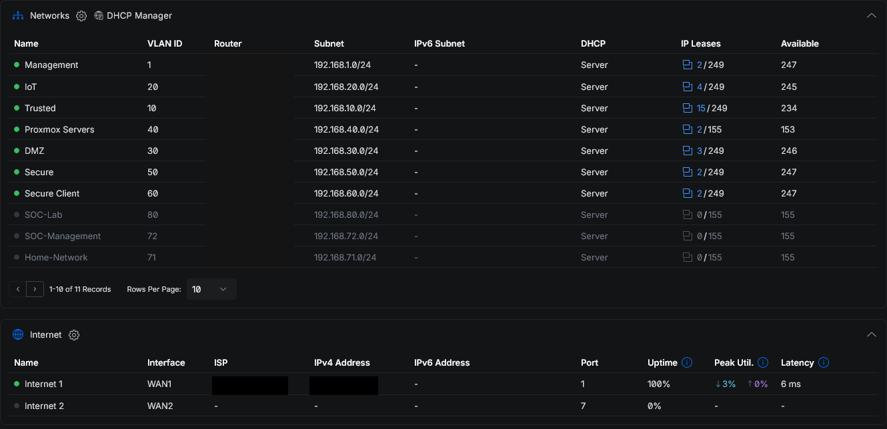
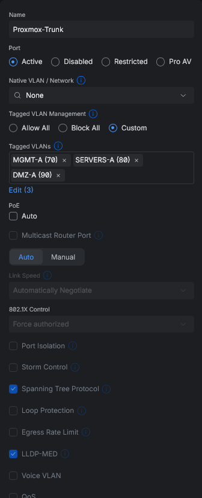

# Segmentation and zoning

This is the foundation the rest of the network sits on. The goal was to take a flat LAN and break it into segments that match how I actually use the network, then group those segments into trust zones so the firewall has something coarse to reason about instead of forty individual rules. By the end there were twelve routed VLANs, nine firewall zones, and a three-tier model for the lab compute.

## Why segment at all

On the flat network, my IoT plugs, my workstation, the hypervisor management interface, and anything a guest brought into the house all shared one broadcast domain and one subnet. A compromised smart bulb could reach the Proxmox web UI. There was no place to stand that was more trusted than any other.

Segmentation fixes that by giving each class of device its own VLAN and its own subnet, and forcing all traffic between them through the gateway, where the firewall can allow or deny it. The design rule I settled on: **a device lives in the lowest-trust VLAN that still lets it do its job**, and crossing between VLANs is denied unless a policy says otherwise.

## The VLAN layout

Twelve routed VLANs, each a `/24`, each with its own DHCP scope. The management network is untagged (native) so the infrastructure stays reachable even if VLAN tagging is misconfigured on a port.

| VLAN | Name | Subnet | Zone | Purpose |
|---|---|---|---|---|
| 1 (untagged) | Management | 192.168.1.0/24 | Internal | UniFi devices, switch and AP management |
| 10 | Trusted | 192.168.10.0/24 | Internal | My own workstations and phones |
| 20 | IoT | 192.168.20.0/24 | Untrusted | Smart-home devices, network isolation on |
| 30 | DMZ | 192.168.30.0/24 | Dmz | Internet-exposed services |
| 40 | Personal | 192.168.40.0/24 | Internal | Shared household devices and a Docker host |
| 50 | Secure | 192.168.50.0/24 | Internal | Hardened admin endpoints |
| 60 | Secure-Client | 192.168.60.0/24 | Internal | Domain-joined clients (DNS points at the AD server) |
| 65 | AD-Servers | 192.168.65.0/24 | Internal | Active Directory domain controllers |
| 66 | AD-Endusers | 192.168.66.0/24 | Internal | Managed end-user accounts |
| 70 | Lab-Mgmt | 192.168.70.0/24 | Lab-Mgmt | SIEM, monitoring, hypervisor administration |
| 80 | Lab-Servers | 192.168.80.0/24 | Lab-Servers | Application and server workloads |
| 90 | DMZ-Edge | 192.168.90.0/24 | Dmz | Reverse-proxy and edge workloads |

The Active Directory tiers (VLANs 65, 66, 60) are the subject of a separate build; the directory design, hybrid sync, and conditional access live in my [Hybrid Azure AD lab](https://github.com/Duresa7/Hybrid-Azure-AD-Lab). Here they matter only as routed segments with their own DNS.

DHCP hands out 1.1.1.1 and 8.8.8.8 on the general VLANs and the internal AD DNS server (192.168.65.10) on the domain segments, so domain clients resolve internal names and everything else uses public resolvers. IPv6 is off on every VLAN; I did not want a second addressing plane to firewall before the v4 one was solid.

## Trust zones

UniFi's zone-based firewall lets me assign each VLAN to a zone and then write policy between zones instead of between networks. Nine zones, seven of them built in and two I created:

`Internal`, `Untrusted`, `Dmz`, `Vpn`, `External`, `Gateway`, and `Hotspot` are the system zones. The two I added, `Lab-Mgmt` and `Lab-Servers`, exist so the lab compute is not lumped in with my personal devices in the `Internal` zone. They carve the hypervisor environment into its own trust boundary, which is what makes the three-tier model below possible.

## The three-tier compute model

The lab compute follows a tiered pattern borrowed from how production application stacks are separated: an edge tier that faces the internet, an application tier behind it, and a management tier that watches both and that nothing reaches except from trusted places.

The direction of trust runs inward and the direction of data runs outward. The edge can reach specific ports on the app tier but cannot reach management. The app tier ships its logs up to the SIEM in the management tier but cannot administer it. The management tier reaches down into both to scrape metrics and administer, and is itself only reachable from `Internal` and over the VPN. The exact policies that enforce this are in [project 02](../02-zone-based-firewall/README.md).

## Carrying the segments: switching and wireless

Segments are only as good as the ports and radios that carry them, so part of this work was making sure each VLAN is presented where it should be and nowhere else.

**Port profiles** on the switches define what a port carries:

- *Management* trunks all VLANs and is used for switch-to-switch and switch-to-gateway uplinks.
- *Trusted* and *IoT* are access profiles that drop a device straight onto VLAN 10 or VLAN 20 with no tagging.
- *Proxmox-Trunk* is a custom trunk for the hypervisor uplinks that carries only the VLANs the cluster actually serves (40, 60, 65, 70, 80, 90) and explicitly excludes Management, IoT, Trusted, DMZ, Secure, and AD-Endusers. A compromised VM cannot tag itself onto a VLAN that never reaches its host.

A trimmed access-switch baseline that mirrors this layout is in [configs/switch-baseline.cfg](../../configs/switch-baseline.cfg): SSH-only management, a management SVI on the native VLAN, access ports pinned to their VLAN, and an uplink trunk with an explicit allow-list.

**Wireless** maps each SSID to a single VLAN at the access point, so the radio a device joins decides its segment:

| SSID | VLAN | Notes |
|---|---|---|
| Home-WiFi | 10 (Trusted) | WPA2-PSK, my own devices |
| IoT-WiFi | 20 (IoT) | client isolation on, no peer-to-peer |
| Endpoint-WiFi | 66 (AD-Endusers) | domain-joined clients |
| Lab-IoT | Management | disabled unless needed |

Client isolation on IoT-WiFi means two smart devices on the same radio cannot talk to each other, only to the gateway, which then applies the IoT zone's outbound-only policy.

## What this gave me

A device's position on the network now determines what it can reach, and that position is set in three places that all agree: the VLAN it is addressed in, the switch port or SSID that admits it, and the zone its VLAN belongs to. A smart plug on IoT-WiFi lands in VLAN 20, in the `Untrusted` zone, isolated from its neighbors and allowed out to the internet but not into any internal segment. The hypervisor management interface lands in `Lab-Mgmt`, reachable only from `Internal` and the VPN. The flat network's single trust level became twelve, and the firewall in [project 02](../02-zone-based-firewall/README.md) is what holds the lines between them.

## Files in this project

- [`../../configs/switch-baseline.cfg`](../../configs/switch-baseline.cfg) - the IOS switch baseline (VLANs, pruned trunk, SSH-only) that carries these segments.
- [`sources.md`](sources.md) - 802.1Q, zero-trust, and UniFi/Cisco references.

## Evidence

*The routed VLANs on my controller, each with its VLAN ID, name, and `/24` subnet - the segmentation this whole project is about.*

*The selective hypervisor trunk: tagged VLANs set to Custom (the lab tiers) rather than "Allow All," so the uplink carries only the VLANs the cluster serves. This is an earlier snapshot showing a subset of those tiers.*
