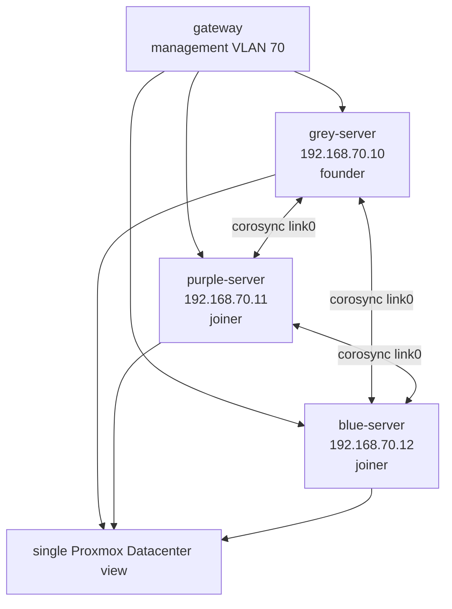

# Proxmox cluster build

I started this build with one Proxmox node, `grey-server`, already carrying my live lab workloads. The goal was to add `purple-server` and `blue-server` without changing the management model: one Datacenter view, three nodes, and a host firewall that still treated the hypervisor plane as a restricted surface. I was not building HA or shared storage in this pass. I was building a clean management cluster with quorum, migration groundwork, and the same defense-in-depth posture from [project 05](../05-hypervisor-host-firewall/README.md).

## Starting state

`grey-server` was the founder of the `Galaxy` cluster. It was a single-node cluster with corosync and pmxcfs already in place, but it had stale history from an older topology. Before I let another node join it, I cleaned the old identity out of the cluster:

- the corosync ring address was moved to the live management network;
- old host and firewall references from a retired node were removed;
- duplicate repository entries were cleaned up;
- the management bridge standard was documented for the two new nodes.

The new nodes were empty Proxmox installs. That mattered because a node with existing guests cannot safely join a cluster. I checked `qm list` and `pct list` on each joiner before I did anything irreversible.

## Topology



All three nodes sit on the management VLAN (`192.168.70.0/24`).

## Pre-flight checks

I made the join boring on purpose. On each node, I checked the same things before changing cluster membership:

```bash
pveversion | head -1
qm list
pct list
timedatectl | grep -E "synchronized|Time zone"
```

The joiners were empty, the Proxmox versions matched, time sync was active, and hostnames were unique. That left two risks to handle before the join: authentication and the host firewall.

## Why I used SSH for the join

My first API-based join attempt hit two blockers. The API fingerprint check did not match the certificate I expected, and the API path still wanted the founder node's root password. I did not want to carry that password through the workflow, so I switched to the SSH-based join.

That made the requirements clearer:

- each joining node needed passwordless root SSH to `grey-server`;
- the founder needed to trust the joiner public keys;
- the host firewall had to allow the joiners to reach SSH on the founder.

The key material itself is not published. The private keys stay out of the repo, and Task 50 moved live SSH material into quarantine before this authoring pass.

## The firewall issue that blocked the join

The existing host firewall did exactly what I had built it to do: it dropped SSH unless the source was already in the `zero_access` allowlist. The new nodes were not on that list, so `pvecm add` could not complete. Editing an inactive helper group would not have changed anything, because the active enforcement point was `zero_access`.

I backed up the cluster firewall config, added the three cluster node sources above the final SSH drop, compiled the firewall, and restarted it:

```bash
pve-firewall compile
pve-firewall restart
pve-firewall status
```

The snippet is in [zero-access-cluster-join.fw](zero-access-cluster-join.fw). It keeps the same shape as project 05: specific accepts first, final drops last.

## Joining one node at a time

I joined `purple-server` first:

```bash
pvecm add 192.168.70.10 --link0 192.168.70.11 --use_ssh
```

After it joined, I checked quorum before touching `blue-server`:

```bash
pvecm status
```

Then I repeated the same process for `blue-server`:

```bash
ssh -o StrictHostKeyChecking=accept-new -o BatchMode=yes root@192.168.70.10 hostname
pvecm add 192.168.70.10 --link0 192.168.70.12 --use_ssh
```

Adding one node at a time kept the failure domain small. If the second join had failed, I would still have known the two-node state was healthy.

## Stale node cleanup

After the cluster was healthy, I removed two empty node directories left from earlier installs. I checked for guest configs first, then deleted only the empty directories:

```bash
find /etc/pve/nodes/<stale-node>/qemu-server /etc/pve/nodes/<stale-node>/lxc -type f | wc -l
rm -rf /etc/pve/nodes/<stale-node>
```

The final `/etc/pve/nodes/` view contained only `grey-server`, `purple-server`, and `blue-server`.

## Verification

The final checks were cluster membership, corosync config, and quorum:

```bash
pvecm status
pvecm nodes
grep -E "name:|cluster_name:|config_version:" /etc/pve/corosync.conf
```

The result was a three-node `Galaxy` cluster:

| Check | Result |
|---|---|
| Nodes | `grey-server`, `purple-server`, `blue-server` |
| Expected votes | 3 |
| Total votes | 3 |
| Quorum | 2 |
| Quorate | Yes |
| Cluster config version | 6 |

The existing guests on `grey-server` stayed online during the join. That was the part I cared about most: the cluster became more resilient without turning the running lab into the test case.

## What this changed

The management plane now has an odd number of votes and can tolerate one node being unavailable while remaining quorate. The host firewall still gates SSH and the Proxmox GUI, and the cluster join rule is scoped to the three node addresses instead of opening SSH to the management VLAN. This is the same design instinct as the rest of this repository: routing, host firewalling, and identity checks each get their own chance to say no.
