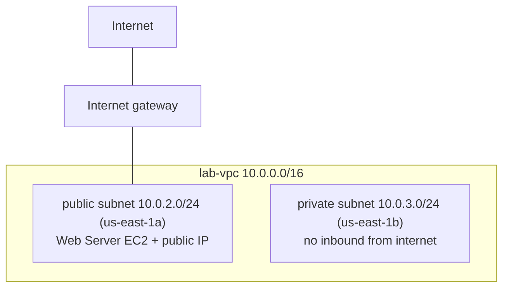
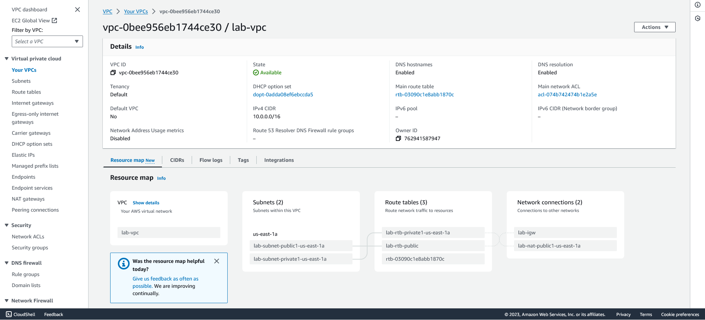
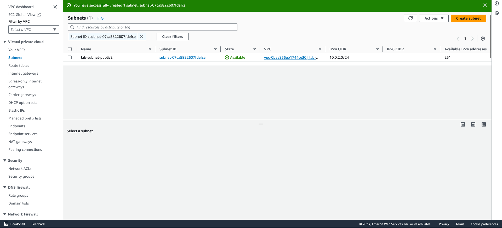
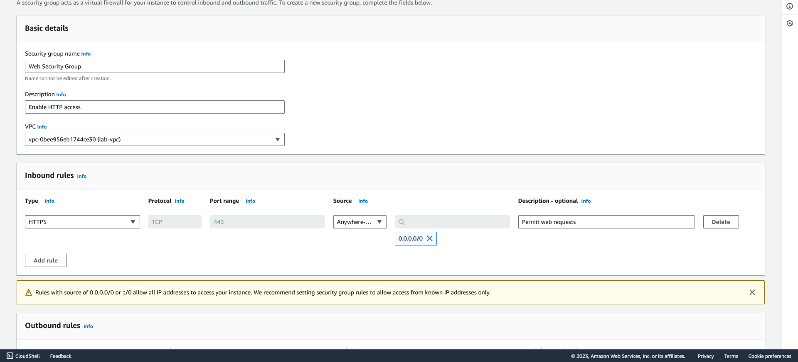
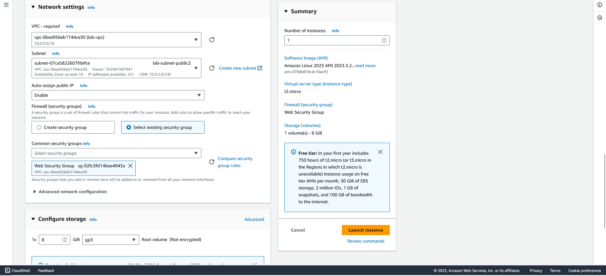
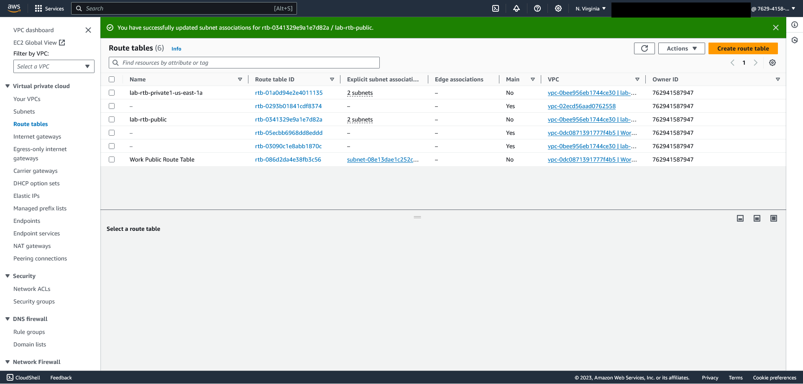

# AWS custom VPC and web server

This is the cloud-networking project everything else builds on. I started from an empty region and built a virtual private cloud up to a working web server that the internet could reach: a VPC with its own address space, a public and a private subnet, routing, a security group, and an EC2 instance serving a page. It is the cloud version of the segmentation and edge work I do on my [home network](https://github.com/Duresa7/Network-Lab), and doing it by hand is what made the pieces click.

## The target architecture

The split is the whole point: the public subnet has a path to the internet, the private subnet does not. What you put where decides what is reachable, before any firewall rule is written.

## Building the VPC

In the `us-east-1` (N. Virginia) region, I created the VPC with a `10.0.0.0/16` address space, which leaves room for plenty of `/24` subnets inside it. I enabled DNS hostnames and DNS resolution so instances get resolvable names, and left tenancy default.

Then two subnets in different availability zones, so the design can survive one AZ going down:

| Subnet | CIDR | AZ | Role |
|---|---|---|---|
| lab-subnet-public | 10.0.2.0/24 | us-east-1a | internet-facing |
| lab-subnet-private | 10.0.3.0/24 | us-east-1b | internal only |

A `/24` out of a `/16` gives each subnet 251 usable addresses after AWS reserves five, which is the kind of subnetting arithmetic I work through by hand in my [network lab](https://github.com/Duresa7/Network-Lab/blob/main/projects/07-ipv4-addressing-design/README.md).

## Routing: what makes a subnet "public"

A subnet is not public because of its name; it is public because its route table sends unknown traffic to an internet gateway. I attached an **internet gateway** to the VPC, then worked with the route tables:

- **lab-rtb-public** carries a route for `0.0.0.0/0` pointing at the internet gateway, and I associated the public subnet with it. That single route is what lets the web server answer traffic from the internet.
- **lab-rtb-private** has no such route, so the private subnet's traffic has nowhere to go but inside the VPC.

Associating the right subnet with the right route table is the step people skip and then wonder why their instance is unreachable. The console confirmed the association applied to the public route table.

## The security group

With routing in place, the security group decides which ports are open. I created **Web Security Group** with one inbound rule:

| Type | Protocol | Port | Source |
|---|---|---|---|
| Web (HTTPS) | TCP | 443 | 0.0.0.0/0 |

Source `0.0.0.0/0` means anyone, which is correct for a public web server and wrong for almost anything else. A security group is stateful, so the matching return traffic is allowed automatically and I did not need an outbound rule for replies. This is the cloud analogue of a firewall policy: the route table gets the packet to the subnet, the security group decides whether the instance accepts it.

## Launching the web server

The EC2 instance pulled it together:

- **AMI:** Amazon Linux 2023
- **Type:** t2.micro
- **Network:** the `lab-vpc`, in `lab-subnet-public`
- **Auto-assign public IP:** enabled (so it gets a routable address)
- **Security group:** the existing Web Security Group
- **Storage:** an 8 GiB gp3 root volume
- **User data:** a boot script that installed and started the web server, so the instance came up already serving a page rather than needing me to log in and configure it

Auto-assigning the public IP plus the public subnet's route to the gateway is what made it reachable; a script in user data is what made it useful the moment it booted.

## Verifying it worked

I verified the build the way that actually matters: I loaded the web server's page from its public address. Six things had to be right for that to work, and the page coming back proves all of them at once: the VPC, the two subnets, the subnet-to-route-table association, the security group, the EC2 instance, and the public route to the internet gateway. A single HTTP response only returns if the gateway, the public route, the subnet placement, the public IP, and the security group are all correct together.

## What it maps to

Every piece here has a counterpart in network design I already understood, which is why building it cemented the cloud model:

| AWS construct | What it is, in plain terms |
|---|---|
| VPC | your own private network with its own address space |
| Subnet | a segment of that space, pinned to an availability zone |
| Route table | the routing decision that makes a subnet public or private |
| Internet gateway | the edge router to the public internet |
| Security group | a stateful, instance-level firewall |

The private subnet sitting there with no route out is the same instinct as the management tier on my home network: the most protected place is the one with no path to the outside, and you only open a path when something has a reason to need it.

## Files in this project

- [`commands.md`](commands.md) - the AWS CLI equivalent of the whole console build.
- [`sources.md`](sources.md) - AWS VPC, security-group, and CLI references.
- `evidence/` - console screenshots of the build (below).

## Evidence

Screenshots from the AWS console as I built it, from an AWS sandbox account (a temporary lab account, not a personal one). This is the approved evidence set for the VPC build: the console shots prove the resource configuration, while the workbench and portal pages stay out because they add no infrastructure proof and carry account context. The account-menu login email is removed from every shot - cropped off the earlier captures, blacked out on the route-tables capture - while the temporary lab account ID is left visible.

*`lab-vpc` (`vpc-0bee956eb1744ce30`), IPv4 CIDR `10.0.0.0/16`, DNS enabled, and the resource map showing the public/private subnets, route tables, and the internet gateway.*

*The public subnet created: `lab-subnet-public2`, `10.0.2.0/24`, in `us-east-1a`, 251 usable addresses.*

*The security group: inbound web (HTTPS/443) from `0.0.0.0/0`, scoped to `lab-vpc`.*

*Launching the web server: Amazon Linux 2023 (`ami-079db87dc4c10ac91`), t2.micro, into `lab-subnet-public2` with auto-assign public IP enabled, the Web Security Group attached, and an 8 GiB gp3 root volume.*

*The route tables after associating the public subnet: the banner confirms the association applied to `lab-rtb-public`, the table whose `0.0.0.0/0` route to the internet gateway is what makes the public subnet reachable. The Owner column shows the temporary lab account ID; the account-menu email is blacked out.*
