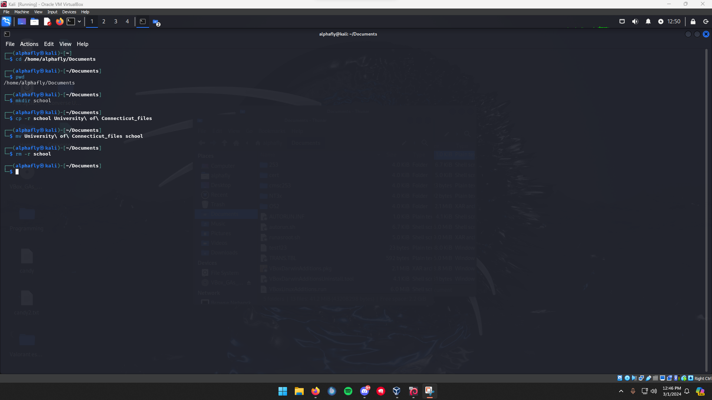
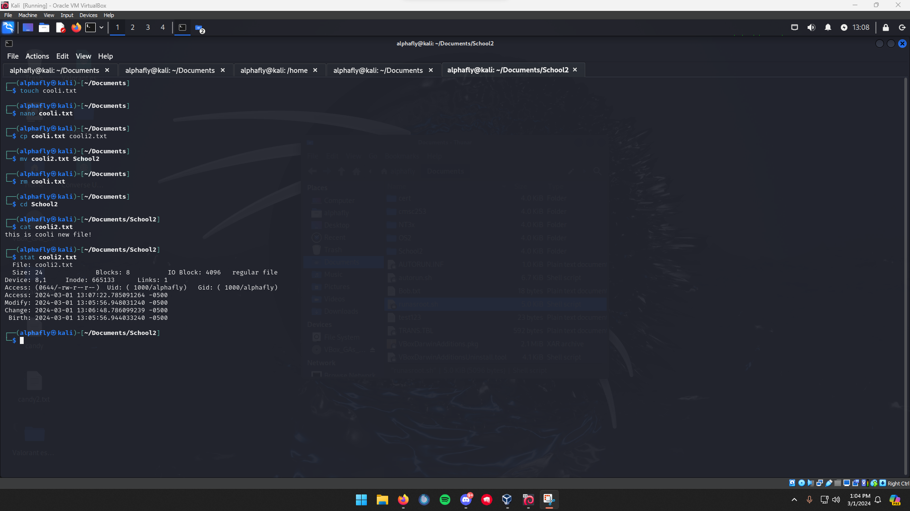
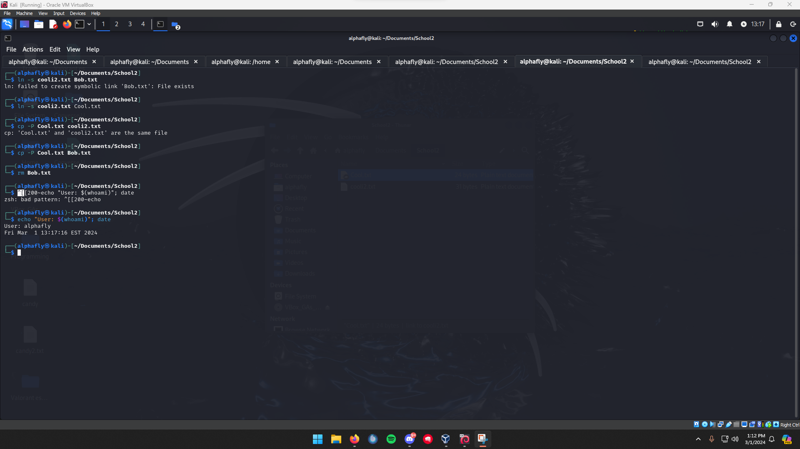

# Linux command-line fundamentals

When I started working seriously in Linux I made a rule for myself: do everything from the terminal, even the things a file manager would do faster. The point was to build the muscle memory I would need later on headless servers, where there is no desktop to fall back on. This project is the record of that, run on a Kali Linux VM. The exact commands are collected in [commands.md](commands.md).

## Getting oriented and asking for help

The first thing I needed was a reliable way to answer my own questions. `man` opens the full manual for a command, and `--help` gives the short version when I only need to remember a flag. Between the two I could work out most things without leaving the shell.

Moving around came next. `pwd` prints where I am, `cd` changes directory, and `ls` lists what is there. `cd -` jumps back to the previous directory, which turned out to be the shortcut I used most once I was bouncing between two folders. I leaned on `ls -1` to get one entry per line when a wide listing was hard to read.

## Creating and managing files and directories

With navigation sorted, I worked through the full life cycle of a file and a directory so nothing about it was a mystery later.

For directories I created one with `mkdir`, copied it (and its contents) with `cp -r`, renamed it by moving it with `mv`, and removed it with `rm -r`. For files I created an empty one with `touch`, opened it to add content, copied it with `cp`, renamed it with `mv`, read it back with `cat`, and looked at its metadata (size, timestamps, inode) with `stat`. Seeing `stat` output is what made permissions and ownership concrete for me later.

Links were the part I had not used before. `ln -s` creates a symbolic link that points at another file by name, so the link breaks if the target moves. I made one, then used `cp -P` to copy the link itself rather than the file it pointed to, which is the distinction that matters when you are backing up a directory full of symlinks. I closed the exercise with `echo "User: $(whoami)"; date` to print who I was logged in as and the current time, a small habit that is useful at the top of any script.

## Editing files in the terminal

I used `nano` as my terminal editor. The loop was simple and I repeated it until it was automatic: open the file with `nano`, make the edit, save and exit with `Ctrl + X`, then confirm the change with `cat`. As a concrete exercise I created a text file, added the current date to it, saved, and read it back to verify the date was written. Knowing one terminal editor cold is the difference between fixing a config file over SSH and being stuck.

## Searching the filesystem

The last piece was finding things. I split this into finding files and finding text.

For files I used `find`, which walks the tree live and filters on name, type, or time, and `locate`, which is near-instant because it reads a prebuilt index. To find where a program lives I used `which`, `whereis`, and `type`. A trailing wildcard like `ls *.txt` was enough when I only wanted everything of one extension in the current folder.

For text inside files I used `grep`, then `egrep` and `fgrep` when I wanted extended regular expressions or a plain fixed-string match. `diff` rounded it out by showing exactly what changed between two versions of a file, which is the fastest way to see what an edit actually did.

## Files in this project

- [commands.md](commands.md) - every command from this project, grouped by task.
- [sources.md](sources.md) - the references I used.

## Evidence

Screenshots from my own Kali Linux VM. My handle `alphafly` and the internal lab paths are shown on purpose as proof the work is mine; the prose above uses placeholder names.

*Creating a directory with `mkdir`, copying it with `cp -r`, renaming it with `mv`, and listing the result.*

*Copying, moving, and reading a file, then inspecting its metadata (size, timestamps, owner) with `stat`.*

*Creating a symbolic link with `ln -s`, copying the link itself with `cp -P`, and printing the current user and date.*
