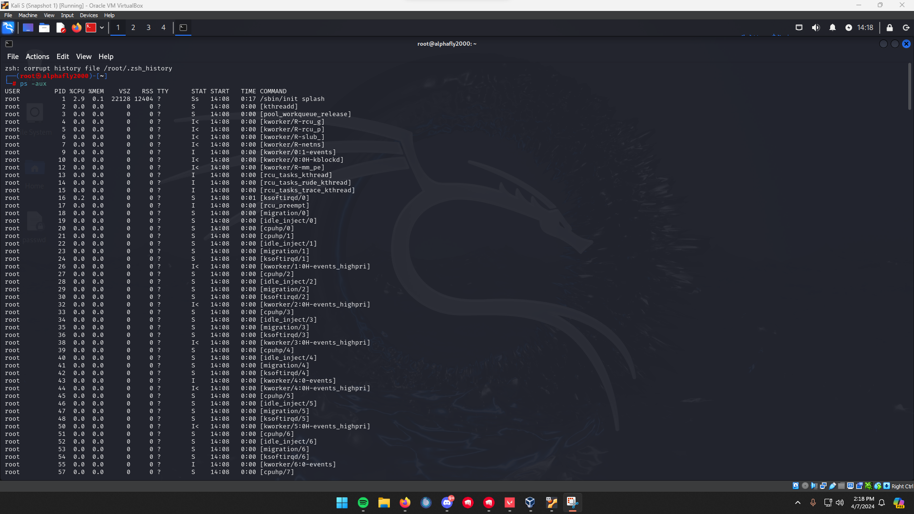
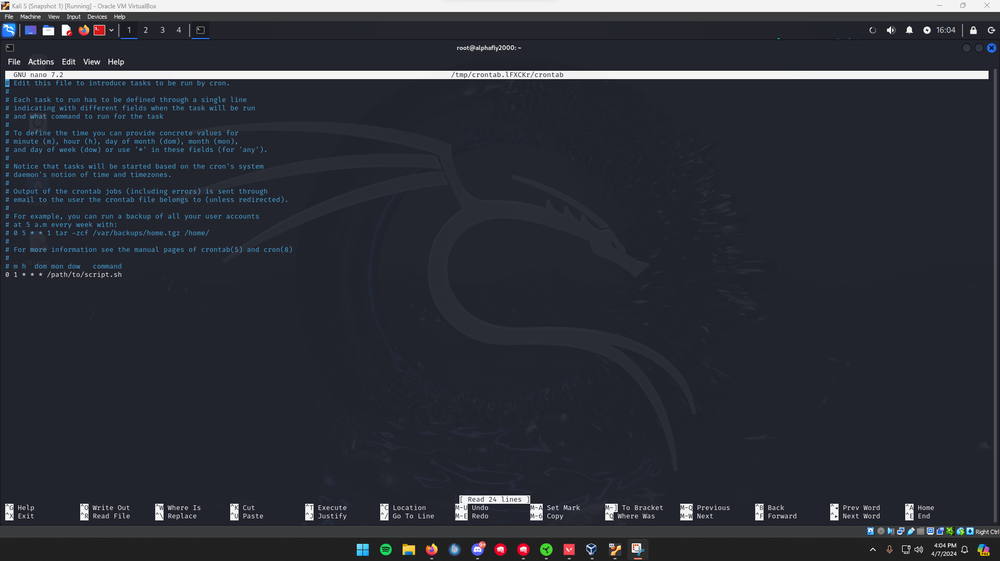
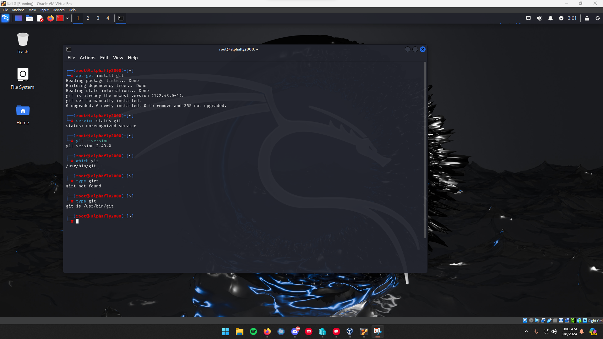
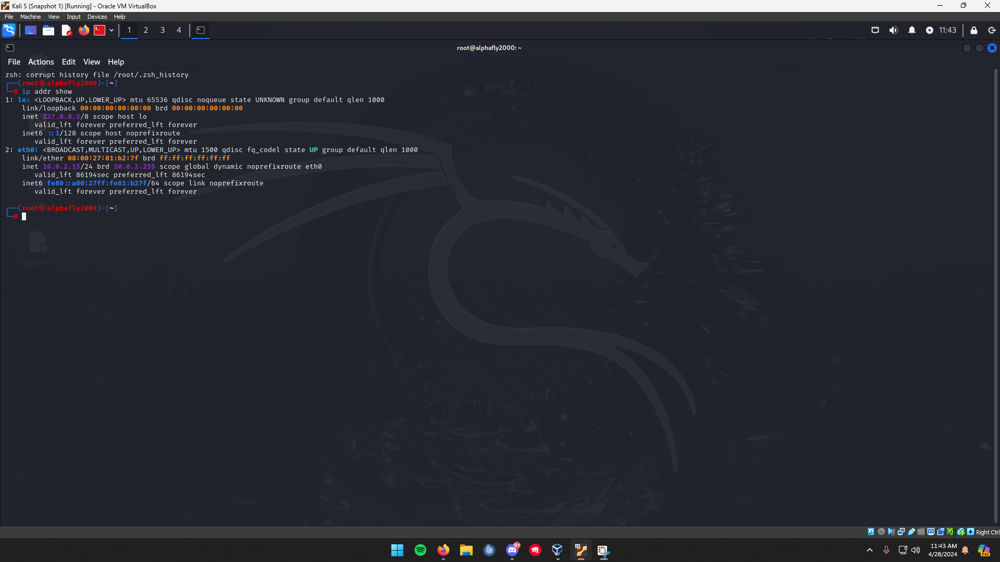
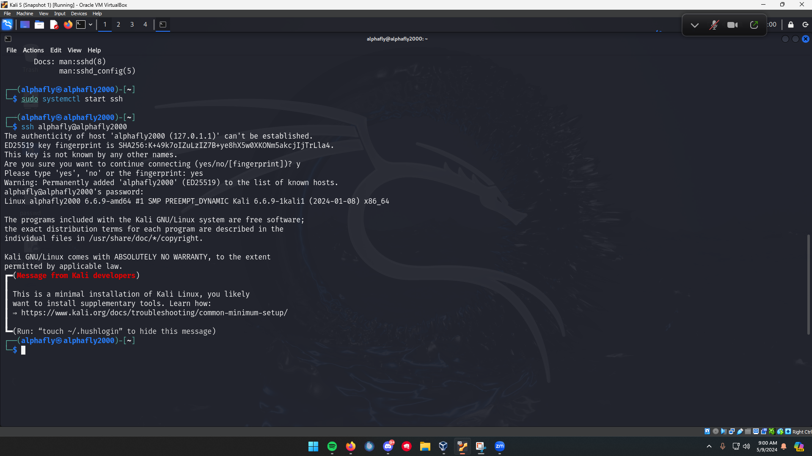

# Linux system administration

Once I was comfortable moving around the shell, I moved on to the tasks that actually keep a machine running: deciding who can touch what, watching and controlling processes, scheduling work, installing software, and checking the network. This is the record of that work on a Kali Linux VM. The exact commands are in [commands.md](commands.md).

## File ownership and permissions

Every file in Linux has an owner, a group, and three sets of read/write/execute bits. I started by reading the current state with `ls -l`, then changed it deliberately.

I locked a file down to read-only for everyone with `chmod 444`, confirmed it with `ls -l`, then opened it back up to `755` so the owner could write and everyone could read and run it. Working in octal forced me to actually understand the bits rather than guessing at `+x` flags. I changed the owner with `chown` and the group with `chgrp` so I could see how access followed ownership rather than the file itself.

The part I had not done before was access control lists. `chmod` only covers owner, group, and other; when I needed to grant one specific user read access without touching any of that, I used `setfacl -m u:<user>:r` and then read the result back with `getfacl`. ACLs are how you handle the real-world case of "this one account needs in, and nobody else's access should change."

## Watching and controlling processes

A process is a running program with its own PID. `ps aux` gave me the full snapshot of everything running, and `top` was the live view I left open to watch CPU and memory move in real time. `pstree` showed the same processes as a parent/child tree, which made it obvious how a shell spawns its children.

When I needed to stop something, I read its PID out of `ps` or `top` and ended it with `kill`. I also kept `df -h` in this section because checking free disk space in human-readable units is part of the same "is this box healthy" habit as checking processes.

## Scheduling jobs and keeping time

For recurring work I used cron. `crontab -e` opens the schedule in an editor, and a line like `0 1 * * * /path/to/script.sh` runs a script every day at 1 AM. `crontab -l` lists what is currently scheduled so I could confirm the job took.

Scheduled jobs are only as trustworthy as the clock behind them, so I also set up time sync. I installed the NTP service with `apt-get install ntp` and synchronized against upstream time servers, which keeps timestamps in logs and cron runs consistent.

## Installing and removing software

I worked through the full package life cycle on Debian's `apt` using Git as the example. I checked whether it was installed with `git --version` (and confirmed the binary's path), refreshed the package index with `apt-get update`, installed with `apt-get install`, verified the version, and then removed it again with `apt-get remove`. Doing the install and the uninstall both meant I understood how to undo a change, not just make one.

## Checking the network from the command line

When something will not connect, the terminal answers faster than any GUI. I read the host's own addressing with `ip addr`, tested reachability and round-trip time with `ping -c 4 example.com`, and listed active sockets and listening ports with `ss`. For name resolution I used `nslookup example.com` to map a name to an address, and `traceroute example.com` to see the hops in between and where latency showed up. Those five commands cover most of "why can't this machine reach that one."

## Connecting to remote hosts with SSH

Almost all of this is meant to run on machines I am not sitting in front of, so SSH ties it together. The basic form is `ssh username@hostname`. When a server listens on a non-standard port I added `-p` (for example `ssh -p 2222 username@hostname`), and when a connection failed I ran it again with `-v` to get the verbose handshake and authentication log, which is where I could actually see why it was being refused. The hardening side of SSH (keys, disabling password auth, restricting access) lives in my [Network-Lab](https://github.com/Duresa7/Network-Lab).

## Files in this project

- [commands.md](commands.md) - every command from this project, grouped by task.
- [sources.md](sources.md) - the references I used.

## Evidence

Screenshots from my own Kali Linux VM. My handle `alphafly`, the loopback address, and the internal lab addresses are shown on purpose as proof; the prose above uses placeholders.

*The running-process snapshot from `ps aux`, with the user, PID, resource use, and command for each.*

*Editing the schedule with `crontab -e`: the five-field format and an example job set to run daily.*

*Working through a package with `apt-get` and confirming the installed version.*

*Reading the VM's own interfaces and addresses with `ip addr`.*

*Starting the SSH service and connecting over SSH, accepting the host key on the first connection.*
