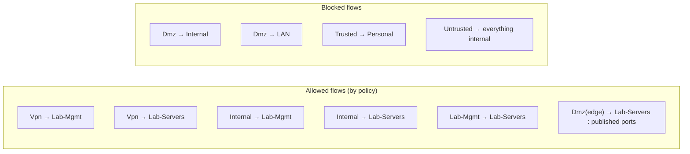
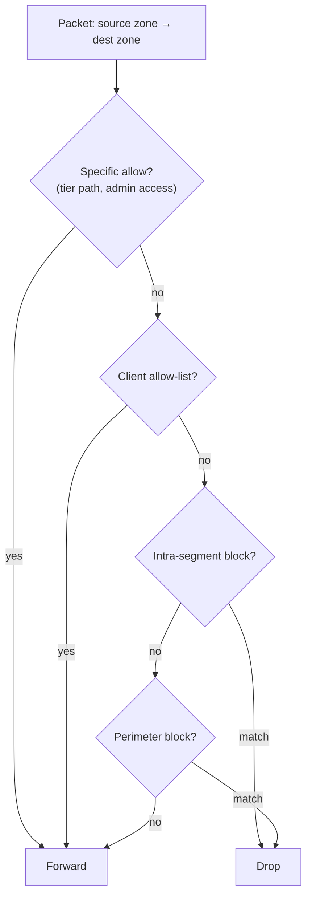

# Zone-based firewall

With the network split into zones ([project 01](../01-segmentation-and-zoning/README.md)), the next job was writing the policy that governs traffic between them. I run a zone-based firewall on the gateway with seventeen user-defined policies on top of the default inter-zone matrix. This is a walkthrough of how the rule set is built, the inter-zone allow matrix it produces, and the reasoning behind the allows and the blocks that matter.

## The default posture

UniFi's zone firewall starts from a matrix where every source zone has a default action toward every destination zone. I set the baseline so that the only traffic crossing zones is traffic I have explicitly allowed. The blocks that enforce the perimeter of the lab compute and the IoT segment are real policies, not just defaults, so they are visible and logged rather than implicit.

## The allow matrix, by intent

I group the seventeen policies by what they are for rather than by their order in the list. Each allow exists to let one tier do one job.

### Reaching the management and server tiers

These let the people and machines that should administer the lab in, and keep everyone else out.

| Policy | Source | Destination | Ports | Logged |
|---|---|---|---|---|
| Allow VPN to Lab-Mgmt | Vpn | Lab-Mgmt | all | |
| Allow VPN to Lab-Servers | Vpn | Lab-Servers | all | |
| Allow Internal to Lab-Mgmt | Internal | Lab-Mgmt | all | |
| Allow Internal to Lab-Servers | Internal | Lab-Servers | all | |
| Allow Lab-Mgmt to Lab-Servers | Lab-Mgmt | Lab-Servers | all | |
| Device Access to Proxmox | Internal (4 admin clients) | Lab-Mgmt | 22, 8006 | |

The Proxmox-admin policy is scoped to four specific client devices rather than the whole `Internal` zone, using a firewall group of just SSH (22) and the Proxmox web UI (8006). Even from a trusted segment, only the machines I administer from can open the hypervisor's management surface.

### The three-tier data path

These three policies are what actually implement the edge → app → management flow from [project 01](../01-segmentation-and-zoning/README.md). They are the most specific rules in the set because they cross trust boundaries.

| Policy | Source | Destination | Ports | Logged |
|---|---|---|---|---|
| Allow DMZ to Lab-Servers | Dmz edge host (10.90.0.10) | Lab-Servers (VLAN 80) | tcp | yes |
| Allow Lab-Servers to Wazuh | Lab-Servers | SIEM (10.70.0.20) | 1514, 1515 | |
| Allow DMZ to Wazuh | Dmz edge host | SIEM (10.70.0.20) | 1514, 1515 | yes |
| Allow Mgmt to DMZ monitoring | Lab-Mgmt | edge host (10.90.0.10) | 9100 | yes |
| Allow Lab-Servers to Portainer Edge | Lab-Servers | Docker host (10.40.0.35) | 8000, 9443 | yes |

Reading them together: the reverse proxy in the DMZ can reach the application tier, but only from the one edge host and the traffic is logged. Both the edge and the app tier ship logs up to the Wazuh SIEM on its agent ports (1514/1515). The management tier reaches back down to scrape Prometheus metrics from the edge (9100) and to talk to the Portainer edge agent. Each port number is defined once in a named firewall group (Wazuh Ports, Proxmox-Admin-Ports, Portainer Edge Agents, Identity Sync), so the policies reference intent, not magic numbers.

### Letting trusted clients reach selected segments

| Policy | Source | Destination | Notes |
|---|---|---|---|
| DMZ Allow List | Internal (3 clients) | Dmz | only named admin devices may reach the DMZ |
| Allow Devices to Personal | Internal (named clients) | Personal (VLAN 40) | shared-device access |
| Allow Identity Sync Service Connection | External | Gateway | port group 9543, for a cloud identity connector |

### The blocks that hold the lines

| Policy | Action | Source | Destination |
|---|---|---|---|
| Block Trusted to Personal | block | Trusted (VLAN 10) | Personal (VLAN 40) |
| Block DMZ to Internal | block | Dmz | Internal |
| Block DMZ to LAN | block | Dmz | Internal (all LAN networks) |

The two DMZ blocks are the important ones. If something in the DMZ is compromised, the firewall's first job is to make sure it cannot pivot inward. Both are explicit, both sit at the high-priority end of the rule order, and the inbound-from-DMZ direction is denied outright. The edge host's one allowed path (to the app tier and the SIEM, above) is the single exception, scoped to specific destinations and ports.

## How a packet is evaluated

Policies carry an index that orders them. The specific allows for the three-tier path and the admin access sit near the top (index 10000), the broader client allow-lists below them (10001), the intra-segment blocks below that (10002), and the perimeter DMZ blocks at the far end (40000+) where they catch anything the earlier rules did not explicitly permit. The effect is a first-match evaluation where a packet from the DMZ to an internal host never finds an allow and falls through to the block.

## What I check it against

After every change I sanity-check three things: the DMZ cannot reach any internal host except the one allowed app-tier path; the IoT zone reaches the internet and nothing else; and the management tier is unreachable from anywhere but `Internal` and the VPN. Those three invariants are the whole point of the segmentation, and the policy set is written so they hold by default rather than by the absence of a mistake.
