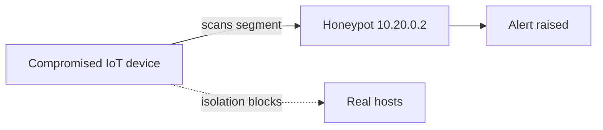
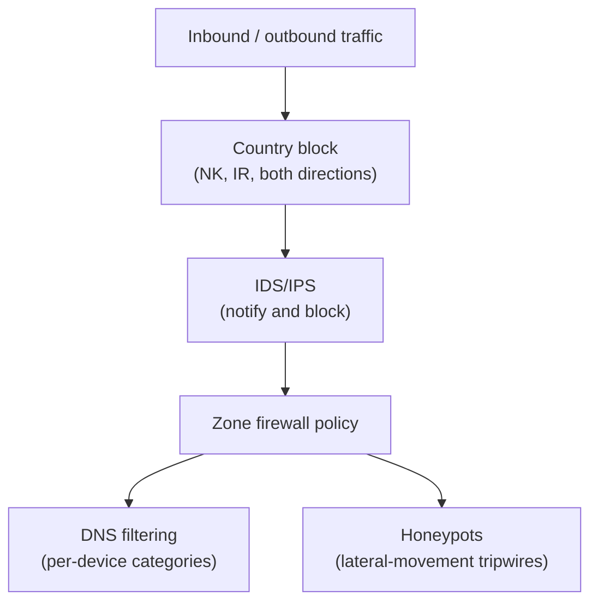

# Threat management

Segmentation and firewall policy decide who can talk to whom. This project is about what happens inside the traffic that is allowed: inspecting it for known-bad patterns, cutting off whole regions I never expect to hear from, planting tripwires for lateral movement, and filtering DNS so some devices cannot resolve what I do not want them reaching. It runs on the gateway's built-in IDS/IPS plus a few features layered on top.

## Intrusion prevention

The gateway runs signature-based intrusion prevention in **Notify and Block** mode, so a matching signature both raises an alert and drops the packet rather than only logging it. Signatures update automatically; at the time of the last audit they had refreshed the same day.

Inspection is pointed at the segments where untrusted or exposed traffic actually flows (Management, DMZ, IoT, Trusted, Secure) rather than at every VLAN, which keeps the gateway from inspecting traffic that never leaves a trusted tier. The detection categories I keep enabled:

| Category | Why it is on |
|---|---|
| Botnets | catches command-and-control callbacks from a compromised device |
| Malware | known malicious payloads in transit |
| Hacking / Exploits | exploitation attempts against services |
| Reconnaissance | scanning and enumeration |
| P2P / Dark Web | traffic I do not expect from any device here |
| Protocol vulnerabilities | malformed or abusive protocol use |

### Exclusions

A few hosts are excluded from inspection on purpose, because their normal behavior trips signatures or because inspecting them adds latency with no benefit:

- the first management VPN client (10.200.6.2), which generates admin traffic that looks like scanning when I sweep the network;
- a hardened admin endpoint on the Secure VLAN (10.50.0.241);
- the internal AD DNS server (10.65.0.10), whose query volume is high and trusted.

Each exclusion is a deliberate trade, documented here so I remember why inspection has a hole in it.

## Country blocking

The gateway blocks traffic to and from countries I have no reason to exchange packets with, in both directions, at the edge before inspection. I block **North Korea** and **Iran** outright. This is not a claim that threats only come from there; it is removing a class of inbound noise and outbound callback destinations cheaply, so the IPS has less to chew on. It is the firewall equivalent of not answering numbers from area codes I never call.

## Honeypots

I run honeypots on three segments as tripwires for lateral movement:

| Segment | Honeypot address |
|---|---|
| Management | 10.1.0.2 |
| IoT | 10.20.0.2 |
| DMZ | 10.30.0.2 |

Nothing legitimate ever connects to these addresses. They host no real service and are not referenced by any record. So any connection attempt to one of them is, by definition, something probing the network from the inside, and it generates an alert the moment it happens. A honeypot on the Management and DMZ segments is the cheapest early warning I know of: an attacker who has landed somewhere and is looking around will find the decoy before they find anything that matters.

## DNS content filtering

On top of the network controls, I filter DNS for selected client devices so they cannot resolve categories I want kept off those devices. One profile blocks adult and advertising categories and forces SafeSearch on Google and YouTube; it is applied to specific client devices rather than a whole VLAN. A second profile blocks ads for one device. Encrypted DNS resolution upstream uses Cloudflare and Google resolvers.

I also block specific application categories (for example online games) for a named client device through the gateway's application-blocking feature, which classifies traffic by app signature rather than by port. This is content policy rather than security policy, but it lives in the same place and uses the same zone model, so it belongs in the same picture.

## Logging

Flow logging is set to record all traffic, with logs kept on the gateway and a 30-day manual retention. The policies that cross trust boundaries (the three-tier data path, the DMZ allows, the management monitoring path) are individually flagged to log, so the records that matter most for an investigation are the inter-zone events rather than the routine intra-zone chatter. NetFlow export and SNMP are off; I did not want either surface open without a consumer for it.

## How the layers stack

Geography is cut first because it is the cheapest filter. What survives is inspected. What passes inspection is still subject to zone policy. DNS filtering and the honeypots sit alongside as content control and detection. No single layer is trusted to be complete; each one removes a different slice of risk.
