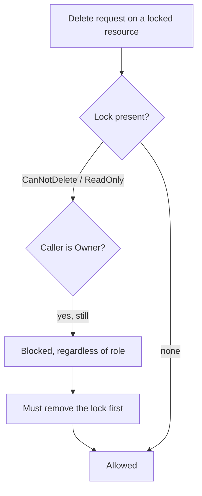

# Azure resource governance

The AWS projects were about building infrastructure. This one is about controlling it: how Azure organizes resources, who is allowed to touch them, what the network lets through, and how to stop the wrong change from happening even when the right person makes a mistake. I worked through a set of Azure labs covering resource groups, network security rules, storage access, and resource locks, all of which are the governance layer that keeps a cloud account from becoming an unmanageable pile.

## Resource groups: the unit of lifecycle

Everything in Azure lives in a **resource group**, a container for resources that share a lifecycle. The labs had me create a VM through the portal and through the Azure CLI in Cloud Shell, and the first decision every time is which resource group it belongs to. The discipline that matters: things created together and deleted together belong in the same group, so the group becomes a clean unit you can reason about, bill against, and tear down as a whole. Getting the grouping right is what keeps an account from turning into a flat list nobody understands.

Building a Linux VM from Cloud Shell and installing a web server (Nginx) through a startup script is the same pattern as the user-data script in my [AWS VPC project](../01-aws-custom-vpc-and-web-server/README.md): the instance comes up already serving rather than waiting for me to log in and configure it.

## Role-based access control

Azure RBAC grants access as a triple, "who, what role, over which scope":

- **Security principal** is who is being granted access (a user, group, or managed identity).
- **Role definition** is the set of permitted actions (Owner, Contributor, Reader, or a narrower built-in role).
- **Scope** is the level it applies at: management group, subscription, resource group, or a single resource.

Because scope is hierarchical, an assignment flows downward: grant Reader at a resource group and the principal can read everything in it. The least-privilege move is to assign the narrowest role at the narrowest scope that still lets the person do their job, Reader on one resource group rather than Contributor on the whole subscription. It is the same instinct as scoping a firewall rule to one host instead of a whole VLAN.

## Network access

Reaching a VM-hosted website from my own machine meant configuring access at the network layer. I retrieved the VM's address through the portal and the CLI, then created a **network security group** with rules permitting the traffic I wanted in. An NSG is Azure's stateful packet filter, the equivalent of an AWS security group: it sits in front of the resource and decides which ports and sources are allowed. No rule, no reach, which is exactly how it should default.

## Storage access levels

A storage lab built a small image-hosting site backed by a storage account and a blob container. The lesson came from a mistake the lab walks you into: the uploaded image would not display, because the container's **access level** was set so the blobs were not publicly readable. Fixing the access level fixed the page. The point lands harder for having failed first: storage is private by default, and making it readable is a deliberate choice with a blast radius, not an oversight to fix by opening everything.

## Resource locks

The last lab was the one I found most useful, because it protects against the wrong *action* rather than the wrong *person*. Resource locks override RBAC entirely:

- A **ReadOnly** lock blocks modification and deletion both.
- A **CanNotDelete** lock allows reading and modifying but blocks deletion.

I worked through the full cycle: create a resource, apply a read-only lock, watch Azure refuse changes that the lock forbade, add a container only after modifying the lock to allow it, and finally remove the delete lock before the resource could be deleted at all.

The detail that makes locks worth knowing: even an Owner is stopped by a lock until they remove it. That extra deliberate step is the entire value. It is a speed bump on destructive actions, the cloud equivalent of the accidental-deletion protection I put on the resources that would hurt most to lose.

## The throughline

Resource groups, RBAC, NSGs, access levels, and locks are five different controls answering the same question from different angles: who or what is allowed to do this, and where. None of them is about building something new; they are about making sure what exists cannot be reached, changed, or destroyed except on purpose.
