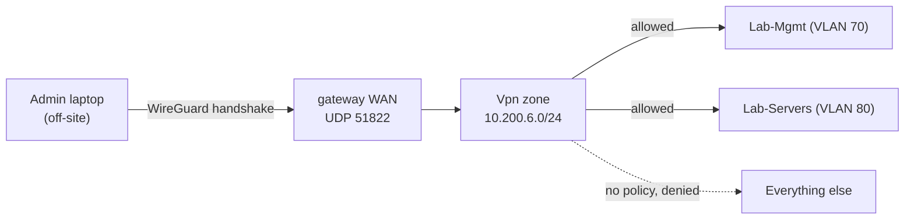

# WireGuard remote access

I needed to administer the lab when I am not on the LAN without exposing a single management port to the internet. The answer is WireGuard terminated on the gateway: I bring up a tunnel, land in a dedicated VPN subnet, and the firewall decides what that subnet can reach. No SSH, no hypervisor UI, and no UniFi controller is reachable from the WAN. The only inbound thing the internet sees is a UDP port that speaks WireGuard and answers nothing without a valid key.

## Why a VPN and not a forwarded port

The tempting shortcut is to forward port 8006 (the Proxmox UI) or 22 (SSH) and call it remote access. That puts an authentication surface on the public internet, where it is scanned within minutes of going live. WireGuard inverts that: the listener does not respond at all to a packet that is not cryptographically valid, so to a scanner the port looks closed. Administration then happens from inside the network's own address space, subject to the same zone policy as a device sitting on the LAN.

## The servers

Four WireGuard servers run on the gateway, each terminating into its own subnet and listening on its own UDP port:

| Server | Tunnel subnet | UDP port | State | Purpose |
|---|---|---|---|---|
| Management Access | 10.200.6.0/24 | 51822 | enabled | administering the lab |
| Game-Access | 10.200.66.0/24 | 51823 | enabled | reaching specific server VMs |
| One-Click VPN | 10.200.12.0/24 | 51820 | enabled | quick full-tunnel access |
| FamilyVPN | 10.200.3.0/24 | 51821 | disabled | kept for occasional use |

Keeping them on separate subnets is what makes the access path controllable: a client on the Management Access tunnel lands in `10.200.6.0/24`, which the firewall treats as the `Vpn` zone, and policy decides the rest. A client on a different tunnel lands somewhere else and gets a different set of allows.

A sanitized server config is in [configs/wireguard-server.example.conf](../../configs/wireguard-server.example.conf). The interesting part is not the crypto, it is the routing: the interface owns the tunnel subnet, and the peer is pinned to a single `/32` so one device cannot impersonate the whole range.

## The access path

Two firewall policies do the work (covered in [project 02](../02-zone-based-firewall/README.md)): *Allow VPN to Lab-Mgmt* and *Allow VPN to Lab-Servers*. There is deliberately no *Allow VPN to Internal* or *Allow VPN to anything else*. A connected admin client can reach the management and server tiers and nothing more, so even the VPN is least-privilege rather than a flat trusted tunnel into the whole network.

## Defense in depth behind the tunnel

The VPN is the first gate, not the only one. Behind it, the Proxmox host firewall ([project 05](../05-hypervisor-host-firewall/README.md)) independently allows the management VPN subnet (`10.200.6.0/24`) to reach the hypervisor management and server ranges, and drops SSH and the GUI from everywhere else. So a host on the management tunnel is allowed by network policy *and* by host policy; a host anywhere else is denied twice. The first management VPN client (10.200.6.2) is also excluded from IPS inspection ([project 03](../03-threat-management/README.md)) so that my own administrative sweeps do not trip reconnaissance signatures.

A second VPN egress exists for routing some outbound traffic through a commercial provider; it is configured as a client tunnel on the gateway and left disabled unless I have a reason to use it. The endpoint detail is omitted here.

## What the internet sees

From outside, the network presents a handful of UDP ports that perform a WireGuard handshake or stay silent, and the published service ports for the DMZ. There is no administrative login page, no SSH banner, and no controller UI anywhere on the WAN. Remote administration works by joining the network, not by punching a hole in it.
