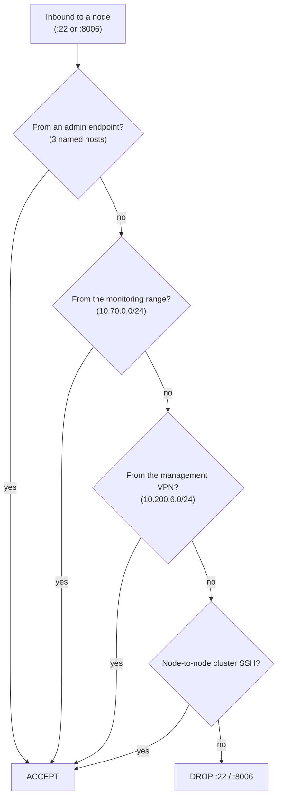

# Hypervisor host firewall

The network firewall on the gateway controls traffic between VLANs. But the Proxmox cluster carries some of the most sensitive surfaces on the network (SSH on every node and the web UI on port 8006), and I did not want their safety to depend on the gateway alone. So each node runs its own host firewall with a default-deny posture on those two ports. If a device that should never reach the hypervisors ends up on a VLAN that can route to them, the host still refuses it. This is the second layer behind the network firewall, written so that the two have to agree before anything reaches the management plane.

## The model

Proxmox firewalling works in layers (datacenter, node, guest) and supports reusable security groups. I defined one security group, `zero_access`, that locks down SSH and the GUI to a named set of sources and drops both for everyone else, then applied it where it counts. The rule order matters: every accept is specific, and the two drops sit at the bottom as the catch-all.

## The rules

The full sanitized group is in [configs/proxmox-zero-access.fw](../../configs/proxmox-zero-access.fw). In words:

**Administrative access** is allowed from three specific endpoints to both SSH (22) and the GUI (8006):

- an automation host (10.40.0.36) that runs Ansible against the cluster;
- my admin laptop (10.10.0.27);
- a hardened workstation on the Secure VLAN (10.50.0.241).

**Monitoring** is allowed from the management VLAN (10.70.0.0/24): the Prometheus node exporter on 9100 from the whole range, and the GUI on 8006 from the management tier.

**Remote administration** is allowed from the management VPN subnet (10.200.6.0/24) into both the management range (10.70.0.0/24) and the server range (10.80.0.0/24). This is the same subnet the network firewall lets into those zones, so the two policies line up.

**Cluster traffic** is allowed node-to-node: each of the three nodes (10.70.0.10, .11, .12) may SSH to the others, which the cluster needs for migration and replication.

**Everything else** hits the two final rules: `DROP tcp dport 22` and `DROP tcp dport 8006`. Anything that did not match an accept above is denied.

## Why both firewalls

It would be easy to argue this is redundant, since the gateway already blocks most of this. Redundant is the point. The two firewalls fail in different ways: a misconfigured zone policy on the gateway, a VLAN that accidentally routes somewhere it should not, a port profile applied to the wrong switch port. Any one of those could expose the hypervisor management surface to a segment it should never see. The host firewall is what stands behind that mistake. For the management plane specifically, I want two independent yes votes before a connection succeeds, and a single no anywhere to stop it.

This is the same instinct as the network design as a whole: no single control is trusted to be complete, and the most sensitive surface gets the most layers.
