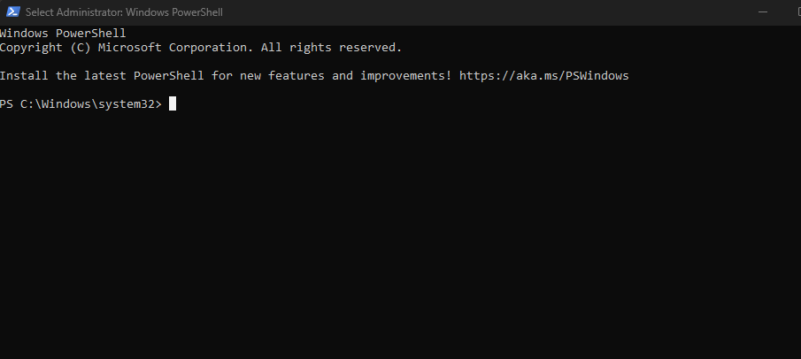
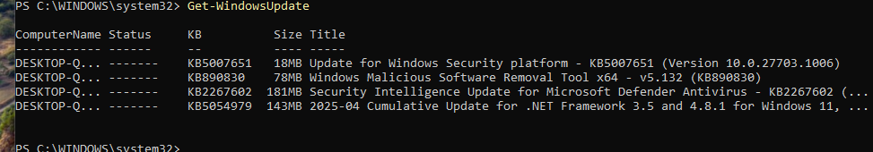
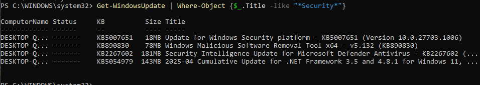
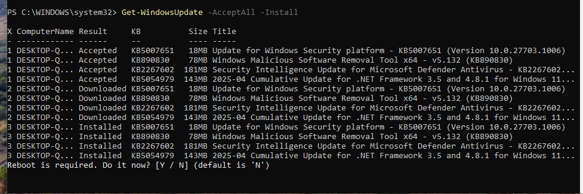
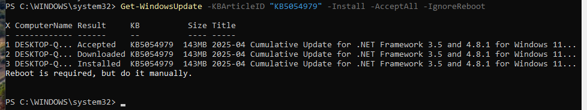
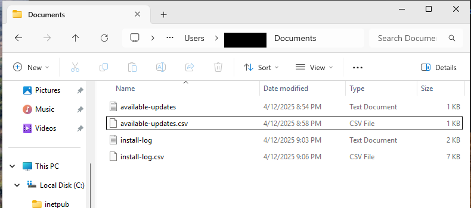
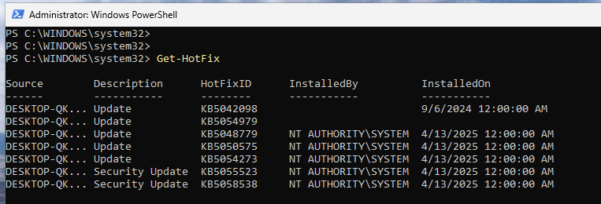
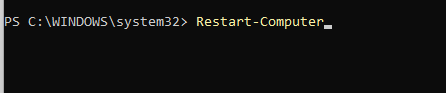

# Windows patch management with PowerShell

Patching is the least glamorous and most important job in keeping a Windows machine secure: most real-world compromises exploit a vulnerability that already had a fix available. Windows Update handles this through the GUI, but that does not scale and it does not leave a record. This project does the whole patch cycle from PowerShell instead, so it can be scripted, scheduled, and logged: check what is missing, apply it on my schedule, keep the reboot under my control, and write down exactly what changed. The full command list is in [commands.md](commands.md).

The work ran on a Windows 11 machine. File paths in the commands use `$HOME` in place of my real profile path.

## Setting up the update module

Windows PowerShell has no built-in cmdlets for driving Windows Update, so the first job is adding them. `PSWindowsUpdate` is a community module on the PowerShell Gallery that wraps the update engine. Installing it pulls in the NuGet provider, and loading it needs the session's execution policy loosened enough to run a signed module:

```powershell
Install-Module PSWindowsUpdate -Force
Set-ExecutionPolicy RemoteSigned -Scope Process
Import-Module PSWindowsUpdate
```

I scoped the execution-policy change to `Process`, so it applies only to this PowerShell session and reverts when I close it, rather than weakening the policy for the whole machine. All of this has to run in an elevated session; without "Run as administrator" the update cmdlets fail outright.



*An elevated Windows PowerShell session. The title bar reads "Administrator," which is the prerequisite for every command that follows.*

## Seeing what is missing before changing anything

Before installing, I look at what is actually pending. `Get-WindowsUpdate` queries the update engine and lists each available update with its KB number, size, and title.



*Pending updates: a Defender platform update, the Malicious Software Removal Tool, a Defender intelligence update, and a .NET cumulative update, each with its KB and size.*

Not every update is equally urgent. Piping the list through `Where-Object` narrows it to the security-relevant ones, which is what I patch first when I cannot take everything at once:

```powershell
Get-WindowsUpdate | Where-Object {$_.Title -like "*Security*"}
```



*The same query filtered to titles containing "Security," so the security-critical patches are separated from the routine ones.*

## Applying updates and keeping the reboot under control

`Get-WindowsUpdate -AcceptAll -Install` downloads and installs everything pending and accepts the license prompts. The output walks each update through Accepted, then Downloaded, then Installed, and ends by telling me a reboot is required.



*Each update moving through Accepted, Downloaded, and Installed, finishing on the reboot prompt.*

The reboot is the part I most want to control. An update that restarts a machine on its own can interrupt whatever it was doing; on a server that is an outage. Two flags handle this. `-IgnoreReboot` installs the patch but suppresses the automatic restart, and the same command can target a single update by its KB number when I only want one specific fix:

```powershell
Install-WindowsUpdate -AcceptAll -IgnoreReboot
Get-WindowsUpdate -KBArticleID "KB5054979" -Install -AcceptAll -IgnoreReboot
```



*Installing one update by KB number with `-IgnoreReboot`. The output confirms "Reboot is required, but do it manually," which is the behavior I wanted.*

## Writing down what changed

A patch run nobody recorded is a patch run you cannot audit. I saved the output in two forms: plain text for reading, and CSV for anything that needs to parse it later. `Out-File` and `Export-Csv` capture the available-update list, and `Tee-Object` writes the install output to a file while still showing it on screen.

```powershell
Get-WindowsUpdate | Out-File "$HOME\Documents\available-updates.txt"
Get-WindowsUpdate | Export-Csv "$HOME\Documents\available-updates.csv" -NoTypeInformation
Get-WindowsUpdate -AcceptAll -Install | Tee-Object -FilePath "$HOME\Documents\install-log.txt"
```



*The four artifacts the run produced: the available-update list and the install log, each in both text and CSV. The profile name in the path is boxed out.*

## Verifying the result

Installing is not the same as confirming. `Get-HotFix` reads back the updates the system actually recorded as installed, with their KB numbers and install dates, which is the independent check that the patches landed:

```powershell
Get-HotFix
```



*Installed updates confirmed by `Get-HotFix`, including the security updates, with their KB IDs and install dates.*

Only after that check did I take the reboot, deliberately and by hand, so the restart happened when I chose:

```powershell
Restart-Computer
```



*Triggering the restart manually with `Restart-Computer`, after the patches were verified.*

## Why do it this way

The GUI can install the same updates. What this approach adds is everything around the install: a filter to prioritize security patches, control over when the reboot happens, a text and CSV record of what was applied, and a verification step that does not just trust the installer's word. Those are the parts that turn patching from a click into a process you can schedule across many machines and prove you ran.

## Files in this project

- [commands.md](commands.md) - every command from this project, grouped by stage.
- [sources.md](sources.md) - the references I used.

## Evidence

Screenshots from my own Windows 11 machine. The host name appears only as the truncated "DESKTOP-Q..." that the update cmdlets print, and my profile name is boxed out of the one File Explorer shot; the commands and their output are real.
