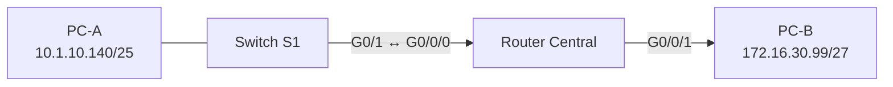

# Switch and router build

Before the UniFi network, I learned the moving parts by building them from scratch on Cisco gear: a switch, a router, two end hosts, addressed by hand, secured before they were reachable, and verified end to end. This project is that build, plus the SSH hardening, MAC-table verification, and troubleshooting pass that go with it. It is the layer everything else in this repository assumes you understand, so I wrote it as the full procedure rather than a summary.

## The topology



PC-A sits on a switched segment; the router connects that segment to PC-B's segment and routes between the two subnets. The original lab used a common private-address teaching range for PC-A. I rewrote that segment as `10.1.10.128/25` here so the public repo does not reuse the home-range pattern reserved for approved screenshots.

## Addressing plan

The two hosts are given; the router interfaces are derived from the subnets they belong to. The rule for this build was that the router's interface toward PC-A takes the **last** usable host of PC-A's subnet, and the interface toward PC-B takes the **first** usable host of PC-B's subnet.

| Device | Interface | Address | Mask | Derivation |
|---|---|---|---|---|
| PC-A | NIC | 10.1.10.140 | /25 (255.255.255.128) | given; lives in 10.1.10.128/25 |
| Central | G0/0/0 | 10.1.10.254 | /25 | last host of 10.1.10.128/25 (broadcast .255) |
| Central | G0/0/1 | 172.16.30.97 | /27 (255.255.255.224) | first host of 172.16.30.96/27 |
| PC-B | NIC | 172.16.30.99 | /27 | given; lives in 172.16.30.96/27 |

PC-A's default gateway is `10.1.10.254`; PC-B's is `172.16.30.97`. Working the masks out by hand is the subject of [project 07](../07-ipv4-addressing-design/README.md).

## Securing the devices first

The habit I built here is to harden a device before it ever carries traffic, not after. On both the switch and the router:

```
! Identify the device and stop it chasing typos as hostnames
hostname S1
no ip domain-lookup
ip domain-name lab.example

! Privileged-mode and line passwords, stored hashed not plaintext
enable secret <secret>
service password-encryption

! Console access requires a password
line con 0
 password <secret>
 login
 logging synchronous
 exec-timeout 5 0

! Remote access: local accounts, SSH only, no Telnet
username netadmin privilege 15 secret <secret>
crypto key generate rsa modulus 2048
ip ssh version 2
line vty 0 4
 login local
 transport input ssh
 exec-timeout 5 0

! Warn before login
banner motd #Unauthorized access is prohibited.#
```

Two choices there matter. `transport input ssh` means the VTY lines accept SSH and refuse Telnet, so management credentials never cross the wire in clear text. `service password-encryption` plus `enable secret` means the running config does not carry a readable password even if someone gets a copy of it. The same baseline, written for a multi-VLAN access switch, is in [configs/switch-baseline.cfg](../../configs/switch-baseline.cfg).

The lab's throwaway Cisco passwords are safe to show, but this repository still keeps them as placeholders because the useful part is the control: hashed privileged mode, encrypted line passwords, local users for VTY access, SSH version 2, and no Telnet. The project-specific sanitized snippets are in [device-configs.md](device-configs.md).

## Bringing up the router

```
interface GigabitEthernet0/0/0
 description link-to-S1-segment
 ip address 10.1.10.254 255.255.255.128
 no shutdown
interface GigabitEthernet0/0/1
 description link-to-PC-B
 ip address 172.16.30.97 255.255.255.224
 no shutdown
```

Both interfaces are directly connected, so once they are up the router has routes to both subnets and forwards between them with no static or dynamic routing needed.

## Shutting unused ports

Every switch port that is not in use is administratively shut, so an unused jack is not a live entry point:

```
interface range GigabitEthernet0/2 - 24
 shutdown
```

The port PC-A uses is left up as an access port; everything else is dark until I have a reason to turn it on.

## Verifying it end to end

The build is not done until traffic proves it. I verified in this order:

1. `show ip interface brief` on Central, confirming both gigabit interfaces read `up/up`.
2. `ping 10.1.10.254` from PC-A and `ping 172.16.30.97` from PC-B, confirming each host reaches its own gateway.
3. `ping 172.16.30.99` from PC-A, the real test: a successful reply means addressing, masks, gateways, and routing are all correct at once, because the packet crossed from one subnet through the router into the other and a reply came back.
4. `show mac address-table` on S1 after traffic, confirming the switch learned dynamic MAC entries on the access and uplink ports instead of flooding everything forever.

When the final ping succeeds and S1 has learned the expected forwarding entries, the whole chain is proven: host addressing, gateways, router interfaces, switch forwarding, and return traffic.

## Evidence handling

The completed Packet Tracer files stay out of the repository because they are proprietary lab binaries. The public evidence for this project should be screenshots and CLI snippets only:

- the physical topology with PC-A, S1, Central, and PC-B;
- Central showing both routed interfaces as `up/up`;
- S1 showing SSH-only VTY access and encrypted local credentials;
- PC-A successfully pinging PC-B;
- S1 showing learned dynamic MAC-table entries after the ping.

Those screenshots still need the redaction pass before they are added: no personal name, no source title or number, no account banners, and no raw file names from the source folder.

## Troubleshooting when it does not

The companion exercise was a network handed to me broken, to fix by reasoning rather than guessing. The method I use, bottom up:

- **Layer 1/2:** is the interface `up/up`? A `down/down` is cabling or a shut port; `up/down` is usually a duplex or encapsulation mismatch.
- **Layer 3, local:** can the host reach its own gateway? If not, the host's address, mask, or gateway is wrong, or the router interface is down.
- **Layer 3, remote:** can the host reach the far subnet? If the local gateway pings but the far host does not, the problem is a wrong mask (the host thinks the destination is local and never sends to the router), a missing route, or the far side's gateway.

The most common fault in these exercises is a subnet mask that is off by a few bits, which is invisible until a host silently decides a remote destination is on its own segment and ARPs for it instead of routing. That is why [project 07](../07-ipv4-addressing-design/README.md) on getting the masks right comes next.
