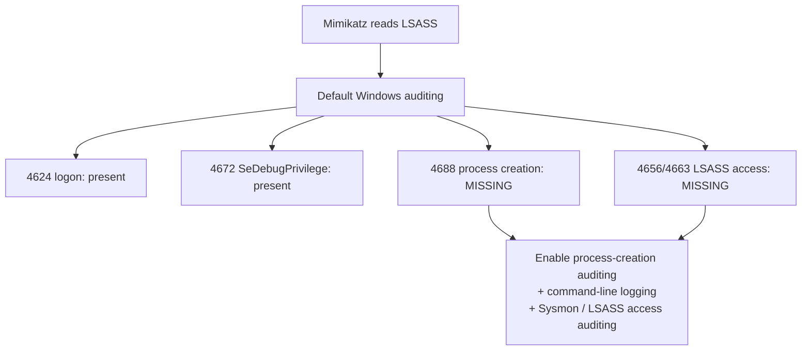
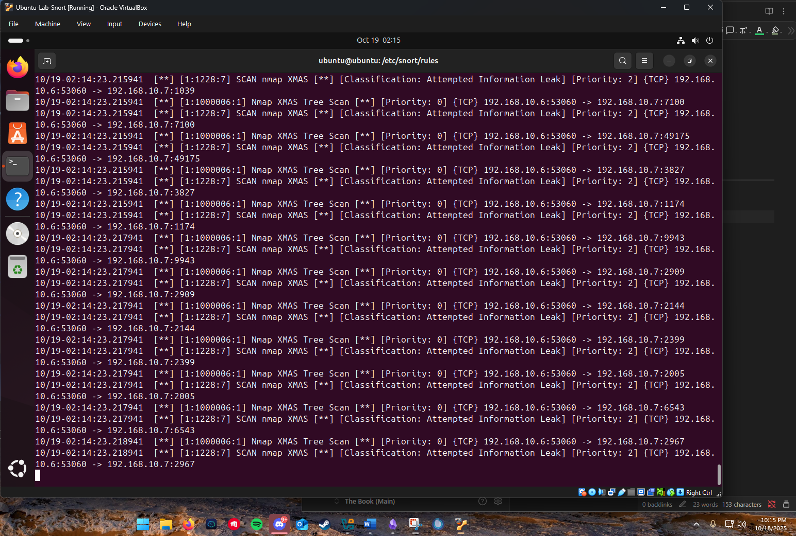
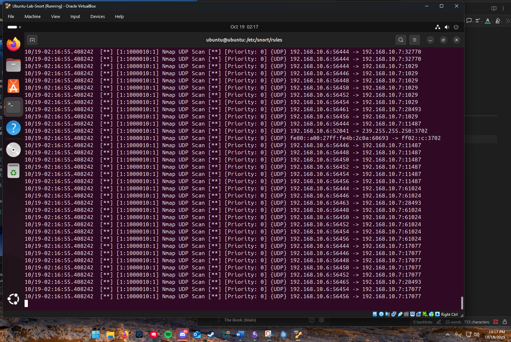
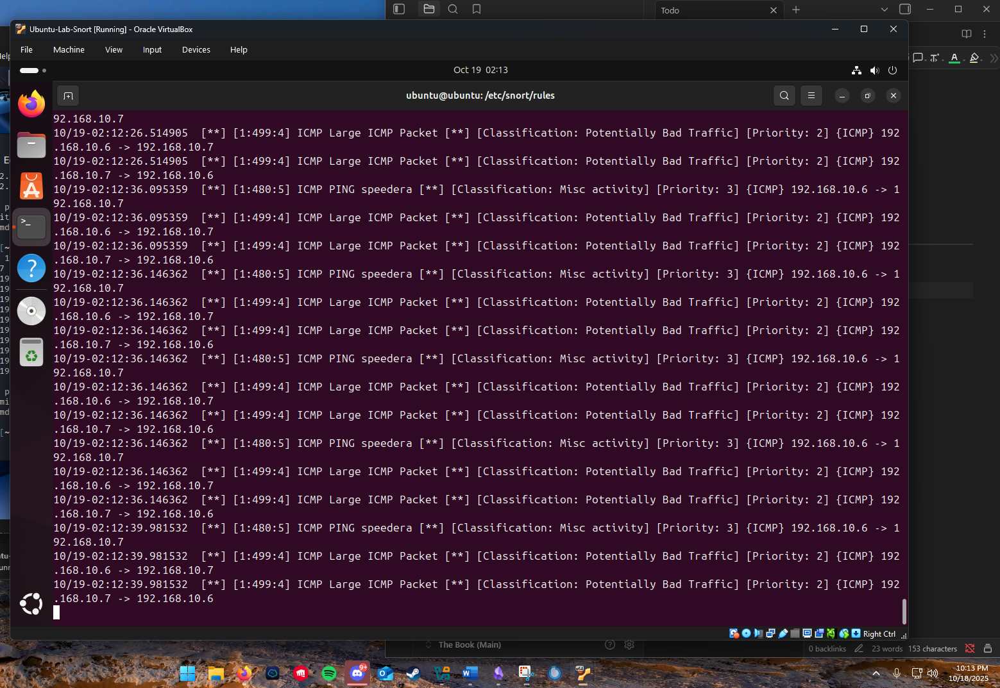

# Detection engineering

A detection is a claim that a specific behavior is worth an analyst's attention, written precisely enough that a machine can decide. This project is two halves of that craft: writing and testing Snort rules that fire on attacks I generated, and a Windows-log investigation that taught the harder lesson, which is that the most important detection gap is often a log that was never being written in the first place.

## Anatomy of a Snort rule

Every Snort rule is a header and a set of options:

```
action proto src_ip src_port -> dst_ip dst_port (option; option; ...)
```

The header says what traffic to match (protocol, source, destination, direction). The options say what to do and how to recognize the thing: `msg` is the alert text, `sid` is the rule's unique ID, `rev` its revision, `classtype` its category, and content matchers like `flags`, `dsize`, or `content` describe the packet. Reading a rule is reading those two parts together.

## Building the Snort lab

I used an Ubuntu VM as the Snort sensor and a Kali VM as the traffic source. The setup kept each step auditable: install Snort, keep a copy of the default config, put the lab rules in a local rule file, validate the syntax, then run the sensor in console-alert mode.

```bash
sudo apt update
sudo apt upgrade
sudo apt -y install snort
snort -V

cd /etc/snort
sudo cp snort.conf test_snort.config
cd rules
sudo cp local.rules custom.rules
sudo nano local.rules     # add: include $RULE_PATH/custom.rules
sudo nano custom.rules    # add the lab detections
```

The package install prompted for a network interface. I kept the lab interface and validated the copied config before sending any test traffic.

## Rules I wrote

The two locally authored scan signatures are the Xmas-tree and UDP scan alerts. I also tested an oversized-ICMP rule to prove that a payload-size condition fired on the ping traffic. Addresses are placeholders.

**Catch an Xmas-tree scan** by its illegal flag combination:

```
alert tcp any any -> any any (msg:"Nmap XMAS Tree Scan"; flags:FPU; sid:1000006; rev:1;)
```

`flags:FPU` matches a packet with FIN, PSH, and URG set together, which is never legitimate, only a scanner sends it (I generated exactly this in my [offensive scanning work](../../offensive/01-network-recon-and-port-scanning/README.md)).

**Catch a UDP scan:**

```
alert udp any any -> any any (msg:"Nmap UDP Scan"; sid:1000010; rev:1;)
```

**Flag oversized ICMP**, the shape of a ping flood or tunneling:

```
alert icmp $EXTERNAL_NET any -> $HOME_NET any (msg:"MISC Large ICMP Packet"; dsize:>800; reference:arachnids,246; classtype:bad-unknown; sid:499; rev:1;)
```

`dsize:>800` matches any ICMP payload over 800 bytes; a normal ping is a few dozen. `$EXTERNAL_NET` and `$HOME_NET` are variables, so the rule reads as "from outside to inside" without hardcoding addresses.

**Log DNS for analysis** rather than alert, when watching for query-based abuse:

```
log udp $EXTERNAL_NET any -> $HOME_NET 53 (msg:"DNS query DoS"; classtype:attempted-dos; sid:1000004; rev:1;)
```

**Watch one host's inbound connections**, scoped to a single server:

```
alert tcp any any -> 10.10.0.10 any (msg:"Inbound to monitored host";)
```

## Testing that they fire

A rule you have not seen fire is a guess. I validated the rules against generated traffic:

1. Test the configuration before running it live: `snort -T -i enp0s3 -c /etc/snort/test_snort.config`, which parses the rules and exits, so a syntax error is caught before deployment, not during an incident.
2. Run in alert mode: `snort -A console -q -i enp0s3 -c /etc/snort/test_snort.config`.
3. Generate the attacks from Kali: `nmap -sX <target>` for the Xmas scan, `nmap -sU <target>` for the UDP scan, and `ping -s 1400 <target>` for the oversized ICMP test.

The console lit up with the matching alerts, each tagged with its SID and message:

```
[**] [1:1000006:1] Nmap XMAS Tree Scan [**]
[**] [1:1000010:1] Nmap UDP Scan [**]
[**] [1:499:4] ICMP Large ICMP Packet [**]
```

Seeing my own `sid:1000006` fire the instant the Xmas scan ran is the proof that closes the loop: the behavior I generated on the offensive side is the behavior this rule catches on the defensive side.

## The harder lesson: a detection gap is invisible until you look

The second half of this project was a Windows-log investigation, and it taught me that the absence of a detection can be the finding. On a Windows test VM (from the DetectionLab project), I ran the Mimikatz credential-dumping tool against LSASS (`privilege::debug` then `sekurlsa::logonpasswords`), exported the Security event log (`wevtutil epl Security ...`), and went looking for evidence of what I had just done.

What the default log contained:

- **Event ID 4624** (an account logged on).
- **Event ID 4672** (special privileges, including `SeDebugPrivilege`, were assigned to a logon).

What it did **not** contain:

- **No Event ID 4688** (process creation) for `mimikatz.exe`. I ran a credential-stealing tool and the log had no record that the process ever started.
- **No Event ID 4656 / 4663** (handle to / access of an object) for the access to LSASS, the exact action credential dumping performs.



The takeaway is the entire point of detection engineering: a SIEM only catches what is being logged, and Windows does not log process creation or LSASS access by default. You would see that a privilege was granted, but not what used it. Closing that gap is the engineering work, enable process-creation auditing (4688) with command-line capture, turn on object-access auditing for LSASS, or deploy Sysmon for richer process and handle telemetry, so that the next time the tool runs, there is a log to alert on. The rule and the log are two sides of the same job: the rule is useless without the data, and the data is useless without the rule.

## Files in this project

- [`rules/local.rules`](rules/local.rules) - the Snort rules I authored, the deliverable.
- [`sources.md`](sources.md) - references for the rule syntax, the scan techniques, and the Windows-auditing gap.
- `evidence/` - console captures of my rules firing (below).

## Evidence

The rules firing on the sensor console as I generated each attack from a Kali box on the lab network (`192.168.10.6` -> `192.168.10.7`). These are training-lab VM addresses; the captures do not show a WAN address, MAC address, SSID, or home device identifier.



*`sid:1000006` (Nmap XMAS Tree Scan) firing on `nmap -sX`.*



*`sid:1000010` (Nmap UDP Scan) firing on `nmap -sU`.*



*`sid:499` (large ICMP packet) firing on `ping -s 1400`.*
